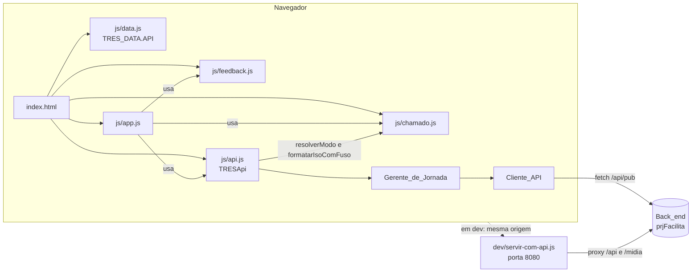
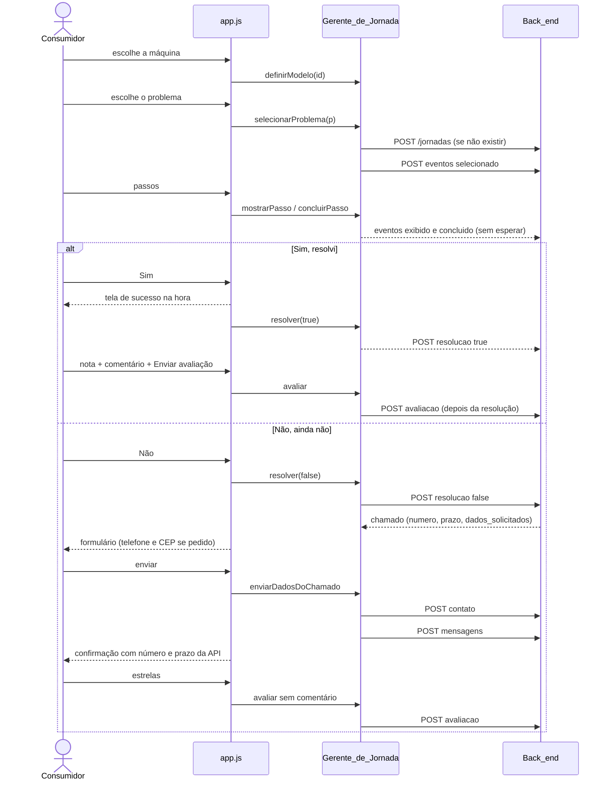
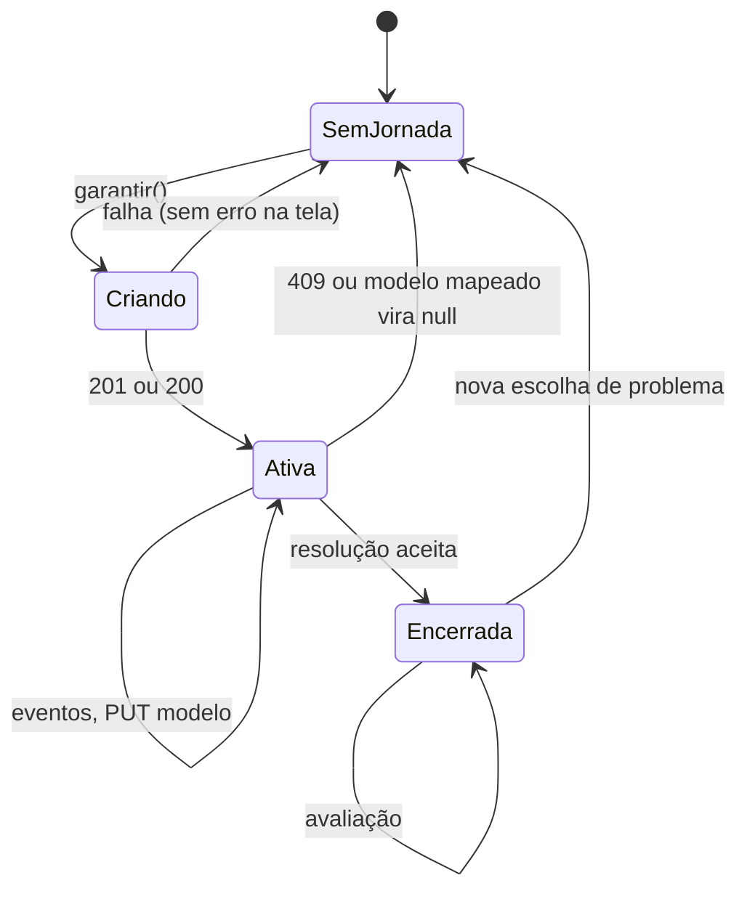
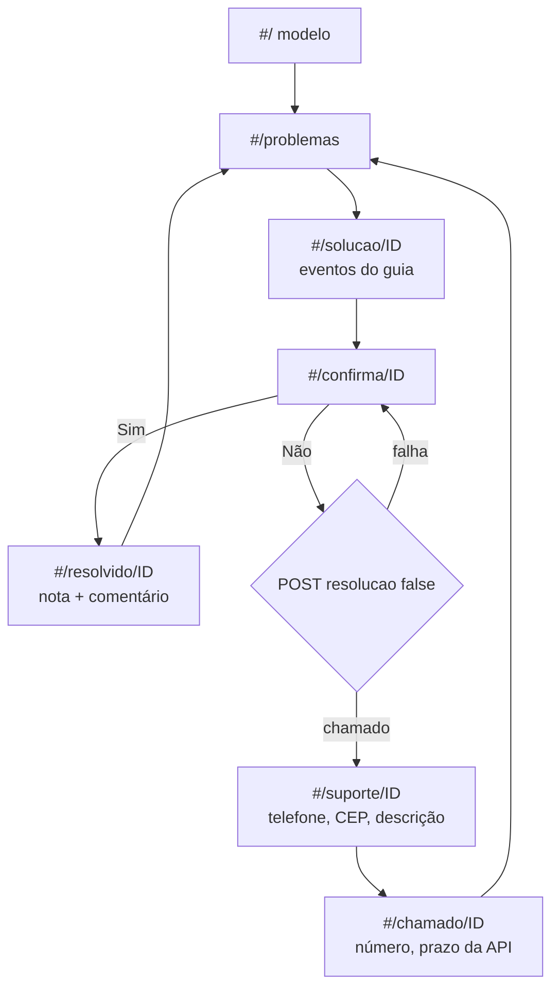
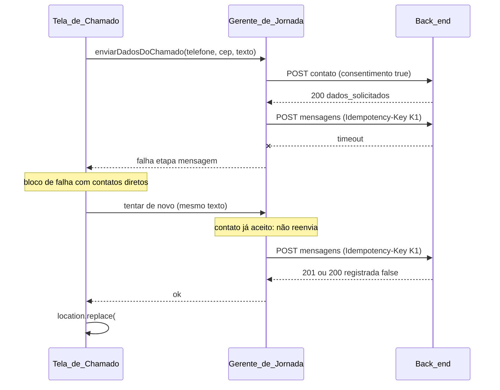

# Design Document: Integração com a API da jornada (api-integration)

## Overview

O front do Autoatendimento TRES é HTML, CSS e JS puros e guarda tudo no navegador. O back end do repositório `ViniMac3do/prjFacilita-` (referência somente leitura) expõe uma API pública, `/api/pub`, que modela a **jornada** (criar, associar modelo, eventos do guia, resolução, escalada em chamado, avaliação) e o **chamado** (contato e mensagens). Este design liga o front a essa API **sem mexer no back end**, na abordagem escolhida pelo usuário: **adaptar o front à API**.

Decisões centrais:

1. **Um interruptor.** `TRES_DATA.API.BASE_URL` vazia = **Modo_Prototipo** (hoje, inteiro, sem requisição nova). Preenchida com URL válida = **Modo_API**. Com `BASE_URL` válida, `API_CHAMADOS_URL` e `API_FEEDBACK_URL` ficam inutilizadas.
2. **Conteúdo local, jornada na API.** Os 13 problemas, passos, modelos e fotos continuam em `js/data.js`. A API só recebe o que o consumidor fez (jornada, eventos, resolução, contato, mensagem, avaliação).
3. **Módulo novo `js/api.js`** (`window.TRESApi`), sem DOM, com tudo do mundo externo por injeção. Duas camadas: o **Cliente_API** (HTTP, erros, ULID, corpos e rotas) e o **Gerente_de_Jornada** (estado em memória e regras: criação preguiçosa, modelo, eventos, resolução, avaliação, envio do chamado).
4. **Falha da API nunca bloqueia o guia.** Jornada e eventos são "dispare e esqueça". Só duas falhas aparecem para o consumidor, e sempre com os contatos diretos: criar o chamado ("Não, ainda não") e enviar o contato/mensagem do chamado, mais a avaliação.
5. **O chamado nasce em "Não, ainda não".** A resposta da API traz número, prioridade, prazo, próximo passo e **quais dados pedir** (`dados_solicitados`). O formulário (`#/suporte/ID`) só aparece depois dela, sem nome e e-mail, com telefone e, se pedido, CEP. A confirmação (`#/chamado/ID`) mostra o que a API disse, não mais o prazo ilustrativo.
6. **Estrela e comentário em um único envio** (Tela_de_Resolvido), nota obrigatória; na Tela_de_Confirmacao a estrela envia sozinha e trava.
7. **Desenvolvimento sem CORS** com `dev/servir-com-api.js`: serve o site e repassa `/api` e `/midia` para a API local deles na porta 8001. Em produção, site e API ficam no mesmo domínio.

O que **não** muda: rotas, textos e telas em Modo_Prototipo; `js/chamado.js` e `js/feedback.js` (nenhuma alteração de comportamento); regras de CSS existentes; `material/`, `img/*.png` originais e o `.glb` original.

## Architecture

### Visão geral



Ordem de carga em `index.html`: `js/data.js`, `js/chamado.js`, `js/feedback.js`, **`js/api.js`**, `js/app.js`. Todos continuam scripts clássicos (sem `type="module"`).

### Separação de responsabilidades

| Camada | Arquivo | Conhece o DOM? | Faz E/S? | Como é testada |
|---|---|---|---|---|
| Configuração e textos | `js/data.js` (`TRES_DATA.API`) | não | não | `tests/dados.test.js` |
| Cliente_API e Gerente_de_Jornada | `js/api.js` | **não** | só o que recebe por injeção (`fetch`, temporizadores, relógio, sorteio) | Node com fast-check e `fetch` falso |
| Regras reaproveitadas | `js/chamado.js`, `js/feedback.js` | não | idem | testes atuais (inalterados) |
| Telas, foco, anúncios, métricas locais | `js/app.js` | sim | `localStorage` (métricas) | Edge por CDP com a API_Falsa |
| API de teste | `tests/ui/servidor-teste.js` | n/a | HTTP local | usada pelos cenários |
| Proxy de desenvolvimento | `dev/servir-com-api.js` | n/a | HTTP local | testes de exemplo em Node com upstream falso |

### Como `js/api.js` reaproveita o `chamado.js` sem `require`

Mesmo padrão do `js/feedback.js`: módulo UMD com **fábrica `criar(base)`**, em que `base` é o `TRESChamado`. No navegador: `window.TRESApi = window.TRESChamado ? criar(window.TRESChamado) : null`. Em Node: `module.exports = { criar }`. Usa de `base`: `resolverModo` (regra de validade da URL) e `formatarIsoComFuso` (campo `ocorrido_em`). Nenhuma alteração em `chamado.js` é necessária (as duas funções já são exportadas). Se `window.TRESApi` for `null`, o `app.js` opera em Modo_Prototipo.

### Fluxo de ponta a ponta (Modo_API)



### Estados do Gerente_de_Jornada



## Fluxo e rotas

### Rotas

Nenhuma rota nova no núcleo e nenhuma rota removida. Mudanças pontuais de comportamento, **só em Modo_API**:

| Rota | Mudança |
|---|---|
| `#/solucao/ID` | `renderSolucao` chama `mostrarPasso`; "Próximo passo" e "Terminei os passos" chamam `concluirPasso`. |
| `#/confirma/ID` | "Sim" navega na hora e chama `resolver(true)`. "Não" fica na tela, desabilita e chama `resolver(false)`; sucesso navega para `#/suporte/ID`; falha mostra o bloco de falha (com contatos) e "Tentar de novo". |
| `#/suporte/ID` | Nova guarda: sem Chamado_API em memória, `location.replace('#/confirma/ID')`. Formulário sem nome e e-mail; CEP e telefone conforme `dados_solicitados`. |
| `#/chamado/ID` | Mostra `numero`, `prioridade_rotulo`, `prazo`, `proximo_passo` da API. Estrelas enviam e travam. |
| `#/resolvido/ID` | Estrelas só selecionam; "Enviar avaliação" envia nota e comentário. |
| `#/acompanhar/NUMERO` | **Opcional** (requisito 20); só existe com `API.ACOMPANHAMENTO_HABILITADO === true`. |

As guardas existentes (`suporte` com chamado aberto vai a `chamado`; `chamado` sem chamado aberto vai a `suporte`) continuam. Em Modo_API a combinação é: `chamado` sem `sessao.aberto` volta a `suporte`, que sem Chamado_API volta a `confirma`.

### Mapa de navegação em Modo_API



### Sequência do envio do chamado (falha parcial)



## Mudanças por arquivo

### `js/data.js`

Novo objeto `API`, exportado em `window.TRES_DATA` (as chaves atuais ficam como estão, inclusive `CHAMADO` e `FEEDBACK`):

```js
const API = {
  // Vazia = Modo_Prototipo (nenhuma requisição ao back end).
  // Preenchida com a URL do prefixo público (ex.: https://dominio/api/pub) = Modo_API.
  // PRECEDÊNCIA: com BASE_URL válida, CHAMADO.config.API_CHAMADOS_URL e FEEDBACK.config.API_FEEDBACK_URL
  // ficam inutilizadas (devem continuar vazias). PENDENTE: URL por ambiente.
  BASE_URL: '',
  TIMEOUT_MS: 5000,                 // ILUSTRATIVO / PENDENTE (back end)
  MODELOS_API: {                    // id do modelo no front -> modelo_id na API (ou null = jornada sem modelo)
    passione: 'tres-passione',
    lov: null,                      // PENDENTE (sem equivalente na API)
    modo: null,                     // PENDENTE
    luna: null,                     // PENDENTE
    touch: null                     // PENDENTE
  },
  ACOMPANHAMENTO_HABILITADO: false, // opcional (requisito 20)
  textos: { /* ver Data Models */ }
};
```

### `js/api.js` (novo)

Núcleo sem DOM, descrito em "Components and Interfaces".

### `index.html`

- `<script src="js/api.js"></script>` entre `js/feedback.js` e `js/app.js`.
- **Tela_de_Pergunta_Final** (`#view-confirma`): `<div id="confirma-falha-area"></div>` depois do bloco `.confirma`. O botão "Tentar de novo" é criado pelo `app.js` dentro do bloco de falha.
- **Tela_de_Chamado** (`#view-suporte`): `<p id="chamado-prioridade-resumo" class="envio__prazo" hidden></p>` ao lado de `#chamado-prazo-resumo`; novo `div.campo[data-campo="cep"]` (`hidden`) logo depois do campo telefone, com `label for="c-cep"` (texto por `data-texto-api="rotuloCep"`), `input#c-cep` (`name="cep"`, `type="text"`, `inputmode="numeric"`, `maxlength="9"`, `autocomplete="postal-code"`, `aria-describedby="c-cep-ajuda"`), `p#c-cep-ajuda.campo__ajuda` e `p#c-cep-erro.campo__erro` (`hidden`). Os campos nome e e-mail ganham o atributo `data-so-prototipo` para o `app.js` ocultá-los por `hidden`.
- **Tela_de_Confirmacao** (`#view-chamado`): ids novos `chamado-linha-email` (na `div` do e-mail), `<p id="chamado-prioridade" hidden>` e `<p id="chamado-proximo-passo" hidden>` dentro de `.retorno`, com rótulos por `data-texto-api`.
- **Tela_de_Resolvido** (`#view-resolvido`): `<p class="campo__erro" id="nota-erro" hidden></p>` logo depois de `#status-aval`; `#estrelas` ganha `tabindex="-1"` (para receber o foco do erro). O `#btn-enviar-comentario` já existe; o `app.js` troca o texto em Modo_API.
- Nenhum texto novo é escrito no HTML: tudo por `data-texto-api="chave"`.

### `css/styles.css`

Só regras novas, **depois do marcador das regras novas** já usado pelo teste estático, sem editar regra existente, sem transição nem animação, só tokens semânticos:

- `.campo[hidden], .aceite[hidden], .envio__prazo[hidden], .retorno p[hidden], .retorno [hidden] { display: none; }` (as regras existentes de `[hidden]` não cobrem `.campo` nem `.aceite`).
- `#c-cep` com `font-size: 1rem` e alvo de 44 px (reaproveita as regras de `.campo input`).
- `.estrelas--travada .estrela { cursor: default; }` e texto de estado das estrelas com contraste mínimo de 4,5:1.
- O bloco de falha de `#confirma-falha-area` reaproveita `.msg-falha`; "Tentar de novo" reaproveita `.btn`.

### `js/app.js`

| Ponto | Mudança (todas guardadas por `if (gerente)`, ou seja, só em Modo_API) |
|---|---|
| Início | `const TRESApi = window.TRESApi \|\| null;` `let gerente = null;` criado por `obterGerente()` na primeira necessidade: `TRESApi.criarApi({ config: D.API, fetch, AbortController, setTimeout, clearTimeout, agora, sorteio })` devolve `null` em Modo_Prototipo; senão `TRESApi.criarGerente({ api, config: D.API })`. |
| `iniciarModelos` | Ao escolher modelo: `gerente.definirModelo(m.id)`; "Continuar sem escolher": `gerente.definirModelo(null)`. |
| `cartaoProblema` | Depois do que já faz: `gerente.selecionarProblema(p.id)`. |
| `renderSolucao` | `gerente.mostrarPasso(p.id, state.passoIdx + 1, total)`. |
| `iniciarSolucao` | "Próximo/Terminei": `gerente.concluirPasso(p.id, state.passoIdx + 1)` antes de avançar. `#btn-sim`: navega e chama `gerente.resolver({resolvido: true, problemaId})` sem `await`. `#btn-nao`: `aoNaoEncerrou()` (abaixo). |
| `aoNaoEncerrou` (novo) | Registra `suporte`, desabilita os botões, `aria-busy`, anuncia; `await gerente.resolver({resolvido: false, ...})`; sucesso: `ir('#/suporte/ID')`; falha: `mostrarFalhaPergunta()`. Já existindo Chamado_API do mesmo problema: navega direto. |
| `aoMudarRota` | Guarda de `suporte` sem Chamado_API (`location.replace('#/confirma/ID')`). |
| `renderChamado` | `aplicarModoApiNoFormulario()` (novo): oculta nome/e-mail (`[data-so-prototipo]`), mostra/oculta telefone e CEP e aceite conforme `dados_solicitados`, troca título/introdução/botão por `API.textos`, mostra prioridade e `prazo` da API no lugar da frase ilustrativa. |
| `CAMPOS` | Passa a ser calculada por `camposAtivos()`: em Modo_API sem `nome`/`email`, com `cep` quando pedido; `telefone` só quando pedido. |
| `aoEnviar` | Em Modo_API, chama `aoEnviarApi()` (novo) em vez de `montarChamado`/`pontoDeIntegracao`: valida os campos ativos, vira `enviando` antes do primeiro `await`, chama `gerente.enviarDadosDoChamado(...)`, sucesso: `concluirSucessoApi()`; falha: `mostrarFalha()` já existente (mesmo bloco, mesmos contatos), ou erro de campo se 422. |
| `concluirSucessoApi` (novo) | Preenche `sessao.aberto = { problemaId, protocolo: numero, modo: 'api', telefone, prazo, prioridadeRotulo, proximoPasso, email: null }`, grava métrica `chamado` e faz `location.replace('#/chamado/ID')`. |
| `renderConfirmacao` | Em Modo_API: oculta aviso de protótipo, linha do e-mail e frase de prazo ilustrativo; mostra `prioridade`, `prazo`, `proximo_passo`; `montarEstrelasApi` no lugar de `montarEstrelas`. |
| `view === 'resolvido'` | `renderAvaliacaoApi()` (novo) no lugar de `montarEstrelas` + `renderFeedback()`. |
| `montarEstrelasApi` (novo) | Estrelas da Tela_de_Confirmacao: toque envia (`gerente.avaliar({nota})`), trava no sucesso, mostra falha sem travar. |
| `aoEnviarAvaliacao` (novo) | Envio único da Tela_de_Resolvido (requisito 12). |
| Métricas | `registrar(...)` e `gravarEvento(...)` continuam; os eventos novos seguem `CHAVES_EXTRAS_PROIBIDAS`. |

### `tests/`, `dev/`, documentação

Descritos em "Testing Strategy" e nas tarefas.

## Components and Interfaces

### `js/api.js`: API do núcleo (`window.TRESApi`)

Convenções: funções puras não leem relógio, sorteio, storage nem rede. O mundo externo entra por `deps`: `{ config, fetch, AbortController, setTimeout, clearTimeout, agora: () => Date, sorteio: (n) => inteiro de 0 a n-1 }`. Nenhuma função lança fora de `Promise` rejeitada com Erro_Padronizado.

```js
// Constantes
ALFABETO_ULID      // '0123456789ABCDEFGHJKMNPQRSTVWXYZ'
LIMITES            // { nota: {min:1,max:5}, comentario: {max:500}, mensagem: {min:1,max:2000}, passo: {min:1,max:10},
                   //   telefoneDigitos: [10,11], cepDigitos: 8, timeoutPadraoMs: 5000 }
TIPOS_ERRO         // ['timeout','rede','http','resposta']
ROTAS              // as 8 combinações método+caminho usadas (para o teste de "nenhuma outra rota")

// Configuração e modo
modoDaApi(config)            // 'api' | 'prototipo' (base.resolverModo(config.BASE_URL); config inválida = 'prototipo')
normalizarBaseUrl(url)       // aparada e sem barras finais; '' se não for texto
timeoutDaApi(config)         // TIMEOUT_MS válido, senão 5000
modeloApiDe(config, id)      // texto não vazio de MODELOS_API[id], senão null

// Identificadores
gerarUlid(agora, sorteio)    // 26 caracteres; agora em ms (número ou Date)
ehUlid(s)

// Erros
novoErro(tipo, detalhes)     // Erro_Padronizado { tipo, status, codigo, campos }
classificarErro(erro)        // 'conflito' | 'definitivo' | 'transitorio'

// Validação e corpos (puros)
normalizarCep(s)             // só dígitos
validarCep(s)                // null | 'vazio' | 'formato' | 'tamanho' (caracteres: dígitos, espaço, ( ) -; 8 dígitos)
telefoneParaApi(s)           // base.normalizarTelefone(s): só dígitos, sem o 55 inicial; vale para telefones já validados por base.validarTelefone
textosValidos(dadosApi)      // true só se config e textos existem e todas as CHAVES_TEXTOS_OBRIGATORIAS são texto não vazio (após trim)
CHAVES_TEXTOS_OBRIGATORIAS   // chaves de API.textos exigidas para ligar o Modo_API
prepararAvaliacao({nota, texto})  // {ok:false,codigo:'nota'|'tamanho'} | {ok:true, nota, comentario|undefined}
filtrarDadosSolicitados(lista)    // só 'telefone' e 'cep', sem repetição, na ordem recebida
montarCorpoJornada({modeloApi}), montarCorpoModelo(modeloApi), montarCorpoEvento(e), montarCorpoResolucao(r),
montarCorpoAvaliacao(a), montarCorpoContato(c), montarCorpoMensagem(m)

// Cliente
criarApi(deps)               // null em Modo_Prototipo; senão { criarJornada, associarModelo, registrarEvento,
                             //   registrarResolucao, registrarAvaliacao, obterChamado, enviarContato, enviarMensagem }

// Gerente
criarGerente({ api, config, agora, sorteio })
```

### Rotas, corpos e respostas do Cliente_API

| Função | Método e caminho | Corpo | `Idempotency-Key` | Resolve com |
|---|---|---|---|---|
| `criarJornada({ modeloApi, chave })` | `POST /jornadas` | `{ origem: 'busca', modelo_id? }` | `chave` (se houver) | `{ jornadaId, modeloId, modeloReconhecido }` |
| `associarModelo(id, modeloApi)` | `PUT /jornadas/{id}/modelo` | `{ modelo_id }` | não | `{ jornadaId, modeloId }` |
| `registrarEvento(id, e)` | `POST /jornadas/{id}/eventos` | `{ tipo, problema_id, passo?, ocorrido_em, evento_id }` | `evento_id` | `{ registrado }` |
| `registrarResolucao(id, r)` | `POST /jornadas/{id}/resolucao` | `{ resolvido, problema_id, evento_id }` | `evento_id` | `{ resolvido: true }` ou `{ resolvido: false, chamado, novo }` |
| `registrarAvaliacao(id, a)` | `POST /jornadas/{id}/avaliacao` | `{ nota, comentario?, evento_id }` | `evento_id` | `{ registrada, nota }` |
| `obterChamado(numero)` | `GET /chamados/{numero}` | não | não | `{ numero, status, prioridade, criadoEm, dadosSolicitados, mensagens, agendamento }` (só para o requisito 20) |
| `enviarContato(numero, c)` | `POST /chamados/{numero}/contato` | `{ telefone?, cep?, consentimento: true, evento_id }` | `evento_id` | `{ dadosSolicitados }` |
| `enviarMensagem(numero, m)` | `POST /chamados/{numero}/mensagens` | `{ texto, evento_id }` | `evento_id` | `{ registrada }` |

Regras de cada resposta (`resposta` = formato inesperado): `criarJornada` e `associarModelo` exigem `jornada_id` em texto; `registrarEvento` aceita 200/201 com `registrado` booleano; `registrarResolucao` com `resolvido` `true` exige o campo booleano, e com `false` exige `chamado.numero` em texto não vazio (até 64 caracteres, só letras, dígitos, hífen e sublinhado), `prazo`, `prioridade_rotulo` e `proximo_passo` em texto **ou** ausentes (viram `''`), `dados_solicitados` como lista (filtrada); `registrarAvaliacao` exige `registrada` booleano; `enviarMensagem` exige `registrada` booleano.

`corpo` sem campo `undefined`: o `JSON.stringify` do cliente já omite `undefined`; os montadores nunca colocam `null` nos campos opcionais.

### Gerente_de_Jornada: API

```js
const g = TRESApi.criarGerente({ api, config, agora, sorteio });

g.definirModelo(modeloLocalOuNull)                  // guarda o modelo; sincroniza (PUT ou descarta) se a jornada existe
g.garantir()                                        // Promise<jornadaId|null>; coalescida; nunca rejeita
g.selecionarProblema(problemaId)                    // escolha explícita: aplica "nova jornada se encerrada", envia 'selecionado'
g.mostrarPasso(problemaId, passo, total)            // garante 'selecionado' do problema e envia 'exibido' (uma vez)
g.concluirPasso(problemaId, passo)                  // envia 'concluido' (uma vez)
g.resolver({ resolvido, problemaId })               // Promise<{ ok:true, resultado } | { ok:false, erro }>; nunca rejeita
g.aguardarResolucao()                               // Promise (sempre resolve) da última resolução em andamento
g.avaliar({ nota, comentario })                     // Promise<{ ok:true, registrada } | { ok:false, erro }>
g.chamado(problemaId)                               // Chamado_API em memória daquele problema, ou null
g.enviarDadosDoChamado({ telefone, cep, texto })    // Promise<{ ok:true } | { ok:false, etapa, erro }>
g.estado()                                          // instantâneo SEM dados pessoais (para testes)
g.reiniciar()
```

Estado interno (somente memória):

```js
{
  modeloApi: null,            // modelo mapeado atual (texto) ou null
  jornadaId: null,
  modeloRegistrado: null,     // modelo que a API tem para a jornada
  encerrada: false,
  emCriacao: null,            // Promise compartilhada
  chaveCriacao: null,         // ULID usado em Idempotency-Key de POST /jornadas até criar
  enviados: new Set(),        // 'tipo|problema|passo' já despachados na jornada
  fila: Promise.resolve(),    // eventos em série
  resolucao: null,            // { chave: 'jornada|problema|resolvido', eventoId }
  resolucaoPendente: null,
  chamadoApi: null,           // { problemaId, jornadaId, numero, prazo, prioridadeRotulo, proximoPasso, classificacao, dadosSolicitados }
  envio: null,                // { contato: { valores, eventoId, aceito }, mensagem: { texto, eventoId, aceita } }
  avaliacao: null             // { chave: 'jornada|nota|comentario', eventoId }
}
```

Regras principais (pseudocódigo):

```js
garantir():
  se jornadaId -> resolve(jornadaId)
  se emCriacao -> devolve emCriacao
  chaveCriacao ||= gerarUlid(agora(), sorteio)
  emCriacao = api.criarJornada({ modeloApi, chave: chaveCriacao })
     .then(r => { jornadaId = r.jornadaId; modeloRegistrado = r.modeloReconhecido ? r.modeloId : null;
                  chaveCriacao = null; encerrada = false; enviados.clear(); sincronizarModelo(); return jornadaId })
     .catch(() => null)
     .finally(() => { emCriacao = null })

sincronizarModelo():
  se !jornadaId ou modeloApi === modeloRegistrado -> nada
  se modeloApi (texto)  -> api.associarModelo(jornadaId, modeloApi).then(ok => modeloRegistrado = modeloApi, e => se conflito: descartar())
  senão (modeloApi null, registrado texto) -> descartar()

descartar(): jornadaId = null; modeloRegistrado = null; encerrada = false; enviados.clear()   // chamadoApi e envio NÃO são apagados aqui

selecionarProblema(p):
  se encerrada -> descartar()
  se chamadoApi && chamadoApi.problemaId !== p -> chamadoApi = null; envio = null
  registrarEvento({ tipo: 'selecionado', problemaId: p })

registrarEvento(e):   // fire-and-forget
  valida (tipo, problemaId inteiro >= 1, passo 1..10 em exibido/concluido) senão ignora
  fila = fila.then(() => despachar(e)).catch(() => {})

despachar(e):
  id = await garantir(); se !id -> fim
  chave = tipo|problema|passo; se enviados.has(chave) -> fim; enviados.add(chave)
  eventoId = gerarUlid(...)
  tentar api.registrarEvento(id, { ...e, ocorridoEm: formatarIsoComFuso(agora()), eventoId })
  se classificarErro == 'conflito':
     descartar(); id2 = await garantir(); se !id2 fim
     se e.tipo !== 'selecionado': api.registrarEvento(id2, selecionado do e.problemaId, novo eventoId)  (engolindo erro)
     api.registrarEvento(id2, e com o mesmo eventoId)   (engolindo erro; sem outra tentativa)
     enviados.add(...) das duas chaves
```

`resolver`, `avaliar` e `enviarDadosDoChamado` estão descritos nos requisitos 7, 8, 10, 12 e 13; os detalhes de reaproveitamento do Evento_Id seguem as "Regras de Evento_Id" abaixo.

### Regras de Evento_Id

| Ato | Quando o Evento_Id é reutilizado | Quando é novo |
|---|---|---|
| Criar jornada (`Idempotency-Key`) | enquanto a criação não deu certo | depois de criada |
| Evento do guia | nunca reenviado (exceto o reenvio da recuperação de 409, com o mesmo id) | cada evento |
| Resolução | mesma jornada, mesmo problema, mesma resposta | outra jornada (inclusive depois de 409), outro problema ou outra resposta |
| Contato | mesmos valores de telefone e CEP | valores diferentes |
| Mensagem | mesmo texto normalizado | texto diferente |
| Avaliação | mesma jornada, mesma nota, mesmo comentário | qualquer diferença |

## Data Models

### Configuração e textos em `TRES_DATA.API`

```js
textos: {
  tituloChamadoApi: 'Falta pouco para o atendimento falar com você.',
  introChamadoApi: 'Seu chamado já foi registrado. Diga como podemos falar com você e o que está acontecendo.',
  rotuloPrioridade: 'Prioridade',
  rotuloPrazoApi: 'Prazo de retorno',
  rotuloProximoPasso: 'Próximo passo',
  rotuloCep: 'CEP',
  ajudaCep: 'Use 8 números. Exemplo: 01310-100.',
  erroCep: 'Digite o CEP com 8 números. Exemplo: 01310-100.',
  botaoEnviarContato: 'Enviar meus dados',
  canaisConfirmacaoApi: 'Vamos falar com você pelo WhatsApp, no número {telefone}.',
  anuncioRegistrandoResposta: 'Registrando sua resposta.',
  falhaPergunta: 'Não conseguimos registrar sua resposta agora. Tente de novo em instantes.',
  botaoTentarDeNovo: 'Tentar de novo',
  botaoEnviarAvaliacao: 'Enviar avaliação',
  botaoEnviandoAvaliacao: 'Enviando',
  erroSemNota: 'Escolha de 1 a 5 estrelas para enviar sua avaliação.',
  anuncioErroSemNota: 'Escolha uma nota de 1 a 5 estrelas.',
  agradecimentoAvaliacao: 'Obrigado! Sua avaliação foi recebida.',
  falhaAvaliacao: 'Não conseguimos enviar sua avaliação agora. Tente de novo em instantes.'
}
```

Todos `ILUSTRATIVO` (validação do time de Customer Success), com comentário em `data.js`. Quando um texto faltar ou estiver vazio, o elemento fica vazio e o `app.js` volta ao texto equivalente de `CHAMADO.textos`/`FEEDBACK.textos` quando houver (`falha`, `falhaAlternativa`); caso contrário, o Modo_API **não é ligado** (`TRESApi.textosValidos(D.API)` falso = Modo_Prototipo). Os contatos diretos usam `D.CONTATO` e `CHAMADO.textos.falhaAlternativa`.

### Chamado_API em memória

```js
{ problemaId, jornadaId, numero, prazo, prioridadeRotulo, proximoPasso, classificacao,
  dadosSolicitados: ['telefone', 'cep'] }   // filtrado
```

`sessao.aberto` (já existente) passa a aceitar `{ problemaId, protocolo: numero, modo: 'api', telefone, email: null, prazo, prioridadeRotulo, proximoPasso }`. As guardas atuais continuam valendo.

### Estado do formulário de avaliação em Modo_API

Reaproveita `state.feedback` (`texto`, `nota`, `estado`, `enviado`) e as funções puras `TRESFeedback.aoExibir`, `editarTexto` e `escolherNota`. O envio **não** usa `TRESFeedback.prepararEnvio` (que exige comentário não vazio): usa `TRESApi.prepararAvaliacao` e muda o estado direto (`'enviando'`, `'enviado'`, `'ocioso'`). O Evento_Id fica no Gerente_de_Jornada.

### Eventos de métrica locais

Sem mudança de formato. Em Modo_API: `chamado` leva `protocolo: numero`, `modo: 'api'`; `avaliacao` e `comentario` são gravados **só depois** de `registrada: true` (não gravam no toque). O `resumo()` continua igual.

### API_Falsa (`tests/ui/servidor-teste.js`)

Rotas sob `<sessão>/api/pub/...`, com estado por sessão de teste. Contratos imitados:

| Rota | Sucesso | Falhas imitadas |
|---|---|---|
| `POST /jornadas` | 201 `{ jornada_id (ULID), origem, modelo_id, modelo_reconhecido, jornada }`; mesma `Idempotency-Key` = 200 com a mesma jornada | 500, lenta, sem resposta |
| `PUT /jornadas/{id}/modelo` | 200 | 404, 409 (encerrada), 422 (modelo desconhecido) |
| `POST /jornadas/{id}/eventos` | 201 `{ registrado: true, jornada }`; repetido = 200 `registrado: false` | 409 (encerrada), 422 (tipo, passo, `ocorrido_em` sem fuso) |
| `POST /jornadas/{id}/resolucao` | `true`: 200 `{ resolvido: true, jornada }` e encerra; `false`: 200 `{ chamado: { numero 'TRES-...', prioridade_rotulo, prazo, proximo_passo, classificacao, dados_solicitados ['telefone','cep'], criado_em }, novo, numero, jornada }` | 409 (encerrada sem escalada), 422 |
| `POST /jornadas/{id}/avaliacao` | 1ª: 201 `{ registrada: true, avaliacao, jornada }`; 2ª: 200 `registrada: false` | 422 (nota fora de 1 a 5, comentário > 500) |
| `POST /chamados/{n}/contato` | 200 `{ dados_solicitados }` (telefone 10/11 dígitos, CEP 8, `consentimento === true`, ao menos um) | 404 `chamado_nao_encontrado`, 422 com `campos` |
| `POST /chamados/{n}/mensagens` | 201 `{ registrada: true }`; mesma `Idempotency-Key` = 200 `registrada: false` | 404, 422 (texto de 1 a 2000) |

Opções do cenário: `modoApiPub: true` (troca `BASE_URL` em memória por `http://127.0.0.1:<porta>/__t/<id>/api/pub`, sem escrever em `js/data.js`) e `apiPub: { falhas: { <rota>: modo | [modos] }, atraso }`, com modos `sucesso`, `erro500`, `conflito409`, `lento`, `sem-resposta`, `corpo-invalido`. A lista de `<rota>` é `jornadas`, `modelo`, `eventos`, `resolucao`, `avaliacao`, `contato`, `mensagens`, e `prioridade: 'P1'|'P2'|'P3'` muda a prioridade, o prazo e os `dados_solicitados` do chamado. O contexto do cenário ganha `ctx.apiPub` com `{ requisicoes(rota?), cabecalhos(rota?), definirApi(cfg), baseUrl }`. O registro de requisições guarda método, rota, `Idempotency-Key`, `X-Requested-With`, `Content-Type` e o corpo, só para o teste.

### Proxy de desenvolvimento (`dev/servir-com-api.js`)

Servidor Node com `http` e `fs` nativos:

- opções `--porta` (8080), `--api-porta` (8001), `--host` (127.0.0.1), `--sem-injecao`;
- estáticos: resolve o caminho contra a raiz do projeto, recusa `..`, dotfiles e as pastas `tests`, `dev`, `.kiro`, `node_modules` (404), só `GET`/`HEAD`;
- `/api` e `/midia`: `http.request` para `127.0.0.1:<api-porta>` com `pipe` do corpo, repassando status e cabeçalhos; erro de conexão = 502 com `{ erro: { codigo: 'api_indisponivel', mensagem } }`;
- `js/data.js`: troca `BASE_URL: ''` por `http://<host>:<porta>/api/pub` na resposta (regex única, como o servidor de teste), a menos que `--sem-injecao`;
- log só com método, caminho sem consulta e status; `SIGINT` fecha o servidor.

`dev/LEIAME.md` traz os comandos para subir a API local (clonar, `python -m venv .venv-demo`, `pip install -e packages/dominio argon2-cffi jsonschema boto3`, `python scripts/dev_local.py --porta 8001`), o comando do proxy (`node dev/servir-com-api.js`), o endereço `http://localhost:8080`, a observação de produção (mesmo domínio, CloudFront deles, sem CORS) e o cabeçalho `x-origem-cloudfront` (só na AWS).

## Layout da tela (mobile primeiro)

Largura de referência: 360 px, uma coluna.

- **Tela_de_Pergunta_Final:** o bloco de falha aparece abaixo dos dois botões; parágrafo de falha, parágrafo de contatos diretos (links `tel:` e `mailto:` como no chamado) e botão "Tentar de novo" de 44 px ou mais. Durante a requisição, os botões ficam desabilitados com `aria-busy` na seção.
- **Tela_de_Chamado:** resumo da jornada (como hoje), linha de prioridade e prazo da API, depois telefone, CEP (quando pedido), descrição, aceite e botão. Sem nome e e-mail.
- **Tela_de_Confirmacao:** número em destaque, prioridade, prazo, próximo passo, canal (WhatsApp), contatos diretos, estrelas.
- **Tela_de_Resolvido:** estrelas, erro de nota (quando houver), comentário opcional, aviso, contador, "Enviar avaliação", agradecimento, cuidados, links. A ordem visual e de leitura de hoje é mantida.

## Acessibilidade

Segue o padrão atual (foco no `h1`, região viva global `#anuncio`, alvos de 44 px ou mais, `prefers-reduced-motion`).

- Falha em "Não, ainda não": `role="alert"` com `tabindex="-1"` e foco no bloco, anúncio em até 1 s; botões reabilitados e `aria-busy` removido.
- Campo CEP: rótulo visível associado, ajuda e erro em `aria-describedby`, `aria-invalid` no erro, foco no primeiro campo inválido.
- Campos ocultos (nome, e-mail, CEP sem pedido) usam `hidden`: saem da ordem de tabulação e da leitura.
- Erro de nota na Tela_de_Resolvido: texto visível (`#nota-erro`), foco no grupo `#estrelas` (`tabindex="-1"`), anúncio em `#anuncio`.
- Estrelas travadas após envio: `aria-disabled="true"` e `disabled`, com o agradecimento em `role="status"`.
- Nenhum evento do guia gera anúncio ou foco.

Nada disso foi testado com leitor de tela real.

## Correctness Properties

*A property is a characteristic or behavior that should hold true across all valid executions of a system-essentially, a formal statement about what the system should do. Properties serve as the bridge between human-readable specifications and machine-verifiable correctness guarantees.*

Reflexão sobre redundância: as propriedades de tela (requisitos 9, 11, 12.1 a 12.3, 12.6, 12.7, 13, 14.1 a 14.3 e 15.6) são de interface e ficam como testes de exemplo no Edge. Os critérios 7.1, 8.1 e 8.3 (navegação imediata, bloqueio do botão e bloco de falha) também são de interface. Os critérios de evento reaproveitado (4.8, 7.4, 8.4, 8.5, 10.7, 12.8 e 13.3) foram reunidos nas propriedades 16, 17 e 18, cada uma ligada a um ato; os critérios 5.3 e 5.7 a 5.10 foram separados porque testam coisas distintas (corpo puro e ciclo de vida). Os critérios 15.3, 15.4, 6.10 e 14.4 viraram uma única propriedade (19).

### Property 1: Modo e normalização da configuração

*Para qualquer* valor de `BASE_URL` (texto vazio, texto qualquer, URL `ftp:`, `javascript:`, `http:` em hosts que não sejam `localhost` ou `127.0.0.1`, caminho relativo, URL `https` ou `http` local, com zero ou mais barras finais) e qualquer `TIMEOUT_MS` (número, texto, `NaN`, negativo, zero, ausente), `modoDaApi` devolve `'api'` exatamente quando a URL é `https`, ou `http` em `localhost` ou `127.0.0.1`, e `'prototipo'` nos demais casos; `normalizarBaseUrl` devolve a URL sem barras finais (ou `''` se não for texto); e `timeoutDaApi` devolve o valor quando é número finito maior que zero e 5000 nos demais casos.

**Validates: Requirements 1.3, 1.4, 1.8, 1.9**

### Property 2: Corpo da jornada e mapeamento de modelo

*Para qualquer* `MODELOS_API` (valores texto, texto vazio, `null` ou ausentes) e qualquer id de modelo do front (inclusive `null` e ids desconhecidos), `modeloApiDe` devolve o texto não vazio mapeado ou `null`, e o corpo montado por `montarCorpoJornada` contém `origem` igual a `busca` e `modelo_id` somente quando o modelo mapeado é texto não vazio, nunca com valor `null` nem `undefined`.

**Validates: Requirements 5.3**

### Property 3: ULID: formato, ordem e determinismo

*Para qualquer* instante em milissegundos e qualquer sequência de sorteio, `gerarUlid` devolve exatamente 26 caracteres do alfabeto Crockford; os 10 primeiros caracteres codificam o instante em base 32; para `t1 < t2` o prefixo de `t1` é menor que o de `t2` na ordem lexicográfica; e o mesmo instante com a mesma sequência de sorteio produz o mesmo identificador.

**Validates: Requirements 4.1, 4.2, 4.3, 4.4**

### Property 4: Requisição do cliente

*Para qualquer* uma das 8 funções do Cliente_API, qualquer segmento dinâmico (inclusive com `/`, `?`, `#`, espaços e Unicode), qualquer `BASE_URL` válida e qualquer corpo de entrada, a requisição enviada ao `fetch` falso tem a URL igual a BASE_URL sem barra final mais o caminho exato com `encodeURIComponent` aplicado ao segmento, `Accept: application/json`, `Content-Type: application/json` quando há corpo, `X-Requested-With: tres-portal` quando o método não é `GET`, `credentials: 'same-origin'`, `cache: 'no-store'`, `referrerPolicy: 'no-referrer'`, nenhum cabeçalho de autorização, cookie, token nem `x-origem-cloudfront`, e `Idempotency-Key` igual ao `evento_id` do corpo nas chamadas com Evento_Id (e, em `criarJornada`, igual à chave recebida e fora do corpo).

**Validates: Requirements 2.2, 2.3, 2.4, 2.5, 2.6, 2.7, 2.10, 4.6, 4.7**

### Property 5: Erros de transporte e tempo limite

*Para qualquer* função do Cliente_API e qualquer `TIMEOUT_MS`, quando o `fetch` falso nunca responde a promessa rejeita com `tipo` igual a `timeout`, e quando o `fetch` falha de imediato rejeita com `tipo` igual a `rede`; em ambos os casos o temporizador é limpo ao concluir, e o resultado é o mesmo com e sem `AbortController` no ambiente.

**Validates: Requirements 2.8, 3.1, 3.2**

### Property 6: Erro HTTP padronizado sem texto do back end

*Para qualquer* status fora de 2xx e qualquer corpo (JSON no formato `{ erro: { codigo, mensagem, campos } }`, JSON fora do formato, texto que não é JSON, vazio), o Cliente_API rejeita com `tipo` igual a `http`, `status` igual ao recebido, `codigo` igual ao `erro.codigo` apenas quando é texto (senão `null`) e `campos` igual à lista de `{ campo, motivo }` válida (senão lista vazia); o objeto de erro não contém a mensagem do back end nem o corpo bruto, e nenhuma outra exceção escapa.

**Validates: Requirements 3.3, 3.4, 3.6, 3.8**

### Property 7: Resposta inesperada

*Para qualquer* função do Cliente_API e qualquer resposta 2xx cujo corpo não seja JSON, ou seja JSON sem os campos esperados ou com campos de tipo errado (inclusive `chamado.numero` ausente, vazio ou com caracteres fora de letras, dígitos, hífen e sublinhado), a promessa rejeita com `tipo` igual a `resposta`, e nenhum valor da resposta chega ao chamador.

**Validates: Requirements 3.5, 8.9, 15.5**

### Property 8: Classificação de erro

*Para qualquer* Erro_Padronizado, `classificarErro` devolve `conflito` para `tipo` `http` com status 409, `definitivo` para os demais status 4xx exceto 408 e 429, e `transitorio` para `timeout`, `rede`, `resposta`, status 5xx, 408 e 429.

**Validates: Requirements 3.7**

### Property 9: Validação e normalização de CEP e telefone

*Para qualquer* texto, `validarCep` devolve `null` exatamente quando o texto só tem dígitos, espaços, parênteses e hífen e tem exatamente 8 dígitos, e `normalizarCep` devolve só esses 8 dígitos; *para qualquer* telefone aceito por `validarTelefone`, `telefoneParaApi` devolve somente dígitos, em 10 ou 11 dígitos.

**Validates: Requirements 9.4, 9.5**

### Property 10: Preparação da avaliação

*Para qualquer* nota (inteiro, número, texto, `null`) e qualquer texto de comentário, `prepararAvaliacao` recusa com `codigo` `nota` quando a nota não é inteiro de 1 a 5, recusa com `codigo` `tamanho` quando o comentário normalizado tem mais de 500 caracteres, e caso contrário devolve a nota e o comentário normalizado apenas quando este não está vazio (campo ausente quando vazio).

**Validates: Requirements 12.4, 12.5**

### Property 11: Filtro de Dados_Solicitados

*Para qualquer* valor recebido como `dados_solicitados` (lista com `telefone`, `cep`, valores desconhecidos, repetidos, de tipos diferentes, ou valor que não é lista), `filtrarDadosSolicitados` devolve uma lista sem repetição que só contém `telefone` e `cep`, na ordem em que apareceram.

**Validates: Requirements 8.10**

### Property 12: Criação da jornada sob demanda e sem duplicidade

*Para qualquer* número de necessidades de Jornada_API disparadas ao mesmo tempo e qualquer resultado da criação (sucesso ou falha), o `fetch` falso recebe no máximo um `POST /jornadas` por rodada, nenhuma jornada é criada antes da primeira necessidade, a falha de criação não rejeita nenhuma promessa do Gerente_de_Jornada e a próxima necessidade tenta criar de novo.

**Validates: Requirements 5.1, 5.2, 5.4, 5.6**

### Property 13: Ciclo de vida do modelo e da jornada

*Para qualquer* sequência de `definirModelo` (modelos mapeados a texto, modelos mapeados a `null`, repetidos) e `selecionarProblema`, depois de a jornada existir: um novo modelo mapeado diferente gera exatamente um `PUT /modelo`; o mesmo modelo não gera requisição; um modelo que passa a `null` descarta a jornada e a próxima necessidade cria outra; e depois de resolução ou de 409 a escolha de problema cria uma jornada nova, enquanto sem encerramento a mesma jornada é reaproveitada.

**Validates: Requirements 5.7, 5.8, 5.9, 5.10**

### Property 14: Eventos do guia

*Para qualquer* sequência de chamadas `selecionarProblema`, `mostrarPasso` e `concluirPasso` (com problemas, passos e repetições arbitrários, inclusive passos fora de 1 a 10 e problemas inválidos), os eventos enviados ao `fetch` falso saem um de cada vez na ordem das chamadas; cada combinação de jornada, tipo, problema e passo aparece no máximo uma vez; eventos com `passo` fora de 1 a 10 ou `problema_id` que não é inteiro maior ou igual a 1 nunca são enviados; cada corpo tem `ocorrido_em` com fuso, um `evento_id` ULID e somente as chaves `tipo`, `problema_id`, `passo`, `ocorrido_em` e `evento_id`; e nenhuma chamada rejeita.

**Validates: Requirements 6.1, 6.2, 6.3, 6.4, 6.6, 6.7, 6.9, 6.10**

### Property 15: Recuperação de 409 em evento

*Para qualquer* tipo de Evento_do_Guia que receba 409, o Gerente_de_Jornada descarta a jornada, cria uma nova, envia nela o `selecionado` do problema atual (quando o evento original não era esse) e depois o evento original com o mesmo Evento_Id, no máximo uma vez, sem nova tentativa depois disso e sem rejeitar.

**Validates: Requirements 6.8**

### Property 16: Resolução e reaproveitamento do Evento_Id

*Para qualquer* sequência de chamadas `resolver` (respostas `true` e `false`, problemas diferentes, falhas transitórias, 409 e respostas válidas), repetir o mesmo ato (mesma jornada, mesmo problema, mesma resposta) depois de uma falha reutiliza o mesmo Evento_Id, enquanto outra jornada, outro problema ou outra resposta usa um Evento_Id novo; `resolver` nunca rejeita; uma resposta `false` válida guarda em memória `numero`, `prazo`, `prioridadeRotulo`, `proximoPasso` e `dadosSolicitados` filtrados; uma resposta `true` ou 409 marca a jornada como encerrada; e `avaliar` só despacha depois do fim da resolução pendente.

**Validates: Requirements 4.8, 7.3, 7.4, 7.5, 8.2, 8.4, 8.5**

### Property 17: Envio do chamado sem duplicar o que a API já aceitou

*Para qualquer* sequência de chamadas `enviarDadosDoChamado` (valores de telefone, CEP e texto que se repetem ou mudam, com falhas no contato ou na mensagem em qualquer tentativa), o contato só é reenviado enquanto não foi aceito com os mesmos valores, a mensagem só é enviada depois do contato aceito (ou direto quando `dadosSolicitados` está vazio), o Evento_Id do contato se repete com os mesmos valores, o da mensagem se repete com o mesmo texto normalizado e muda quando o texto muda, o contato nunca leva nome nem e-mail e sempre leva `consentimento` igual a `true`, e o resultado indica a `etapa` da falha.

**Validates: Requirements 10.2, 10.3, 10.5, 10.6, 10.7**

### Property 18: Avaliação única e reaproveitamento do Evento_Id

*Para qualquer* sequência de chamadas `avaliar` (notas e comentários que se repetem ou mudam, falhas e sucessos, com ou sem Jornada_API ativa), o Evento_Id se repete quando jornada, nota e comentário são os mesmos e muda em qualquer diferença; se não há Jornada_API ativa o Gerente_de_Jornada tenta criá-la antes de enviar e devolve falha quando não consegue; o resultado `registrada` igual a `true` (201) ou `false` (200) é tratado como aceito; e `avaliar` nunca rejeita.

**Validates: Requirements 4.8, 12.8, 12.9, 12.10, 13.3**

### Property 19: Estado em memória sem dados pessoais

*Para qualquer* sequência de ações do Gerente_de_Jornada e qualquer nome, e-mail, telefone, CEP e texto digitados, o `estado()` do gerente não contém nenhum desses valores; os corpos dos Eventos_do_Guia não os contêm; nenhuma chamada grava em `localStorage`, `sessionStorage` ou cookie (o gerente não recebe esses objetos); e os eventos de métrica local construídos a partir do Chamado_API e da avaliação têm só as chaves já permitidas, sem `jornada_id`, Evento_Id, telefone, CEP, texto nem nota no evento `comentario`.

**Validates: Requirements 14.3, 14.4, 15.3, 15.4**

### Property 20: Textos obrigatórios do Modo_API

*Para qualquer* objeto `API` com `textos` em que alguma chave de `CHAVES_TEXTOS_OBRIGATORIAS` falte, não seja texto ou seja só espaços, `textosValidos` devolve `false` (e o app opera em Modo_Prototipo); e devolve `true` quando todas estão preenchidas.

**Validates: Requirements 9.9, 19.4**

### Property 21: Resolução de caminho do Proxy_de_Desenvolvimento

*Para qualquer* caminho de requisição (com `..`, segmentos iniciados por ponto, `%2e%2e`, barras duplicadas, pastas `tests`, `dev`, `.kiro` e `node_modules` em qualquer nível, e caminhos legítimos), a função de resolução devolve um arquivo dentro da raiz do projeto exatamente quando o caminho não contém `..`, nenhum segmento iniciado por ponto e nenhuma das pastas proibidas, e `null` (404) nos demais casos.

**Validates: Requirements 17.2**

### Property 22: Injeção da BASE_URL pelo Proxy_de_Desenvolvimento

*Para qualquer* host e porta, a transformação de `js/data.js` troca `BASE_URL: ''` por `http://<host>:<porta>/api/pub` e preserva o restante do texto; com `--sem-injecao` o texto sai idêntico.

**Validates: Requirements 17.6**

## Error Handling

| Situação | Comportamento |
|---|---|
| `BASE_URL` vazia, inválida, ou `window.TRESApi` ausente, ou `textosValidos` falso | Modo_Prototipo, sem requisição e sem erro de script. |
| Falha ao criar a jornada, ao associar modelo ou ao enviar Evento_do_Guia | Silenciosa. Nada na tela. Tenta de novo só na próxima necessidade; 409 em evento tem a recuperação única. |
| Falha na resolução `true` ("Sim") | Silenciosa. A Tela_de_Resolvido continua. |
| Falha na resolução `false` ("Não") | Bloco `role="alert"` na Tela_de_Pergunta_Final com contatos diretos e "Tentar de novo"; mesmo Evento_Id, exceto após 409. |
| Falha no contato | Bloco de falha com contatos diretos; mensagem não é enviada; nova tentativa reenvia o contato. |
| Falha na mensagem | Bloco de falha; valores preservados; contato já aceito não é reenviado. |
| 422 no contato com `campos` | Erro de validação padrão do campo (texto de `data.js`), foco no primeiro campo com erro. |
| Falha na avaliação | Resolvido: bloco `role="alert"`, nota e texto preservados. Confirmação: mensagem de falha visível, estrelas habilitadas. |
| Nota ausente em "Enviar avaliação" | Mensagem visível `#nota-erro`, foco em `#estrelas`, anúncio em `#anuncio`; nada enviado. |
| Corpo de resposta fora do formato | Erro `resposta`, tratado como falha de envio (sem exibir nenhum valor recebido). |
| Falha ao gravar métrica local | Não altera a tela. |
| `#/suporte/ID` sem Chamado_API (recarregada) | `location.replace('#/confirma/ID')`. |

Nenhuma mensagem, código ou status do Back_end chega ao consumidor. Todo texto de falha vem de `data.js`. O proxy responde 502 com JSON se a API local não responde e continua em execução.

## Testing Strategy

### Abordagem dupla

- **Testes de propriedade (fast-check 4.10.2, já fixado em `tests/package.json`)**: valem para o núcleo de `js/api.js` (propriedades 1 a 20) e para as funções puras do `dev/servir-com-api.js` (propriedades 21 e 22). Mínimo de 100 execuções por propriedade. Cada propriedade é implementada por **um único** teste de propriedade, com o comentário `// Feature: api-integration, Property N: <título>`. Não se implementa property-based testing do zero.
- **Testes de exemplo e de integração em Node**: contratos exatos de cada rota com `fetch` falso, tempo limite com temporizador falso, `dev/servir-com-api.js` com um upstream HTTP falso (repasse, 502, opções, log, SIGINT), `tests/dados.test.js` para `TRES_DATA.API`.
- **Testes de interface no Edge headless** (CDP, API_Falsa em `tests/ui/servidor-teste.js`): fluxos completos e falhas. Não usam PBT: é UI e I/O.
- **Testes estáticos**: `tests/estatico.js` inclui `js/api.js` em "sem `console.*`", "sem HTML dinâmico", "núcleo puro (sem DOM, `window`, armazenamento, `fetch` direto nem relógio direto)" e "sem `require(`"; nenhuma frase de `API.textos` fora de `data.js`; `index.html` carrega os scripts na ordem definida.

PBT **não** se aplica a: telas, foco, anúncios, CSS, contrato real do back end, CORS, leitor de tela, celular físico (ficam em exemplos, cenários de UI ou roteiro manual).

### Geradores (em `tests/geradores.js`)

`baseUrlBruta`, `timeoutBruto`, `mapaModelos`, `instanteMs`, `sequenciaSorteio`, `segmentoDinamico`, `corpoErroHttp`, `respostaInesperada`, `dadosSolicitadosBrutos`, `telefoneBruto`, `cepBruto`, `notaBruta`, `acaoDoGerente` (definir modelo, selecionar problema, mostrar passo, concluir passo, resolver, avaliar, enviar dados), `falhaDeRede` (sucesso, 500, 409, lenta, sem resposta, corpo inválido), `caminhoDeRequisicao` e `hostEPorta`. `tests/falsos.js` ganha um `fetch` falso de API que implementa os contratos da API_Falsa em memória (sem rede), com registro de requisições.

### Execução

`npm test` dentro de `tests/` roda o núcleo. `node tests/ui/rodar.js` roda a interface em série. Nunca duas execuções de `rodar.js` ao mesmo tempo; para paralelo, `node --test` direto em `tests/ui/cenarios/`.

### Itens não verificados pela automação

Back end real, CORS e autorização de origem na AWS, leitor de tela real, celular físico, Firefox e Safari. Ficam no roteiro manual e no `CONTEXTO-PROJETO.md` como `PENDENTE` ou não verificados.
