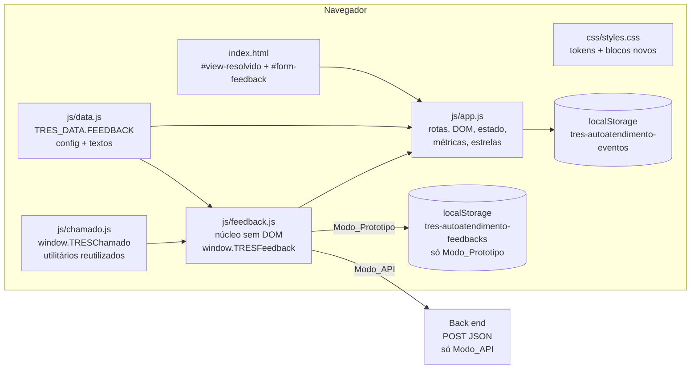
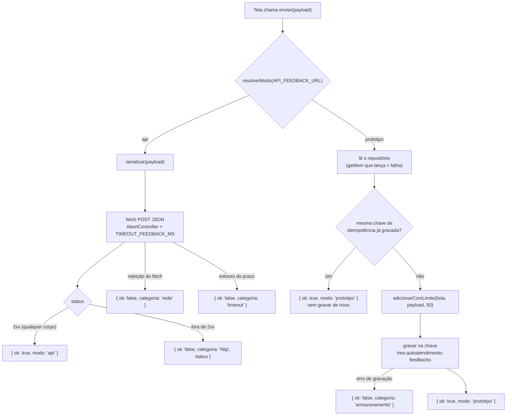
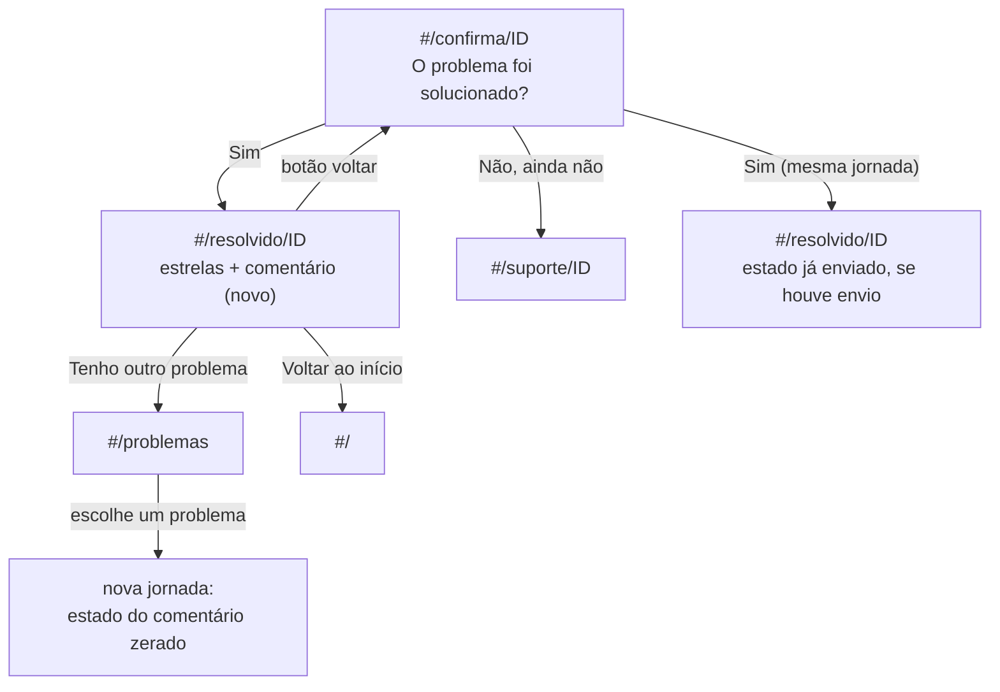
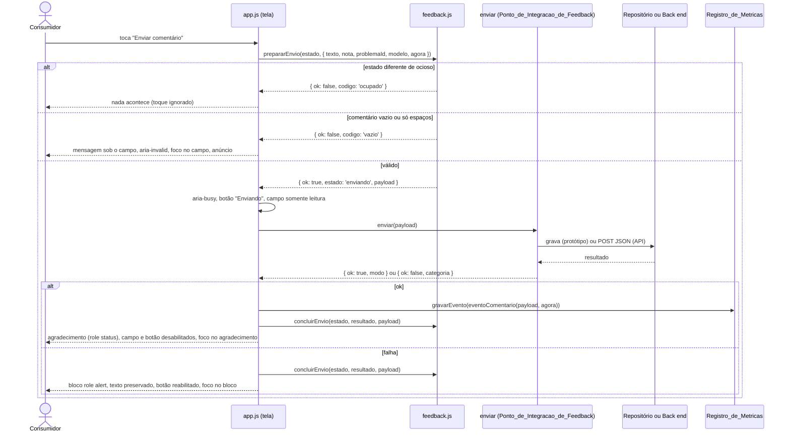
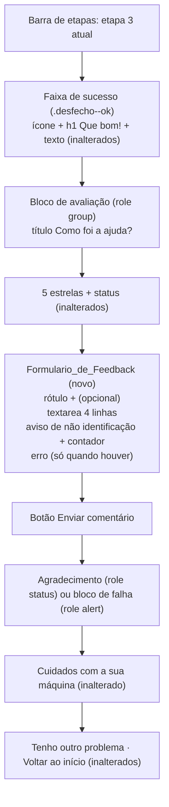
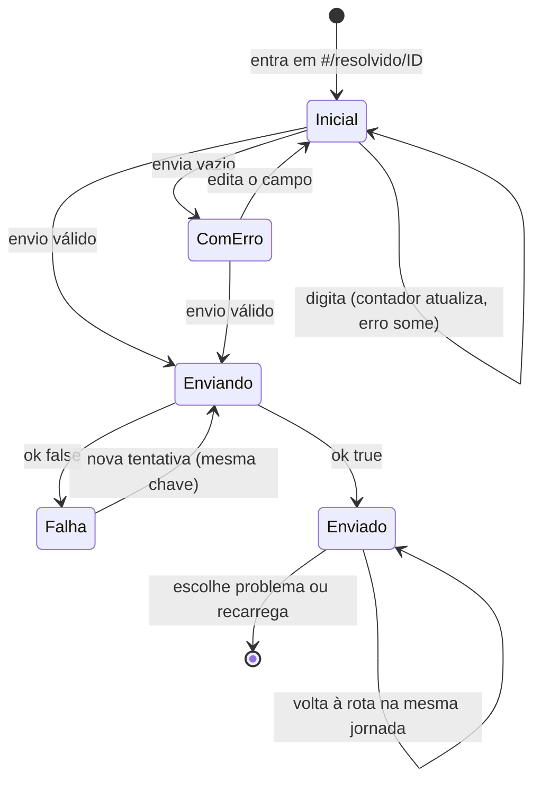

# Design Document: Comentário opcional na tela de problema resolvido (resolved-feedback-comment)

## Overview

Hoje, quando o consumidor responde "Sim" em "O problema foi solucionado?", a rota `#/resolvido/ID` mostra a mensagem "Que bom! Seu café está de volta.", a avaliação por estrelas ("Como foi a ajuda?") e os links "Tenho outro problema" e "Voltar ao início". A nota vira o evento `avaliacao` e nada mais. Esta funcionalidade acrescenta, **no mesmo bloco da avaliação**, um **campo de comentário opcional**: o consumidor pode enviar só a nota (como hoje), só o comentário, ou os dois.

O design segue o que o projeto já faz para o chamado: HTML, CSS e JS puros, sem build, mobile primeiro, textos em `js/data.js`, cores em tokens CSS, foco movido para o `h1` a cada tela, região viva global `#anuncio`, núcleo testável sem DOM e dois modos de envio (Modo_Prototipo e Modo_API).

Decisões do usuário já incorporadas nos requisitos e neste design:

1. A nota **não** é obrigatória para enviar o comentário (P1).
2. O limite continua em **500 caracteres** (P2).
3. Há **um único comentário por jornada** (P3).
4. **Não existe aviso de protótipo** no agradecimento: a mensagem é igual em Modo_Prototipo e em Modo_API (P6).
5. O contrato com o back end continua **provisório** (P7). Avaliação jurídica (LGPD) e contrato seguem `PENDENTE`.

Decisões principais do design:

1. **Núcleo sem DOM em arquivo novo, `js/feedback.js`.** Normalização, validação, payload, repositório, camada de envio, máquina de estados do formulário e evento de métrica ficam em funções que não tocam no DOM. O módulo reaproveita utilitários do `js/chamado.js` (modo da URL, chave de idempotência, repositório genérico, substituição de marcadores) por **injeção de dependência**, sem copiar código e sem alterar o comportamento do chamado.
2. **Nenhuma rota nova.** O bloco entra dentro de `#view-resolvido`. O roteador, a barra de etapas e o foco no `h1` continuam como estão.
3. **Configuração e textos próprios.** `TRES_DATA.FEEDBACK`, separado de `TRES_DATA.CHAMADO`, com `API_FEEDBACK_URL` vazia por padrão e independente de `API_CHAMADOS_URL`.
4. **Estado em memória.** O texto digitado, a chave de idempotência e o estado "já enviado" ficam só em memória e seguem as regras dos requisitos 7.8 a 7.10.
5. **Métricas sem texto.** O evento `comentario` leva só tipo, instante, problema e modelo. `TRESMetricas.resumo()` ganha `comentarios`.
6. **Sem identificação.** O formulário não pede nome, e-mail, telefone nem aceite. O payload não tem campo de pessoa.

## Architecture

### Visão geral



Ordem de carga em `index.html`: `js/data.js`, `js/chamado.js`, `js/feedback.js`, `js/app.js`. Todos continuam scripts clássicos (sem `type="module"`).

### Separação de responsabilidades

| Camada | Arquivo | Conhece o DOM? | Faz E/S? | Como é testada |
|---|---|---|---|---|
| Conteúdo e configuração | `js/data.js` (`FEEDBACK`) | não | não | validação de presença (`textosValidos`) e testes de exemplo sobre `data.js` |
| Utilitários reutilizados | `js/chamado.js` | não | não | testes existentes do chamado |
| Núcleo puro | `js/feedback.js` (normalização, validação, payload, estado, evento) | não | não | propriedades com fast-check em Node |
| Núcleo com portas | `js/feedback.js` (`criarPontoDeIntegracao`) | não | sim, por parâmetros injetados | propriedades com `fetch` e `storage` falsos |
| Interface e estado | `js/app.js` | sim | `localStorage` (métricas) | testes de interface no Edge headless |

### Como o módulo novo reaproveita o `chamado.js` sem `require`

O `chamado.js` se anexa a `window.TRESChamado` ou a `module.exports`. O `feedback.js` precisa de algumas funções dele. Para não duplicar código e para respeitar o teste estático que proíbe `require(` nos arquivos de `js/`, o `feedback.js` exporta uma **fábrica** que recebe o módulo base:

```js
(function (raiz, fabrica) {
  if (typeof module === 'object' && module.exports) {
    // Em Node (testes): module.exports = { criar }, chamado com require('js/chamado.js') pelo teste.
    module.exports = { criar: fabrica };
  } else {
    // No navegador: usa window.TRESChamado, já carregado antes deste script.
    raiz.TRESFeedback = raiz.TRESChamado ? fabrica(raiz.TRESChamado) : null;
  }
})(typeof window !== 'undefined' ? window : globalThis, function criar(base) { 'use strict'; /* ... */ return { /* API */ }; });
```

Funções usadas de `base` (todas já exportadas por `TRESChamado`): `resolverModo`, `gerarChaveIdempotencia`, `preencherModelo`, `criarRepositorio`, `lerLista`, `adicionarComLimite`, `serializar`, `desserializar`. Uma exportação nova, aditiva: `formatarIsoComFuso` (hoje é privada). Se `window.TRESFeedback` for `null` (script ausente ou falhou), o `app.js` omite o Formulario_de_Feedback e o resto da tela segue funcionando (requisito 13.4).

### Camada de envio (Ponto_de_Integracao_de_Feedback)



A função devolve sempre uma `Promise` que **resolve** (nunca rejeita). Diferenças em relação ao chamado, todas decorrentes dos requisitos: não há protocolo (nem local, nem vindo do back end), então não existem as categorias `'protocolo'` e `'resposta-invalida'`; e qualquer status 2xx basta, com ou sem corpo (requisito 10.9).

Escolha deliberada: a rotina de `fetch` com `AbortController` é **reescrita** em `feedback.js` (cerca de 40 linhas) em vez de extraída de `chamado.js`. Extrair exigiria mexer na camada de envio do chamado, o que o requisito 14.4 manda deixar sem nenhuma alteração de comportamento.

## Fluxo e rotas

### Rotas

Nenhuma rota nova e nenhuma rota alterada. `#/resolvido/ID` continua levando a `#view-resolvido`. As guardas de `aoMudarRota` não mudam. Duas mudanças pontuais de comportamento na própria rota:

- **Foco ao abrir a URL direto.** Hoje `mostrarView` não move o foco na primeira rota, exceto em `suporte` e `chamado`. O requisito 1.7 exige o foco no `h1` da Tela_de_Resolvido "por qualquer meio de navegação", inclusive abertura direta. A lista de exceções passa a incluir `resolvido`.
- **Montagem do bloco.** Depois de `montarEstrelas(...)`, a rota chama `renderFeedback()`.

### Mapa de navegação (inalterado, com o bloco novo destacado)



### Sequência do envio



## Mudanças por arquivo

### `index.html`

- Incluir `<script src="js/feedback.js"></script>` entre `chamado.js` e `app.js`.
- Dentro de `#view-resolvido`, no `div.avaliacao` já existente (que tem `role="group"` e `aria-labelledby="titulo-aval"`), logo **depois** de `#status-aval`, incluir o formulário abaixo. O bloco "Cuidados com a sua máquina" (`#cuidados-resolvido`) e os links finais continuam depois, na mesma ordem.
- O título "Como foi a ajuda?", as estrelas, o status e os textos fixos da tela **não mudam**. O texto novo vem de `data.js` por `data-texto-feedback="chave"` (atributo diferente de `data-texto`, para não misturar com os textos do chamado).
- O formulário nasce com `hidden` e só aparece quando `renderFeedback()` confirma que há textos e módulo.

Esqueleto do Formulario_de_Feedback (sem texto):

```html
<form id="form-feedback" class="feedback" novalidate hidden>
  <div class="campo" data-campo="comentario">
    <label for="f-comentario" class="campo__rotulo">
      <span data-texto-feedback="rotulo"></span>
      <span class="campo__obrig" data-texto-feedback="opcional"></span>
    </label>
    <textarea id="f-comentario" name="comentario" rows="4" maxlength="500" autocomplete="off"
              aria-describedby="f-comentario-aviso f-comentario-contador"></textarea>
    <p class="campo__ajuda" id="f-comentario-aviso" data-texto-feedback="avisoNaoIdentificacao"></p>
    <p class="campo__ajuda" id="f-comentario-contador"></p>
    <p class="campo__erro" id="f-comentario-erro" hidden></p>
  </div>

  <button type="submit" class="btn" id="btn-enviar-comentario"></button>

  <!-- Região viva persistente: o texto é preenchido no sucesso. Vazia, não ocupa espaço. -->
  <div id="feedback-agradecimento" class="feedback__agradecimento" role="status" aria-live="polite" tabindex="-1"></div>
  <!-- Container do bloco de falha (role="alert"), criado só quando necessário, como no chamado. -->
  <div id="feedback-falha-area"></div>
</form>
```

O rótulo do botão é preenchido pelo `app.js` (texto de repouso ou de envio em andamento), porque muda de estado, como o botão "Abrir meu chamado".

### `css/styles.css`

- No `:root`, **um** token novo: `--campo-fundo-desabilitado: var(--creme)`, usado no estado "já enviado" para manter o contraste do texto (requisito 12.6).
- Ao final, um bloco novo, comentado, "Comentário opcional (Tela_de_Resolvido)", **depois** do marcador que o teste estático já usa para separar as regras novas. Reaproveita `.campo`, `.campo__rotulo`, `.campo__obrig`, `.campo__ajuda`, `.campo__erro`, `.msg-falha`, `.btn`. Regras novas: `.feedback`, `.feedback__agradecimento`, `.feedback .btn[disabled]` (sem a opacidade de 0,45 da regra global, ver "Pontos em aberto") e `.campo textarea:disabled`.
- Só tokens semânticos, sem animação nem transição. Nenhuma regra existente é editada.

### `js/data.js`

- Novo objeto `FEEDBACK` (estrutura em "Data Models"), exportado em `window.TRES_DATA` junto das chaves atuais.
- Comentários marcam `PENDENTE` e `ILUSTRATIVO` conforme os requisitos 10.16 e 13.6.

### `js/chamado.js` (mudanças aditivas)

- `resumirEventos` passa a contar eventos `tipo === 'comentario'` em `comentarios` (e a ignorá-los nos demais cálculos, como já faz com `chamado`).
- `formatarIsoComFuso` passa a ser exportada.
- Nada mais muda. Comportamento, assinaturas e chaves do chamado ficam como estão.

### `js/feedback.js` (novo)

Núcleo sem DOM, descrito em "Components and Interfaces".

### `js/app.js`

| Ponto | Mudança |
|---|---|
| Topo | `const TRESFeedback = window.TRESFeedback || null;` e `state.feedback = TRESFeedback ? TRESFeedback.novoEstado(null) : null` |
| `CHAVES_EXTRAS_PROIBIDAS` | acrescentar `comentario`, `texto` e `feedback` (requisito 11.3) |
| `mostrarView` | acrescentar `resolvido` à lista de exceções do foco na primeira rota (requisito 1.7) |
| `aoMudarRota` (view `resolvido`) | depois de `montarEstrelas(...)` e `renderCuidados(...)`, chamar `renderFeedback()` |
| `cartaoProblema` (clique) | `state.feedback = TRESFeedback.novoEstado(p.id)` ao escolher um problema, para zerar a jornada (requisito 7.9) |
| `montarEstrelas` | ganha um 5º parâmetro opcional `aoEscolher(n)`, chamado depois de gravar o evento. Sem o parâmetro, o comportamento é idêntico ao atual. A Tela_de_Resolvido passa um callback que guarda a nota em `state.feedback.nota` |
| `pontoDeIntegracao` | a escolha do `storage` (com o substituto que lança) vira a função `obterStorage()`, usada também pelo feedback. Sem mudança de comportamento |
| Novas | `renderFeedback`, `iniciarFeedback`, `aoEnviarFeedback`, `mostrarErroComentario`, `limparErroComentario`, `definirEnviandoFeedback`, `mostrarEnviado`, `mostrarFalhaFeedback`, `pontoDeIntegracaoFeedback`, `aplicarTextosFeedback` |
| `TRESMetricas.resumo` | sem mudança no `app.js`: delega a `TRESChamado.resumirEventos`, que agora devolve `comentarios` |

A nota guardada em `state.feedback.nota` é zerada a cada `renderFeedback()`, porque as estrelas são remontadas neutras a cada exibição. Isso implementa "na mesma exibição da Tela_de_Resolvido" do requisito 3.3.

## Components and Interfaces

### `js/feedback.js`: API do núcleo (`window.TRESFeedback`)

Convenções: funções puras não leem relógio, sorteio, `localStorage` nem rede. O "mundo externo" entra por parâmetro: `agora: () => Date`, `sorteio` (opcional, para testes), `storage` (`{ getItem, setItem }`), `fetch`, `AbortController`, `setTimeout`, `clearTimeout`. A contagem de caracteres usa `String.length` (unidades UTF-16), o mesmo critério do `maxlength` do navegador.

| Grupo | Função | Contrato |
|---|---|---|
| Constantes | `LIMITES` | `{ comentario: { min: 1, max: 500 }, maxFeedbacks: 50 }` |
| | `CHAVE_REPOSITORIO` | `'tres-autoatendimento-feedbacks'` |
| | `CAMPOS_PAYLOAD` | `['versaoContrato','chaveIdempotencia','enviadoEm','comentario','nota','problemaId','modelo']` |
| | `CHAVES_TEXTOS_OBRIGATORIOS` | lista das chaves de `FEEDBACK.textos` exigidas |
| Texto | `normalizarComentario(s)` | `String(s).trim()`; preserva quebras de linha e espaços internos; `null` e `undefined` viram `''` |
| | `validarComentario(s)` | `null` (válido), `'vazio'` (sem nada depois da normalização) ou `'tamanho'` (mais de 500) |
| | `limitarComentario(s)` | `s.slice(0, 500)` |
| | `formatarContador(modelo, s)` | `base.preencherModelo(modelo, { n: s.length, max: 500 })`; com o texto de referência devolve "N de 500 caracteres" |
| Estado | `novoEstado(problemaId)` | `{ problemaId, texto: '', chave: null, estado: 'ocioso', enviado: null, nota: null }` |
| | `garantirEstado(estado, problemaId)` | mesmo objeto se o `problemaId` coincide; senão `novoEstado(problemaId)` |
| | `aoExibir(estado, problemaId)` | `garantirEstado` e, se o estado é `'ocioso'`, devolve cópia com `texto: ''`, `chave: null` e `nota: null`; `'enviando'` e `'enviado'` voltam como estão (com `nota: null`) |
| | `editarTexto(estado, s)` | se `'ocioso'`, devolve cópia com `texto: limitarComentario(s)`; senão devolve o mesmo estado |
| | `escolherNota(estado, n)` | guarda `n` se for inteiro de 1 a 5; senão `null` |
| | `prepararEnvio(estado, entrada)` | ver abaixo |
| | `concluirEnvio(estado, resultado, payload)` | ver abaixo |
| Payload | `montarPayload(entrada)` | monta o objeto com exatamente os 7 campos do contrato |
| | `serializar(x)` / `desserializar(t)` | delegam a `base.serializar` e `base.desserializar` |
| Modo | `modoDoFeedback(config)` | `base.resolverModo(config.API_FEEDBACK_URL)` |
| Envio | `criarPontoDeIntegracao(deps)` | devolve `{ enviar(payload) → Promise<Resultado> }` |
| Métricas | `eventoComentario(payload, em)` | `{ tipo: 'comentario', em, problema, modelo }`; modelo `null` vira `'nao-informado'` |
| Conteúdo | `textosValidos(dadosFeedback)` | `true` se `config` e `textos` existem e todas as chaves obrigatórias são texto não vazio após `trim` |

#### `prepararEnvio(estado, entrada)`

`entrada = { texto, nota, problemaId, modelo, agora, sorteio? }`. Não altera `estado`.

1. Se `estado.estado !== 'ocioso'` → `{ ok: false, codigo: 'ocupado' }` (cobre duplo toque, envio em andamento e comentário já enviado).
2. `codigo = validarComentario(entrada.texto)`; se não for `null` → `{ ok: false, codigo }`. Nada é gravado nem enviado.
3. `chave = estado.chave || base.gerarChaveIdempotencia(entrada.sorteio)`. A chave nasce no primeiro envio válido e é reutilizada nas retentativas.
4. `payload = montarPayload({ chave, texto, nota, problemaId, modelo, agora })`.
5. Devolve `{ ok: true, estado: { ...estado, texto: entrada.texto, chave, estado: 'enviando' }, payload }`.

O texto do estado é o que foi digitado (sem `trim`); o payload leva o texto normalizado.

#### `concluirEnvio(estado, resultado, payload)`

- Se `estado.estado !== 'enviando'`, devolve o mesmo estado.
- `resultado.ok === true` → `{ ...estado, estado: 'enviado', enviado: { comentario: payload.comentario } }`.
- Caso contrário → `{ ...estado, estado: 'ocioso' }`, com `texto` e `chave` preservados (retentativa com a mesma chave, requisito 8.2).

#### `montarPayload(entrada)`

Aceita `{ chave, texto, nota, problemaId, modelo, agora, versao? }` e ignora qualquer outro campo recebido. Regras:

- `versaoContrato`: `FEEDBACK.config.VERSAO_CONTRATO_FEEDBACK` (`"1"`), texto.
- `chaveIdempotencia`: a chave recebida.
- `enviadoEm`: `base.formatarIsoComFuso(agora())`, ISO 8601 com o deslocamento de fuso do dispositivo.
- `comentario`: `normalizarComentario(texto)`.
- `nota`: o valor se for inteiro de 1 a 5; senão `null`.
- `problemaId`: o inteiro recebido.
- `modelo`: texto não vazio, ou `null`.

### Resultado do envio

```js
// Resultado = { ok: true, modo: 'prototipo' | 'api' }
//           | { ok: false, categoria: 'rede' | 'timeout' | 'http' | 'armazenamento', status?: number }
```

`status` existe só para `'http'` e é apenas o número. O corpo da resposta nunca é lido, copiado para o resultado ou escrito no console.

### Camada de envio: comportamento

```js
function criarPontoDeIntegracao(deps) {
  // deps: { config, fetch, AbortController, setTimeout, clearTimeout, storage }
  return { enviar: function (payload) { /* Promise que sempre resolve */ } };
}
```

`enviarApi(payload)`:

1. Corpo: `base.serializar(payload)`.
2. Cria `AbortController` e `setTimeout(abort, TIMEOUT_FEEDBACK_MS)` (valor padrão de 10 000 ms se a configuração for inválida).
3. `fetch(API_FEEDBACK_URL, { method: 'POST', headers: { 'Content-Type': 'application/json' }, body, signal, credentials: 'omit', cache: 'no-store', referrerPolicy: 'no-referrer' })`.
4. `AbortError` ou prazo estourado → `'timeout'`; qualquer outra rejeição → `'rede'`.
5. Status de 200 a 299 → `{ ok: true, modo: 'api' }`, sem ler o corpo. Qualquer outro status → `{ ok: false, categoria: 'http', status }`.
6. Sempre chama `clearTimeout`. Não há retentativa automática. Sem `AbortController` no ambiente, usa `Promise.race` com temporizador, como o chamado.

`enviarPrototipo(payload)`:

1. Lê com `storage.getItem(CHAVE_REPOSITORIO)` diretamente; exceção → `'armazenamento'` (a leitura que lança não pode virar lista vazia, senão a gravação seguinte apagaria o que existe).
2. `lista = base.lerLista(texto)`; texto ilegível vira `[]` (requisito 9.6).
3. Se algum item tem a mesma `chaveIdempotencia`, devolve `{ ok: true, modo: 'prototipo' }` sem gravar de novo (o primeiro registro prevalece, como no chamado).
4. `base.criarRepositorio(storage, CHAVE_REPOSITORIO).gravar(base.adicionarComLimite(lista, payload, 50))`; exceção → `'armazenamento'`, sem alterar o que já estava gravado.
5. O registro gravado é **exatamente o Payload_do_Feedback**, sem campos extras. Assim a ida e volta do requisito 9.5 compara payload com payload.

Modo_Prototipo nunca chama `fetch` e nunca toca `tres-autoatendimento-eventos` nem `tres-autoatendimento-chamados`. Modo_API nunca grava no repositório e nunca usa `API_CHAMADOS_URL`.

### Funções de `app.js` (DOM)

| Função | Responsabilidade |
|---|---|
| `aplicarTextosFeedback(raiz)` | preenche `[data-texto-feedback]` com `D.FEEDBACK.textos[chave]` por `textContent` |
| `renderFeedback()` | se `!TRESFeedback \|\| !TRESFeedback.textosValidos(D.FEEDBACK)`: mantém o formulário `hidden` e sai; senão: `state.feedback = aoExibir(...)`, aplica textos, repõe o texto e o contador, limpa erro e falha e aplica o estado (`ocioso`, `enviando` ou `enviado`) |
| `iniciarFeedback()` | liga `input`, `submit` e o clique do botão, uma única vez |
| `aoEnviarFeedback(ev)` | fluxo da sequência acima |
| `definirEnviandoFeedback(bool)` | `aria-busy` no formulário, texto e `disabled` do botão, campo somente leitura |
| `mostrarEnviado(texto)` | campo e botão desabilitados, texto enviado visível, agradecimento preenchido, foco no agradecimento |
| `mostrarFalhaFeedback()` | cria o bloco `role="alert"` com `D.FEEDBACK.textos.falha`, reabilita campo e botão, foca o bloco |
| `mostrarErroComentario()` / `limparErroComentario()` | gerenciam mensagem, `aria-invalid` e `aria-describedby` do campo |

O campo fica `readonly` (não `disabled`) **durante** o envio, para continuar legível e focável; vira `disabled` somente depois do sucesso (requisitos 7.2 e 7.6). A fase de envio marca `estado = 'enviando'` **antes** do primeiro `await`, o que torna segundo toque, Enter repetido e duplo clique inofensivos.

Se o consumidor sair da rota com o envio em andamento, o resultado atualiza `state.feedback` (se a chave ainda for a da tentativa) e grava a métrica no sucesso, mas só mexe na tela se a rota ainda for `resolvido`. É o mesmo cuidado que `concluirSucesso` do chamado tem.

## Data Models

### Configuração e textos em `TRES_DATA.FEEDBACK`

```js
const FEEDBACK = {
  config: {
    // Vazia = Modo_Prototipo (grava em tres-autoatendimento-feedbacks).
    // PENDENTE (back end): URL do endpoint de feedback por ambiente. Independente de API_CHAMADOS_URL.
    API_FEEDBACK_URL: '',
    // ILUSTRATIVO / PENDENTE (back end): tempo limite do envio do feedback, em milissegundos.
    TIMEOUT_FEEDBACK_MS: 10000,
    // ILUSTRATIVO / PENDENTE (back end): versão do contrato do Payload_do_Feedback.
    VERSAO_CONTRATO_FEEDBACK: '1'
    // PENDENTE (back end): autenticação e autorização, CORS, esquema do banco, formato da resposta
    // de sucesso, tratamento de chave de idempotência repetida, cabeçalho de idempotência,
    // limites de tamanho, limitação de taxa e prazo de retenção.
  },
  textos: {
    rotulo: 'Deixe um comentário sobre a ajuda',
    opcional: '(opcional)',
    // ILUSTRATIVO / PENDENTE (jurídico/LGPD): texto do aviso de não identificação.
    avisoNaoIdentificacao: 'Não escreva nome, e-mail, telefone nem outros dados pessoais aqui.',
    contador: '{n} de {max} caracteres',
    botaoEnviar: 'Enviar comentário',
    botaoEnviando: 'Enviando',
    erroVazio: 'Escreva um comentário antes de enviar.',
    anuncioErroVazio: 'Comentário vazio. Escreva um comentário antes de enviar.',
    agradecimento: 'Obrigado pelo seu comentário! Ele ajuda a melhorar o autoatendimento.',
    falha: 'Não conseguimos enviar o seu comentário agora. O texto continua aqui. Tente de novo em instantes.'
  }
};
```

Os nomes `TIMEOUT_FEEDBACK_MS` e `VERSAO_CONTRATO_FEEDBACK` são diferentes dos do chamado de propósito: o servidor de teste troca valores de `data.js` em memória por nome de chave, e dois `TIMEOUT_ENVIO_MS` tornariam a troca ambígua. Não existe texto de "aviso de protótipo": o agradecimento é um só.

Limites numéricos (1 a 500, máximo de 50 registros) ficam em `TRESFeedback.LIMITES`, porque são regra dos requisitos. O formato do contador usa `{n}` e `{max}`.

Se `FEEDBACK`, `FEEDBACK.config`, `FEEDBACK.textos` ou qualquer chave obrigatória estiver ausente ou vazia (após `trim`), `textosValidos` devolve `false` e o formulário é omitido sem mensagem técnica (requisito 13.4).

### Estado do formulário em memória (`state.feedback`)

```js
state.feedback = {
  problemaId: 3,          // jornada a que o estado pertence
  texto: '',              // exatamente o que foi digitado (máx. 500)
  chave: null,            // Chave_de_Idempotencia, criada no 1º envio válido e mantida até o sucesso
  estado: 'ocioso',       // 'ocioso' | 'enviando' | 'enviado'
  enviado: null,          // { comentario } depois do sucesso
  nota: null              // última nota escolhida nesta exibição (1 a 5) ou null
};
```

| Evento | Efeito no estado |
|---|---|
| Entrar em `#/resolvido/ID` | `aoExibir`: outro problema → estado novo; `'ocioso'` → texto, chave e nota zerados; `'enviando'` e `'enviado'` mantidos |
| Digitar | `editarTexto` (só em `'ocioso'`) |
| Tocar uma estrela | `escolherNota`; o evento `avaliacao` segue exatamente como hoje |
| Envio válido | `'ocioso'` → `'enviando'`, chave criada se ainda não existe |
| Sucesso | `'enviando'` → `'enviado'`, `enviado.comentario` guardado |
| Falha | `'enviando'` → `'ocioso'`, texto e chave mantidos |
| Escolher um problema na lista | `novoEstado(p.id)`: descarta texto, chave e "já enviado" |
| Recarregar a página | tudo volta ao estado inicial (memória) |

### Feedback e Payload_do_Feedback (contrato provisório com o back end)

O Feedback e o Payload são o mesmo objeto, com exatamente 7 campos:

```js
{
  versaoContrato: '1',
  chaveIdempotencia: '3f2b8c1e-6d4a-4f0e-9b7a-2c5d8e1a4b90',
  enviadoEm: '2026-10-13T14:32:10.123-03:00',
  comentario: 'O passo a passo resolveu em dois minutos. 👍',
  nota: 4,
  problemaId: 3,
  modelo: 'touch'
}
```

| Campo | Tipo | Observação |
|---|---|---|
| `versaoContrato` | string | `"1"` |
| `chaveIdempotencia` | string | UUID v4 |
| `enviadoEm` | string | ISO 8601 com fuso; instante da tentativa de envio |
| `comentario` | string | normalizado, 1 a 500 caracteres, texto puro |
| `nota` | integer ou null | 1 a 5, ou `null` quando não há nota na exibição |
| `problemaId` | integer | `ID` da rota |
| `modelo` | string ou null | id do modelo (`lov`, `modo`, `passione`, `luna`, `touch`) ou `null` |

Não há nome, e-mail, telefone, protocolo, título do problema, dado de métricas, identificador de banco, agente de usuário, IP nem geolocalização (requisitos 2.4, 10.13 e P5).

Requisição provisória:

```http
POST {API_FEEDBACK_URL}
Content-Type: application/json

{ ...payload... }
```

Qualquer status 2xx conta como sucesso, com ou sem corpo. O cliente ignora o corpo. O contrato não cita tabelas, ids de banco nem nomes de colunas, então o esquema do banco pode ser definido depois sem mudar o cliente. Os pontos em aberto com o back end estão em "Decisões e pontos em aberto".

### Evento no Registro_de_Metricas

| Tipo | Campos | Quando |
|---|---|---|
| `comentario` (novo) | `tipo`, `em`, `problema`, `modelo` (ou `nao-informado`) | envio de comentário com sucesso |
| `avaliacao` (existente) | inalterado | toque em uma estrela, com `desfecho: 'resolvido'` na Tela_de_Resolvido |
| `resolvido`, `suporte`, `chamado` | inalterados | como hoje |

O evento `comentario` **não** leva texto, nota, tamanho, chave de idempotência nem dado pessoal. O evento `avaliacao` não ganha nenhuma indicação de que há comentário (requisito 11.8). `resumirEventos` mantém `resolvidos`, `encaminhadosAoSuporte`, `deflexaoPercentual`, `porProblema` e `chamadosAbertos` exatamente como hoje e soma `comentarios`.

### Repositorio_de_Feedbacks (Modo_Prototipo)

- Chave `tres-autoatendimento-feedbacks`, valor: JSON de uma lista de Payloads_do_Feedback.
- No máximo 50 itens; ao passar disso, saem os mais antigos.
- Leitura tolerante: texto vazio, JSON inválido ou JSON que não seja lista vira `[]`; itens que não sejam objetos são descartados.
- Chave separada de `tres-autoatendimento-eventos` e de `tres-autoatendimento-chamados`; nada do feedback é gravado nelas.
- Em Modo_API este repositório não é usado.
- O texto livre fica em texto puro no `localStorage` do navegador. É aceitável para demonstração e é um dos pontos `PENDENTE` de LGPD.

## Layout da tela (mobile primeiro)

Largura de referência: 360 px. Uma coluna em qualquer largura; o bloco ocupa a largura do `.container` (requisito P11).



Pontos de layout:

- Textarea com `font-size: 1rem` (16 px, evita zoom automático no iOS), `rows="4"` e `min-height: 140px` (regra `.campo textarea` já existente), redimensionável só na vertical.
- Botão com `min-height` de 48 px (`.btn`), largura de conteúdo, espaçado ao menos 8 px do campo e das estrelas.
- Agradecimento: faixa com fundo `--sucesso-fundo`, borda e ícone "✓" por pseudo-elemento com texto alternativo vazio. O estado de sucesso é dito por **texto**, não só por cor ou ícone.
- Falha: reaproveita `.msg-falha` (fundo `--erro-fundo`, ícone de alerta, texto).
- Em 640 px ou mais, o formulário respeita `max-width: 640px` e fica alinhado à esquerda do bloco, sem colunas.

### Estados do Formulario_de_Feedback



| Estado | O que a pessoa vê | O que o código faz |
|---|---|---|
| Inicial | campo vazio, "0 de 500 caracteres", aviso | botão operável mesmo sem nota |
| ComErro | mensagem sob o campo | `aria-invalid="true"`, `aria-describedby` com aviso, contador e erro, foco no campo, anúncio em `#anuncio` |
| Enviando | botão "Enviando", campo legível | `aria-busy="true"`, botão `disabled`, campo `readonly`, novas ativações ignoradas |
| Falha | bloco de alerta, texto preservado | foco no bloco `role="alert"`, botão e campo reabilitados, mesma chave |
| Enviado | texto enviado visível e travado, agradecimento | campo e botão `disabled`, foco no agradecimento, métrica gravada |
| Conteúdo indisponível | nada (formulário oculto) | estrelas, cuidados e links seguem funcionando |

## Acessibilidade

Segue o padrão atual (foco no `h1`, região viva global, alvos de 44 px ou mais, `prefers-reduced-motion`).

| Tema | Decisão | Requisitos |
|---|---|---|
| Foco ao entrar na tela | `mostrarView` foca o `h1` em toda troca de rota; a abertura direta da URL passa a incluir `resolvido`. O foco nunca vai para o campo | 1.7 |
| Rótulo | `label for="f-comentario"` com a indicação "(opcional)" dentro do rótulo, sempre visível, sem placeholder como rótulo | 1.3 |
| Aviso e contador | `aria-describedby="f-comentario-aviso f-comentario-contador"`; o contador não usa `aria-live`, para não falar a cada tecla | 1.6, 4.4 |
| Erro | `<p class="campo__erro" id="f-comentario-erro">` abaixo do campo; ao mostrar, `aria-invalid="true"` e o id do erro entra em `aria-describedby`; ao editar, os dois somem em até 200 ms e ficam aviso e contador | 5.3, 5.5 |
| Foco no erro | `focus()` no campo e `anunciar(anuncioErroVazio)` na região `#anuncio` em até 1 s | 5.4 |
| Enter | em `textarea`, Enter insere quebra de linha; o envio só ocorre por clique no botão, Enter ou Espaço com o botão focado | 5.7, 12.4 |
| Enviando | `aria-busy="true"` no formulário, texto do botão "Enviando", campo `readonly` | 7.2 |
| Sucesso | `#feedback-agradecimento` com `role="status"` e `aria-live="polite"`, persistente no DOM e preenchido no sucesso, recebe o foco (`tabindex="-1"`); a própria região é o anúncio, sem repetir em `#anuncio` | 7.4, 7.6, 7.7 |
| Falha | bloco criado com `role="alert"` e `tabindex="-1"`, focado | 8.1, 8.3 |
| Estado "já enviado" | campo e botão `disabled`, texto enviado visível, contraste mantido por token | 7.8, 12.6 |
| Grupo | o `div.avaliacao` já é `role="group"` com nome acessível igual ao título "Como foi a ajuda?" | 12.10 |
| Alvos de toque | textarea com 140 px de altura, botão com 48 px, estrelas com 48 px, links com 44 px ou mais, espaçamento mínimo de 8 px | 12.2 |
| Fonte | textarea com `font-size: 1rem`, incluindo o texto digitado | 12.3 |
| Teclado | ordem visual e de leitura: estrelas, campo, botão, links; sem armadilha de foco | 12.4 |
| Foco visível | regra global `:focus-visible` (3 px) vale para os controles novos; nenhum `overflow` corta o contorno | 12.5 |
| Contraste | texto em `--texto` e `--texto-suave`, erro em `--erro` sobre `--erro-fundo`, desabilitado em `--texto` sobre `--campo-fundo-desabilitado` | 12.6 |
| Texto, não só cor | erro, falha, envio e sucesso sempre têm frase visível | 12.7 |
| Movimento | nada anima; a regra global de `prefers-reduced-motion` continua valendo | 12.8 |
| Estrelas | sem alteração: nome "N estrela(s) de 5", `aria-pressed`, 48 px, teclado | 12.9 |
| Barra de etapas | `ETAPA_DA_VIEW.resolvido` continua 3 | 12.11 |

Possível leitura dupla: ao mover o foco para uma região `role="status"` recém-preenchida, alguns leitores de tela podem ler o agradecimento duas vezes (uma pelo foco, outra pela região viva). Os requisitos 7.4, 7.6 e 7.7 pedem as duas coisas. O design não chama `anunciar()` em paralelo para não somar uma terceira leitura. Isso precisa de teste manual com leitor de tela e continua **não verificado**.

Os valores de contraste são calculados a partir dos tokens e conferidos pelo teste estático existente; nada disso foi testado com leitor de tela real.

## Correctness Properties

*A property is a characteristic or behavior that should hold true across all valid executions of a system-essentially, a formal statement about what the system should do. Properties serve as the bridge between human-readable specifications and machine-verifiable correctness guarantees.*

As propriedades valem para o **núcleo sem DOM** (`js/feedback.js`, mais `resumirEventos` de `js/chamado.js`), onde há entradas variáveis e saídas verificáveis. Critérios sobre posição de elementos, estilo, foco, textos fixos, ARIA e navegação são cobertos por testes de exemplo, testes estáticos e testes de interface (ver "Testing Strategy").

**Reflexão sobre redundância.** A análise inicial (prework) foi consolidada assim:

- 6.1, 6.2, 6.5 e 2.5 viram uma única propriedade de normalização (idempotência, "só tira as pontas" e preservação de caracteres).
- 5.2 e 5.3 viram uma propriedade de validação; 5.1 e 5.6 entram na máquina de estados, porque dependem de `prepararEnvio` não alterar o estado quando o texto é inválido.
- 4.1, 4.2 e 4.3 viram uma propriedade de limite e contador.
- 10.11, 10.12, 10.13, 2.4, 3.2 e 3.3 viram uma propriedade sobre o conteúdo do payload (inclui a regra da nota).
- 9.1, 9.4 e 9.5 viram uma propriedade de ida e volta pelo repositório; 10.14 fica separada porque testa só o JSON, sem armazenamento.
- 7.2, 7.3, 7.8, 7.10, 8.2, 8.4, 8.5 e 8.6 viram uma propriedade de máquina de estados (teste baseado em modelo), em vez de oito propriedades quase iguais.
- 7.9 e 4.5 viram uma propriedade de reinício por jornada.
- 10.4, 10.5 e 10.6 viram uma propriedade de modo e destino; 9.3 e 10.8 viram uma propriedade de armazenamento isolado.
- 11.1 e 11.2 viram uma propriedade do evento; 11.5 e 11.6 viram uma propriedade do resumo.
- 13.4 vira a propriedade de conteúdo indisponível.
- Fora das propriedades, por não variarem com a entrada: estrutura e atributos de DOM (1.x, 2.1, 2.3, 4.4, 12.x), foco, tempos de UI (4.2, 5.4, 5.5, 7.4 a 7.7), regressão de rotas (14.x) e arquivos protegidos.

### Property 1: Normalização do comentário

*Para qualquer* texto (incluindo espaços, tabulações, quebras de linha, emojis, aspas, barras invertidas, `<`, `>`, `&`, e-mails e telefones digitados no meio do texto), `normalizarComentario(s)` é igual a `s.trim()`, é um trecho contíguo de `s`, preserva todos os caracteres internos sem escapar nem remover nenhum, e `normalizarComentario(normalizarComentario(s))` é igual a `normalizarComentario(s)`.

**Validates: Requirements 2.5, 6.1, 6.2, 6.5**

### Property 2: Validação do comentário

*Para qualquer* texto `s`, `validarComentario(s)` devolve `null` se e somente se `normalizarComentario(s)` tem de 1 a 500 caracteres; devolve `'vazio'` quando `s` é vazio ou só tem espaços e quebras de linha; e devolve `'tamanho'` quando a forma normalizada tem mais de 500 caracteres.

**Validates: Requirements 5.2, 5.3**

### Property 3: Limite e contador de caracteres

*Para qualquer* texto `s`, `limitarComentario(s)` tem no máximo 500 caracteres, é um prefixo de `s` e é igual a `s` quando `s` já tem até 500 caracteres; e *para qualquer* texto de até 500 caracteres, `formatarContador(modelo, s)` com o modelo `"{n} de {max} caracteres"` devolve exatamente `"N de 500 caracteres"`, com `N` igual ao comprimento de `s`.

**Validates: Requirements 4.1, 4.2, 4.3**

### Property 4: Conteúdo do Payload_do_Feedback

*Para qualquer* comentário válido, chave, instante, `problemaId` inteiro, modelo (texto ou ausente) e valor de nota, mesmo quando a entrada traz campos extras de identificação (como `nome`, `email`, `telefone`, `protocolo` ou `problemaTitulo`), `montarPayload` devolve um objeto com exatamente os campos `versaoContrato`, `chaveIdempotencia`, `enviadoEm`, `comentario`, `nota`, `problemaId` e `modelo`, em que `versaoContrato` é `"1"`, `enviadoEm` está em ISO 8601 com fuso horário, `comentario` é a forma normalizada com 1 a 500 caracteres, `nota` é a nota recebida quando é inteiro de 1 a 5 e `null` em qualquer outro caso, e `modelo` é o texto recebido ou `null`; nenhum valor extra da entrada aparece no objeto.

**Validates: Requirements 2.4, 3.2, 3.3, 10.11, 10.12, 10.13**

### Property 5: Ida e volta do Payload em JSON

*Para qualquer* Payload_do_Feedback válido, incluindo letras acentuadas, emojis, quebras de linha, aspas, barras invertidas e os caracteres `<`, `>` e `&`, `desserializar(serializar(payload))` é igual ao payload, campo a campo e caractere a caractere.

**Validates: Requirements 10.14**

### Property 6: Ida e volta pelo Repositorio_de_Feedbacks

*Para qualquer* Payload_do_Feedback válido e qualquer lista prévia de registros, em Modo_Prototipo um envio bem-sucedido devolve `{ ok: true, modo: 'prototipo' }`, não realiza nenhuma chamada de rede, e a leitura posterior da chave `tres-autoatendimento-feedbacks` devolve uma lista cujo último item é igual ao payload enviado, com todos os campos presentes e valores idênticos caractere a caractere.

**Validates: Requirements 9.1, 9.4, 9.5**

### Property 7: Leitura tolerante do repositório

*Para qualquer* texto armazenado na chave `tres-autoatendimento-feedbacks` (ausente, vazio, JSON inválido, JSON que não é lista, lista com itens que não são objetos), um envio em Modo_Prototipo não lança exceção, devolve `ok: true` e deixa gravada uma lista cujo único item é o payload enviado quando o conteúdo prévio não era uma lista de objetos.

**Validates: Requirements 9.6**

### Property 8: Limite de 50 registros

*Para qualquer* lista prévia de registros (de 0 a 120 itens) e qualquer novo payload com chave diferente das já gravadas, o envio em Modo_Prototipo deixa no máximo 50 registros, com o novo payload como último item, e, quando a lista já tinha 50 ou mais itens, descarta os mais antigos mantendo a ordem dos demais.

**Validates: Requirements 9.2**

### Property 9: Idempotência por chave no repositório

*Para qualquer* lista prévia de registros e qualquer payload, enviar o mesmo payload (mesma `chaveIdempotencia`) um número qualquer de vezes, de 1 a 5, em Modo_Prototipo deixa exatamente um registro com essa chave e devolve sucesso em todas as chamadas.

**Validates: Requirements 9.8**

### Property 10: Seleção do modo e do destino

*Para qualquer* par `(API_FEEDBACK_URL, API_CHAMADOS_URL)` de textos (vazio, ausente, sem protocolo, `ftp:`, `javascript:`, `http:` em outro host, `http:` em `localhost` ou `127.0.0.1`, `https:`), o envio opera em Modo_API se e somente se `API_FEEDBACK_URL` é `https:` válida, ou `http:` com host `localhost` ou `127.0.0.1`; em Modo_Prototipo o `fetch` injetado nunca é chamado, mesmo com `API_CHAMADOS_URL` preenchida; e em qualquer modo nenhuma chamada ao `fetch` usa `API_CHAMADOS_URL` como destino.

**Validates: Requirements 10.4, 10.5, 10.6**

### Property 11: Armazenamento isolado

*Para qualquer* payload válido e qualquer conteúdo prévio das chaves `tres-autoatendimento-eventos` e `tres-autoatendimento-chamados`, um envio em Modo_Prototipo escreve somente na chave `tres-autoatendimento-feedbacks` e deixa as outras duas chaves byte a byte iguais; e um envio em Modo_API não escreve em nenhuma chave do armazenamento.

**Validates: Requirements 9.3, 10.8**

### Property 12: Requisição em Modo_API

*Para qualquer* payload válido, em Modo_API o envio faz exatamente uma chamada ao `fetch`, com método `POST`, destino `API_FEEDBACK_URL`, cabeçalho `Content-Type: application/json`, sinal de cancelamento presente e corpo cujo JSON, ao ser lido, é igual ao payload.

**Validates: Requirements 10.7**

### Property 13: Classificação do resultado do envio

*Para qualquer* resposta do `fetch` em Modo_API, o envio resolve (nunca rejeita) e devolve `ok: true` se e somente se o status está entre 200 e 299, qualquer que seja o corpo (vazio, JSON, texto ou ausente); status fora dessa faixa devolve `{ ok: false, categoria: 'http', status }`; rejeição do `fetch` devolve `'rede'`; ausência de resposta no prazo configurado devolve `'timeout'`; em todos os casos há no máximo uma chamada ao `fetch` e o corpo da resposta não aparece no resultado.

**Validates: Requirements 10.9, 10.10**

### Property 14: Falha de armazenamento não deixa rastro

*Para qualquer* lista prévia de registros e qualquer falha de armazenamento (`getItem` que lança, `setItem` que lança), o envio em Modo_Prototipo devolve `{ ok: false, categoria: 'armazenamento' }` e o conteúdo armazenado fica idêntico ao que era antes.

**Validates: Requirements 8.1, 9.7**

### Property 15: Chave de idempotência

*Para qualquer* estado ocioso e comentário válido, `prepararEnvio` devolve um payload cuja `chaveIdempotencia` tem 36 caracteres no formato de UUID versão 4 (versão `4` e variante `8`, `9`, `a` ou `b`); e uma sequência de chaves geradas por estados novos independentes, com sorteio aleatório, não tem repetições.

**Validates: Requirements 7.1, 10.15**

### Property 16: Máquina de estados do envio

*Para qualquer* sequência de ações (editar texto, enviar, concluir com sucesso, concluir com falha, reexibir a tela) aplicada ao estado do formulário, comparada com um modelo simples: um envio só é aceito no estado `'ocioso'`; qualquer envio pedido em `'enviando'` ou `'enviado'` é recusado com `'ocupado'` e não gera segundo payload; um envio com texto vazio é recusado com `'vazio'` e deixa o estado exatamente como estava; depois de uma falha o estado volta a `'ocioso'` com o mesmo texto e a mesma chave; a chave permanece a mesma em todas as tentativas até o sucesso, e o payload da nova tentativa reflete o texto atual; depois de um sucesso o estado é `'enviado'` e reexibir a tela do mesmo problema o mantém.

**Validates: Requirements 4.5, 5.1, 5.6, 7.2, 7.3, 7.8, 7.10, 8.2, 8.4, 8.5, 8.6**

### Property 17: Reinício por jornada

*Para quaisquer* dois identificadores de problema diferentes, `garantirEstado` devolve, para o segundo, um estado com texto vazio, chave `null`, estado `'ocioso'`, `enviado` `null` e nota `null`, sem alterar o estado do primeiro; para o mesmo identificador mantém o estado existente; `novoEstado` sempre devolve o estado inicial, descartando qualquer "já enviado"; e `aoExibir` sobre um estado `'ocioso'` devolve texto, chave e nota zerados.

**Validates: Requirements 4.5, 7.9**

### Property 18: Evento de métrica sem texto

*Para qualquer* payload válido e instante, `eventoComentario` devolve um objeto com exatamente os campos `tipo` (`'comentario'`), `em`, `problema` (o `problemaId` do payload) e `modelo` (o modelo do payload, ou `'nao-informado'` quando `null`), e nenhum outro campo; o texto do comentário, a nota, o tamanho do texto e a chave de idempotência não aparecem em nenhum campo.

**Validates: Requirements 11.1, 11.2**

### Property 19: Resumo de métricas com comentários

*Para qualquer* lista de eventos (incluindo eventos `comentario`, `avaliacao`, `chamado`, `resolvido`, `suporte`, itens que não são objetos e tipos desconhecidos), `resumirEventos` devolve `comentarios` igual à quantidade de eventos do tipo `comentario` (0 se não houver nenhum), e `resolvidos`, `encaminhadosAoSuporte`, `deflexaoPercentual`, `porProblema` e `chamadosAbertos` iguais aos obtidos da mesma lista sem os eventos `comentario`.

**Validates: Requirements 11.5, 11.6**

### Property 20: Conteúdo indisponível

*Para qualquer* objeto de dados do feedback em que a configuração ou ao menos um dos textos obrigatórios (rótulo, indicação "opcional", aviso de não identificação, formato do contador, botão de envio, texto de envio em andamento, erro de comentário vazio, anúncio do erro, agradecimento, falha) está ausente, não é texto ou é vazio após `trim`, `textosValidos` devolve `false`; para o objeto completo devolve `true`.

**Validates: Requirements 13.4**

## Error Handling

| Situação | Detecção | Resposta da tela | Requisitos |
|---|---|---|---|
| Comentário vazio ou só espaços | `validarComentario` → `'vazio'` | mensagem sob o campo, `aria-invalid`, foco no campo, anúncio; nada gravado nem enviado; texto preservado | 5.1, 5.3, 5.4, 5.6 |
| Comentário acima de 500 | `maxlength` e `limitarComentario` no `input` | texto truncado em 500, contador "500 de 500 caracteres" | 4.3 |
| Gravação local falha (armazenamento cheio, bloqueado, indisponível) | exceção em `getItem`/`setItem` → `'armazenamento'` | bloco `role="alert"`, texto preservado, botão reabilitado, mesma chave | 8.1 a 8.3, 9.7 |
| Sem resposta do back end no prazo | `AbortController` + `TIMEOUT_FEEDBACK_MS` → `'timeout'` | mesma mensagem de falha; nova tentativa manual com a mesma chave | 8.1, 10.10 |
| Falha de rede ou bloqueio de CORS | `fetch` rejeita → `'rede'` | mesma mensagem de falha. O navegador não distingue CORS de queda de rede, e o cliente não tenta distinguir | 8.1, 10.10 |
| Back end responde 4xx ou 5xx | status fora de 200 a 299 → `'http'` | mesma mensagem de falha; só o número do status fica no resultado | 8.1, 10.10 |
| Back end responde 2xx com corpo vazio, inválido ou qualquer | status 2xx | **sucesso**; o corpo é ignorado | 10.9 |
| Toque repetido no botão | `prepararEnvio` devolve `'ocupado'` | segundo toque ignorado; no máximo um envio | 7.3 |
| Retentativa depois de falha | estado volta a `'ocioso'` | reaproveita a chave; no protótipo a chave já gravada não duplica o registro; no Modo_API cabe ao back end tratar a chave repetida | 7.10, 8.5, 8.6, 9.8 |
| Falha ao gravar a métrica | exceção engolida em `gravarEvento` | o envio segue como sucesso, com agradecimento e sem erro | 11.7 |
| Repositório ilegível | `lerLista` | tratado como vazio, sem mensagem técnica | 9.6 |
| `FEEDBACK` ausente ou com texto obrigatório vazio, ou `feedback.js` não carregado | `textosValidos`, `TRESFeedback === null` | formulário omitido sem mensagem; estrelas, cuidados e links seguem funcionando | 13.4 |
| `API_FEEDBACK_URL` inválida (ex.: `http` fora de localhost) | `resolverModo` → `'prototipo'` | segue em Modo_Prototipo, sem rede | 10.5 |
| `API_FEEDBACK_URL` vazia e `API_CHAMADOS_URL` preenchida | `modoDoFeedback` | Modo_Prototipo; nada vai ao endpoint de chamados | 10.5, 10.6 |
| Consumidor sai da rota durante o envio | chave da tentativa diferente da do estado, ou rota diferente | métrica gravada no sucesso; a tela só muda se ainda estiver na Tela_de_Resolvido | 7.9, 11.1 |
| ID de rota inválido | `D.PROBLEMAS.find` | `ir('#/problemas')` e formulário não exibido | 1.8 |
| Estrela tocada com falha de feedback (e o contrário) | operações independentes | uma não impede nem desfaz a outra | 3.5, 8.7 |
| Página recarregada | memória perdida | campo vazio, estado inicial | 7.9, P10 |
| `crypto.randomUUID` ausente | verificação no momento de gerar, já em `gerarChaveIdempotencia` | usa `getRandomValues` ou `Math.random` (a chave só precisa ser única, não secreta) | 7.1 |

Regras gerais:

- **Sem dados no console.** O código novo não chama `console.*`. Erros viram categorias e não carregam o comentário, o corpo da requisição nem o corpo da resposta.
- **Texto literal.** O comentário só entra na página por `textContent` ou `value`. Nenhum `innerHTML`, `insertAdjacentHTML`, `outerHTML` ou `document.write` é usado com dado do consumidor, do back end ou de `data.js`.
- **Sem segredo no cliente.** Nenhum token ou chave de API vai ao front end.
- **Sem retentativa automática.** Só o consumidor repete o envio.
- **HTTPS.** Em Modo_API só `https` (ou `http` em `localhost`/`127.0.0.1`, para desenvolvimento) é aceito.

## Testing Strategy

### Abordagem dupla

- **Testes de propriedade** para as 20 propriedades acima, sobre `js/feedback.js` e `resumirEventos`, em Node.
- **Testes de exemplo, estáticos e de interface** para o que não varia com a entrada: estrutura do DOM, foco, estilos, navegação, textos de `data.js` e arquivos protegidos.

Há lógica pura e de transformação (normalização, validação, payload, máquina de estados, classificação de respostas), então testes de propriedade se aplicam ao núcleo. A interface (HTML e CSS) usa testes de exemplo e verificação em navegador, não propriedades.

### Ferramentas

- Node 24 e o executor nativo, `node --test`.
- Biblioteca de propriedades: **fast-check 4.10.2**, já fixada em `tests/package.json`. Não se implementa geração aleatória à mão.
- O site continua sem `package.json` na raiz, sem build e sem dependências. A pasta `tests/` não faz parte do site.

### Configuração das propriedades

- Cada propriedade é implementada por **um único** teste de propriedade com `fc.assert(fc.property(...), { numRuns: 100 })` (mínimo de 100 execuções; mais nas idas e voltas).
- Cada teste leva um comentário de rastreabilidade neste formato: `// Feature: resolved-feedback-comment, Property 6: Ida e volta pelo Repositorio_de_Feedbacks`.
- Geradores novos em `tests/geradores.js`:
  - `comentarioBruto`: texto Unicode completo com `fc.string({ unit: 'binary' })`, variantes com emojis, acentos, quebras de linha, tabulações, aspas, `\`, `<`, `>`, `&`, e-mails e telefones no meio do texto, espaços e quebras nas pontas e *surrogates* soltos (para a ida e volta);
  - `comentarioValido` (1 a 500 caracteres após `trim`) e `comentarioLongo` (mais de 500);
  - `payloadFeedback` (7 campos válidos), `listaDeFeedbacks` (0 a 120 itens, chaves distintas);
  - `urlDeConfiguracao` (vazio, inválido, `ftp:`, `javascript:`, `http:` em outros hosts e locais, `https:`);
  - `acaoDoFormulario` (editar, enviar, concluir com sucesso, concluir com falha, reexibir) para o teste baseado em modelo da Propriedade 16;
  - `eventoComentario` somado ao `eventoMetrica` existente.
- `tests/falsos.js` já fornece `storage` falso (com modos que lançam e espião de chamadas), `fetch` falso (status e corpo configuráveis, resposta que nunca chega, rejeição) e temporizadores falsos; é reaproveitado sem mudança de contrato.
- O núcleo é carregado nos testes assim: `const base = require('../../js/chamado.js'); const fb = require('../../js/feedback.js').criar(base);`.

### Arquivos de teste

```
tests/
  nucleo/
    feedback-texto.test.js       propriedades 1, 2, 3, 20
    feedback-payload.test.js     propriedades 4, 5, 15
    feedback-repositorio.test.js propriedades 6, 7, 8, 9, 11, 14
    feedback-envio.test.js       propriedades 10, 12, 13
    feedback-estado.test.js      propriedades 16, 17
    feedback-metricas.test.js    propriedades 18, 19
  dados.test.js                  novos testes de exemplo sobre TRES_DATA.FEEDBACK
  ui/cenarios/24-comentario-resolvido.test.js   fluxos do Modo_Prototipo
  ui/cenarios/25-comentario-api.test.js         fluxos do Modo_API
```

O script `npm test` já usa `nucleo/*.test.js`, então os arquivos novos entram sem alterar `tests/package.json`.

### Testes existentes que precisam ser atualizados

Esta funcionalidade muda de propósito o que a spec `ticket-opening-screen` (requisito 12.1) exigia: a Tela_de_Resolvido "idêntica". Os testes que fixaram essa expectativa são atualizados, e a atualização é uma tarefa explícita do plano:

| Arquivo | O que muda |
|---|---|
| `tests/ui/cenarios/22-regressao-rotas.test.js` | O cenário `#/resolvido/ID: "Sim, resolvi" ... a tela de sempre` passa a conferir também a ordem estrelas, `#form-feedback`, `#cuidados-resolvido`, links; os textos e destinos de sempre ficam como estão; `resumo()` passa a trazer `comentarios: 0`. O foco no `h1` ao abrir `#/resolvido/ID` direto passa a ser esperado (hoje a primeira rota não move o foco para esta tela). Os cenários de cabeçalho, rodapé e etapas continuam valendo sem mudança |
| `tests/ui/cenarios/18-estrelas.test.js` | O cenário "problema resolvido: tocar a nota 5..." continua igual e ganha: nenhum registro em `tres-autoatendimento-feedbacks` e nenhum evento `comentario`; novo cenário: nota escolhida acompanha o comentário e não cria segundo `avaliacao`; estrela tocada depois do envio não altera o feedback gravado. O ajuste de `gap: 0.5rem` das estrelas continua protegido por este arquivo |
| `tests/ui/cenarios/19-texto-literal.test.js` | Novo cenário: `<b>x</b>` e `` no comentário aparecem como texto no campo travado e no armazenamento, e nenhum elemento é criado em `#view-resolvido` |
| `tests/ui/cenarios/20-responsivo.test.js` | Novos cenários, para 360, 480, 768 e 1024 px, da Tela_de_Resolvido com o formulário (e depois do envio): sem rolagem horizontal, alvos de 44 px, textarea com 16 px, sem cortes; `medirLayout` aplicado a `#view-resolvido` |
| `tests/ui/cenarios/21-movimento-reduzido.test.js` | Novo cenário: Tela_de_Resolvido com `prefers-reduced-motion: reduce` sem transição, animação nem rolagem suave |
| `tests/ui/cenarios/23-dados-pessoais.test.js` | Acrescentar a chave `tres-autoatendimento-feedbacks` à lista de chaves conhecidas; novo cenário: dados digitados no Formulario_de_Chamado (sem enviar) **não** aparecem no feedback, no payload nem no evento `comentario` (requisito 2.4); `exigirMetricasLimpas` passa a proibir também as chaves `comentario`, `texto` e `feedback` nos eventos |
| `tests/ui/cenarios/16-duplo-toque.test.js` | Novo cenário: dois cliques rápidos em "Enviar comentário" geram um registro (Modo_Prototipo) ou uma requisição (Modo_API) |
| `tests/ui/cenarios/17-navegacao.test.js` | Novos cenários: voltar a `#/resolvido/ID` depois do envio mostra "já enviado"; escolher um problema (mesmo o mesmo) zera o estado; sair sem enviar e voltar mostra o campo vazio |
| `tests/ui/cenarios/15-modo-api.test.js` | Novo cenário: `API_CHAMADOS_URL` preenchida e `API_FEEDBACK_URL` vazia → Modo_Prototipo, nenhuma requisição ao endpoint de chamados |
| `tests/ui/servidor-teste.js` e `tests/ui/cenarios.js` | Nova opção `modoApiFeedback` (troca em memória de `API_FEEDBACK_URL`, com a mesma técnica de `API_CHAMADOS_URL`, sem escrever em `js/data.js`); nova rota `POST api/feedbacks` na API falsa, com modos `sucesso`, `erro500`, `lento` e registro das requisições; `ctx.feedbacksLocais()` análogo a `ctx.chamadosLocais()` |
| `tests/estatico.js` (e `estatico.test.js`) | Ver abaixo |
| `tests/geradores.js` | `eventoComentario` entra em `eventoMetrica`; geradores novos listados acima |
| `tests/nucleo/textos-metricas.test.js` | Os `deepEqual` que fixam o formato de `resumirEventos` (entrada inválida e exemplo com chamado) passam a incluir `comentarios`; a Propriedade 25 do chamado passa a incluir eventos `comentario` entre os eventos ignorados |
| `tests/smoke.test.js` | Carregar `feedback.js` com `criar(chamado)` e conferir a API pública |
| `tests/dados.test.js` | Novos exemplos sobre `FEEDBACK` (abaixo) |

Mudanças em `tests/estatico.js`:

- Os testes 1 (sem `console.*`), 2 (sem HTML dinâmico), 5 (núcleo puro, sem DOM, `window`, armazenamento direto, `fetch` direto nem relógio) e 6 (sem `require(`, `import(` nem scripts de terceiros) passam a incluir `js/feedback.js`. O `feedback.js` não usa `require`, por causa da fábrica `criar(base)`.
- Teste 3 novo: dentro de `#form-feedback`, todo texto vem de `data-texto-feedback`; o HTML não escreve frases do feedback.
- Teste 3b novo: todo `data-texto-feedback` aponta para uma chave existente em `FEEDBACK.textos`.
- Teste 4 estendido: nenhuma frase de `FEEDBACK.textos` está escrita em `index.html`, `js/app.js`, `js/chamado.js` nem `js/feedback.js`.
- Teste 7: `#view-resolvido` continua existindo (já coberto); acrescentar que o `h1`, o `h2` de avaliação e os links finais mantêm os textos.
- Testes 9a a 9d (CSS): o bloco novo fica depois do marcador que já separa as regras novas, então entra nas verificações de "sem transição", "fonte do campo de 16 px", "alvos de 44 px"; acrescentar ao 9d os pares novos (texto sobre `--campo-fundo-desabilitado`, texto sobre `--sucesso-fundo`).

Novos exemplos em `tests/dados.test.js`:

- `FEEDBACK.config.API_FEEDBACK_URL === ''` e `CHAMADO.config.API_CHAMADOS_URL === ''` (requisito 14.8).
- Aviso de não identificação com 1 a 200 caracteres e pedindo para não escrever nome, e-mail, telefone ou dados pessoais.
- Todas as chaves obrigatórias presentes; nenhum texto com palavras vagas ("rapidamente", "adequado").
- Marcação `PENDENTE` ou `ILUSTRATIVO` junto de `API_FEEDBACK_URL`, do tempo limite, da versão do contrato e do aviso (requisitos 10.16 e 13.6).
- `FEEDBACK.textos` não tem chave de aviso de protótipo (decisão 4 do usuário).
- `TRES_DATA.CHAMADO` idêntico ao anterior (requisito 13.2).

### Testes de exemplo do núcleo

- Ordem e códigos de validação (`vazio`, `tamanho`); `"  ótimo \n"` vira `"ótimo"`.
- Comentário com 500 caracteres aceito e com 501 recusado.
- Tempo limite: `fetch` que nunca responde com temporizador falso → `'timeout'`.
- Sem `AbortController` no ambiente: usa a corrida com temporizador.
- Chave `tres-autoatendimento-feedbacks` com texto de 3 ou 4 formatos de lixo conhecidos.
- Sem `API_FEEDBACK_URL` mas com `API_CHAMADOS_URL` válida: o `fetch` falso nunca é chamado.

### Testes de interface (Edge headless, sem dependências novas no site)

Cada cenário é curto (menos de 4 s) e começa em carga nova, por causa do recarregamento da aba do Edge headless depois de uns 5 s.

`24-comentario-resolvido.test.js` (Modo_Prototipo):

1. **Fluxo feliz só com comentário**: chegar a `#/resolvido/ID`, escrever, enviar; agradecimento em `role="status"`, campo e botão desabilitados, foco no agradecimento, um registro com `nota: null`, evento `comentario`, `resumo().comentarios === 1`, nenhum evento `avaliacao`.
2. **Nota mais comentário**: tocar a estrela 4, enviar; registro com `nota: 4`; um só evento `avaliacao`.
3. **Só nota (como hoje)**: sem comentário nenhum registro novo e `comentarios === 0`.
4. **Validação**: enviar vazio e com espaços; mensagem, `aria-invalid`, `aria-describedby` com aviso, contador e erro, foco no campo, anúncio; editar remove o erro mantendo aviso e contador; Enter não envia.
5. **Contador e limite**: digitar e colar acima de 500; "500 de 500 caracteres" e texto truncado.
6. **Falha e nova tentativa**: forçar falha de gravação local, conferir bloco `role="alert"`, texto preservado, botão reabilitado, nenhuma métrica; reenviar e conferir sucesso com a mesma chave.
7. **Sem aviso de protótipo**: agradecimento com o mesmo texto de `data.js` e nenhum elemento de aviso de protótipo na tela.
8. **Conteúdo indisponível**: entregar `data.js` sem uma chave de `FEEDBACK.textos`; formulário omitido, estrelas e links funcionando.
9. **Estrutura**: ordem estrelas, formulário, cuidados, links; um único campo editável; sem campos de identificação nem "Ler os termos"; `aria-describedby` do campo; foco no `h1` nos quatro meios de navegação.

`25-comentario-api.test.js` (Modo_API, `modoApiFeedback: true`):

1. **Sucesso com 201 e corpo vazio**: uma requisição `POST` com `Content-Type: application/json`, corpo com os 7 campos, nenhum registro em `tres-autoatendimento-feedbacks`, mesmo agradecimento.
2. **Falha 500, rede e timeout** (`configNumerica: { TIMEOUT_FEEDBACK_MS: 800 }`): bloco de falha, texto preservado; nova tentativa com a mesma `chaveIdempotencia` (a API falsa registra as chaves).
3. **Destino**: com `API_CHAMADOS_URL` preenchida e `API_FEEDBACK_URL` vazia, nenhuma requisição a `api/chamados` nem a `api/feedbacks`.
4. **Dados pessoais**: a API falsa não recebe nome, e-mail nem telefone digitados no Formulario_de_Chamado.

### Verificações estáticas e de integridade

- Busca no código por `innerHTML` com dado do usuário e por `console.` em `js/feedback.js` e `js/app.js` (teste estático estendido).
- Contraste: o teste 9d existente calcula a razão dos pares de tokens usados.
- Arquivos protegidos: `node tests/verificar-protegidos.js --conferir` antes e depois da implementação (`material/`, `img/*.png` originais e `.glb` original; nada é criado em `material/`).

### Como rodar a suíte (lições do projeto)

- `cd tests && npm test`: núcleo, dados, estático e fumaça; não precisa de navegador.
- `node tests/ui/rodar.js [arquivo]`: roda os cenários de interface **um por vez** e, **ao terminar, encerra todos os processos de Edge de teste** (os de perfil temporário `tres-ui-edge-`) e apaga os perfis. Por isso **nunca** rodar dois `rodar.js` ao mesmo tempo, nem rodá-lo enquanto outro processo de teste de interface ainda usa o Edge: um mata o navegador do outro e os testes falham com erros enganosos.
- Para rodar cenários em paralelo, **não usar `rodar.js`**: chamar `node --test` direto nos arquivos de `tests/ui/cenarios/` (cada arquivo sobe o próprio ambiente).
- Depois de mexer em `.estrelas` ou `.estrela` no CSS, rodar o cenário `18-estrelas`.
- Apagar arquivos temporários e servidores ao final.

### O que não será verificado por automação

Leitor de tela real (NVDA, VoiceOver, TalkBack), incluindo a leitura dupla do agradecimento descrita em "Acessibilidade"; celular físico; Firefox e Safari; e o back end real. Esses itens entram em um roteiro de teste manual (`tests/ui/roteiro-manual.md` ganha uma seção do comentário) e continuam **não verificados** até alguém executá-lo.

## Decisões e pontos em aberto

**Decisões deste design**

1. **Módulo novo `js/feedback.js` com fábrica `criar(base)`**, em vez de crescer o `chamado.js`. Evita mexer na camada de envio do chamado (requisito 14.4) e mantém o teste estático de "sem `require`" válido. A mudança em `chamado.js` é só aditiva: `comentarios` em `resumirEventos` e a exportação de `formatarIsoComFuso`.
2. **Nenhuma rota nova.** O bloco entra em `#view-resolvido`, dentro do `div.avaliacao` que já é um grupo com nome acessível.
3. **Registro gravado = Payload_do_Feedback**, sem campos extras. Isso deixa a ida e volta (requisito 9.5) direta e não cria campo que o contrato provisório não tem.
4. **Primeiro registro prevalece** quando a mesma chave chega de novo no protótipo, como no chamado.
5. **A nota não é congelada entre tentativas.** Se o consumidor trocar a estrela depois de uma falha, a nova tentativa leva a nota atual com a mesma chave. É coerente com o requisito 8.6 (texto atualizado com a mesma chave), e o back end deve tratar a chave repetida (ponto já em aberto).
6. **`enviadoEm` é tomado a cada tentativa**, em ISO 8601 com fuso do dispositivo, igual ao chamado.
7. **Contagem de caracteres em unidades UTF-16**, igual ao `maxlength` do navegador. Um emoji conta como 2. Colar um texto que corte um emoji ao meio pode deixar um *surrogate* solto no fim; o JSON preserva esse caractere e a ida e volta é testada com ele.
8. **Chaves de configuração com nomes próprios** (`TIMEOUT_FEEDBACK_MS`, `VERSAO_CONTRATO_FEEDBACK`) para não colidir com as do chamado na troca em memória feita pelo servidor de teste.
9. **Região viva do agradecimento persistente**, preenchida no sucesso, em vez de criada na hora, porque regiões que surgem junto com o conteúdo nem sempre são anunciadas.
10. **Foco no `h1` ao abrir `#/resolvido/ID` direto**: nova exceção na lista de `mostrarView`, exigida pelo requisito 1.7. É uma mudança pequena de comportamento da rota existente e atualiza o teste de regressão.

**Pontos para o usuário confirmar**

- **"Título do bloco" no requisito 13.1.** O título do Bloco_de_Feedback é o `h2` já existente, "Como foi a ajuda?", que o requisito 14.2 manda manter com o mesmo texto. Por isso o design **não** cria um título novo em `data.js`. Se a intenção era um subtítulo novo para o campo (por exemplo, "Quer contar mais?"), é preciso dizer, porque isso muda o layout e o requisito 1.2.
- **Leitura dupla do agradecimento.** Os requisitos pedem região `role="status"` e foco no agradecimento ao mesmo tempo. Alguns leitores de tela podem ler duas vezes. Se isso incomodar nos testes manuais, a alternativa é tirar o `tabindex` e o foco e deixar só a região viva (exigiria mudar o requisito 7.6).
- **Texto do aviso de não identificação** (`avisoNaoIdentificacao`) é `ILUSTRATIVO` e depende de revisão jurídica.

**Pontos em aberto e riscos**

- **LGPD:** o texto livre pode conter dado pessoal digitado pelo consumidor, e o design não detecta nem remove (requisito 2.5). Em Modo_Prototipo ele fica em texto puro no `localStorage`, até 50 registros, em dispositivo possivelmente compartilhado. É aceitável para demonstração e inaceitável em produção. Avaliação jurídica, retenção e base legal seguem `PENDENTE`. Sugestão fora do escopo: um comando de limpeza do repositório de feedbacks, como `TRESMetricas.limpar()` faz com os eventos.
- **A alinhar com o time de back end** (nada foi inventado aqui): URL por ambiente, autenticação e autorização, CORS, esquema do banco, formato da resposta de sucesso (o cliente aceita qualquer 2xx), tratamento de chave repetida (mesma resposta? 409?), cabeçalho `Idempotency-Key` além do campo do payload, limites de tamanho, limitação de taxa e retenção. O contrato do payload (versão `"1"`) continua **provisório**, por decisão do usuário.
- **Segurança:** o endpoint de feedback, se for público, recebe texto livre sem autenticação do cliente (o front end não pode guardar segredo). Spam, abuso e limitação de taxa precisam ser tratados no back end; o cliente não faz nenhuma defesa além de `maxlength`, validação e envio único por tentativa.
- **Mudança deliberada em requisito anterior:** a spec `ticket-opening-screen` exigia a Tela_de_Resolvido idêntica à anterior (requisito 12.1). Esta spec o altera, e os testes de regressão que codificavam isso são atualizados (tabela de testes).
- **Contraste e a11y** foram projetados e serão conferidos pelo teste estático; leitor de tela real, celular físico e outros navegadores continuam **não verificados**.
- **Botão desabilitado com contraste baixo.** A regra existente `.btn[disabled]` aplica `opacity: 0.45`, o que derruba o contraste do texto. O requisito 12.6 não lista o botão, mas "Enviando" e o botão travado depois do envio carregam informação. Proposta: no bloco novo, `.feedback .btn[disabled]` com `opacity: 1` e cores próprias por token (texto `--texto` sobre `--campo-fundo-desabilitado`, borda `--campo-borda`), sem editar a regra global, e acrescentar o par ao teste 9d. A ser confirmado na implementação.
