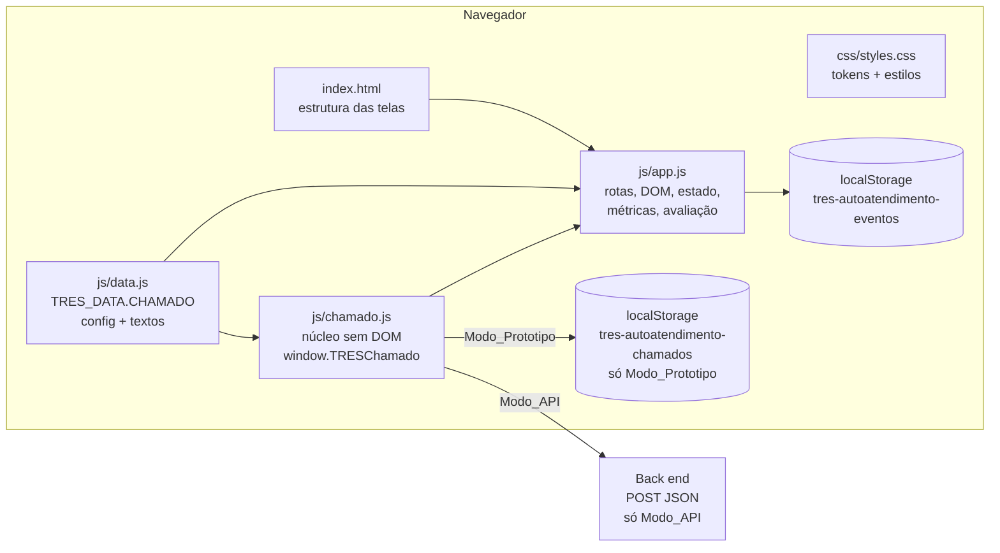
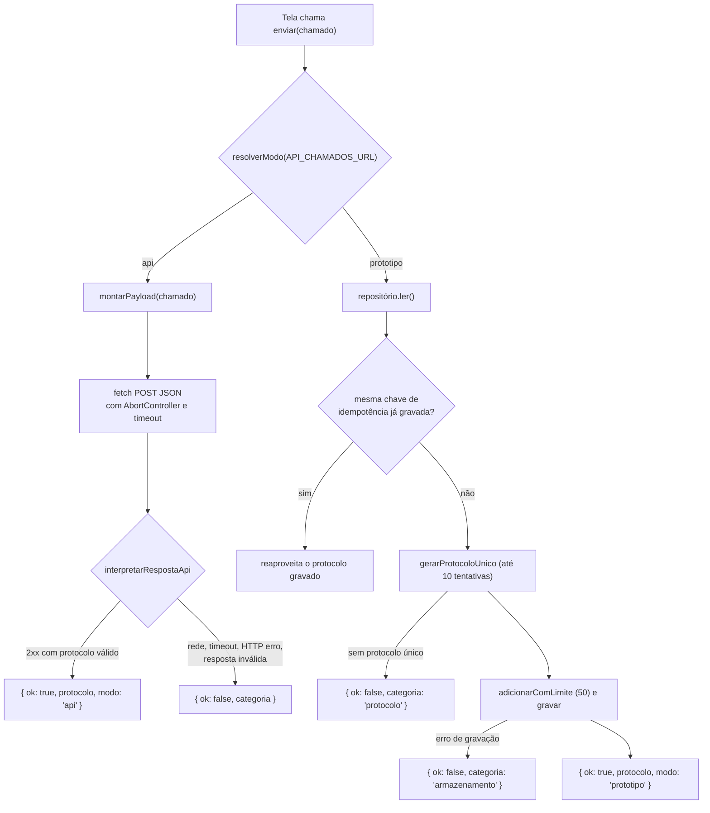
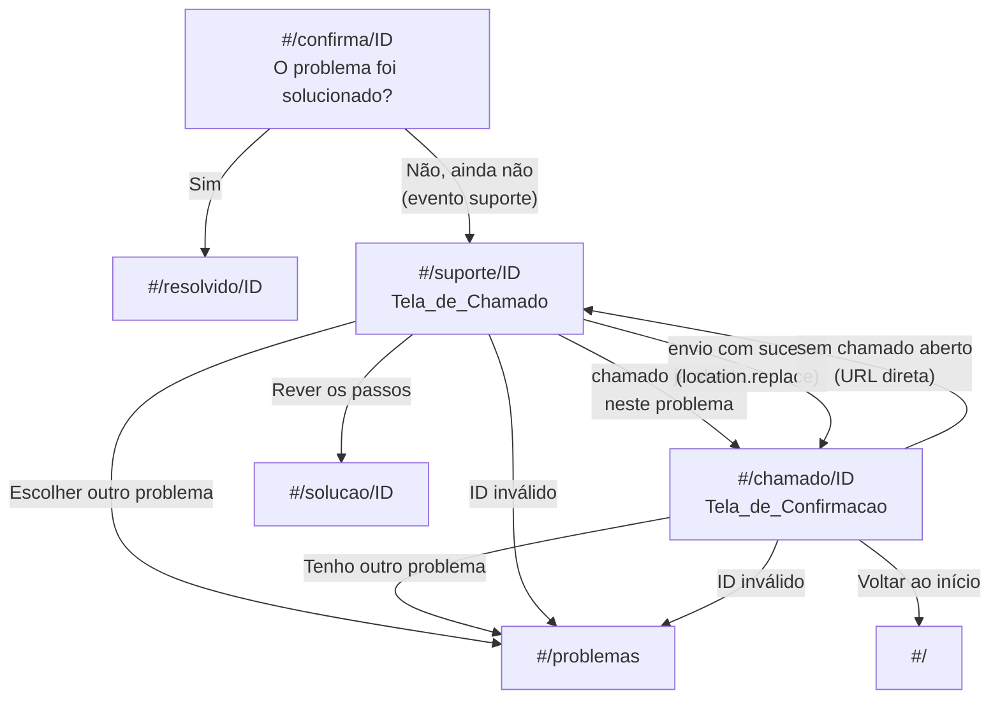
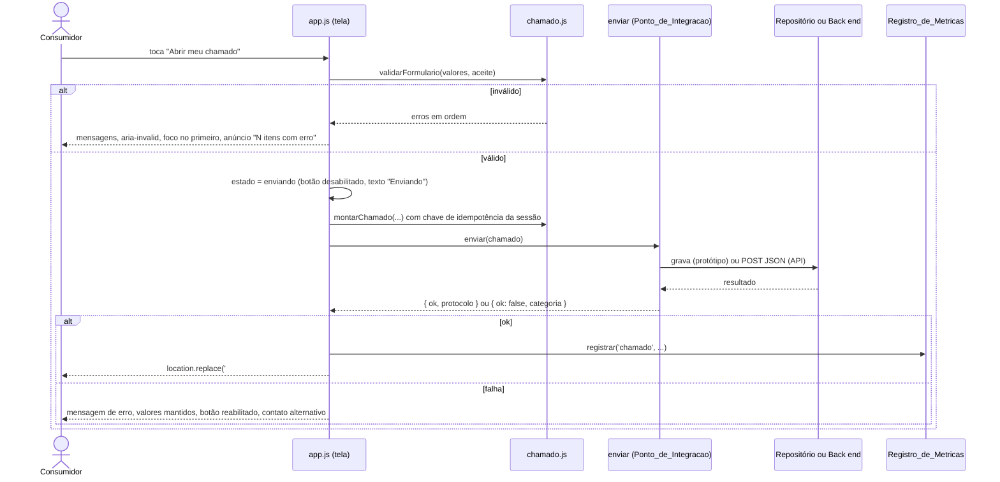
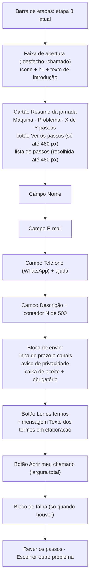
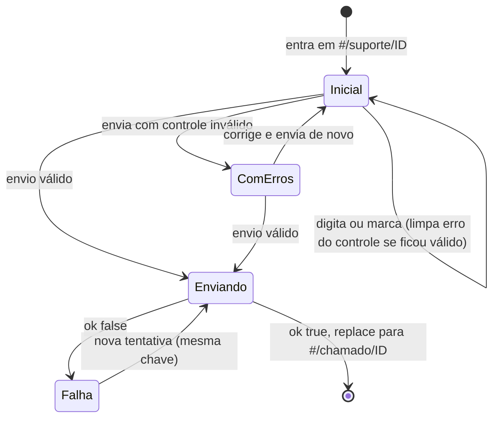
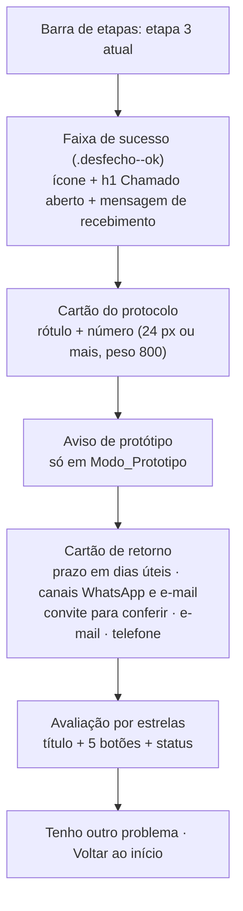

# Design Document: Tela de abertura de chamado (ticket-opening-screen)

## Overview

Hoje o desfecho "Não, ainda não" leva à rota `#/suporte/ID`, que mostra telefone, horários e e-mail. Esta funcionalidade troca esse desfecho por uma **Tela_de_Chamado**: o consumidor vê o resumo do que já percorreu, informa nome, e-mail, telefone (usado como WhatsApp) e uma descrição, aceita os termos e abre o chamado. Depois do envio, uma **Tela_de_Confirmacao** mostra o protocolo, o prazo de retorno (2 dias úteis, ilustrativo), os canais (WhatsApp e e-mail) e a avaliação por estrelas.

O design segue o que a página já faz: HTML, CSS e JS puros, sem build, mobile primeiro, rotas por hash, textos em `js/data.js`, cores em variáveis no começo de `css/styles.css`, cartões e botões arredondados, foco movido para o `h1` a cada tela e `aria-live` nos avisos.

Decisões principais:

1. **Núcleo sem DOM em arquivo novo (`js/chamado.js`).** Validação, normalização, protocolo, chave de idempotência, payload, repositório, camada de envio e resumo de métricas ficam em funções que não tocam no DOM e recebem como parâmetro o que é "mundo externo" (`fetch`, `localStorage`, relógio e sorteio). Isso permite testar por propriedades em Node, sem build e sem dependências no site.
2. **Camada de envio com dois modos.** `API_CHAMADOS_URL` vazia (padrão) liga o **Modo_Prototipo**; uma URL válida liga o **Modo_API**. A tela não sabe qual está ativo; ela chama uma única função `enviar(chamado)` e recebe `{ ok, protocolo }` ou `{ ok: false, categoria }`.
3. **Confirmação em rota própria, `#/chamado/ID`.** O sucesso do envio faz `location.replace`, o que reaproveita foco no `h1`, barra de etapas e roteamento, e evita que o botão voltar mostre um formulário já enviado. A justificativa completa está em "Fluxo e rotas".
4. **Estado em memória por problema.** Passos vistos, valores do formulário, chave de idempotência e chamado aberto ficam em `state` e são zerados quando o consumidor passa a outro problema (requisitos 3 e 8.15).
5. **Estilo trocável.** Os componentes novos só usam variáveis CSS semânticas, que apontam para as variáveis de marca atuais. Trocar o visual depois (Figma) significa trocar valores no `:root`.

## Architecture

### Visão geral



Ordem de carga em `index.html`: `js/data.js`, `js/chamado.js`, `js/app.js`. Os três continuam scripts clássicos (sem `type="module"`), como hoje.

### Separação de responsabilidades

| Camada | Arquivo | Conhece o DOM? | Faz E/S? | Como é testada |
|---|---|---|---|---|
| Conteúdo e configuração | `js/data.js` | não | não | validação de presença (`textosValidos`) |
| Núcleo puro | `js/chamado.js` (funções puras) | não | não | propriedades com fast-check em Node |
| Núcleo com portas | `js/chamado.js` (`criarPontoDeIntegracao`, `criarRepositorio`) | não | sim, por parâmetros injetados | propriedades com `fetch`/`storage` falsos |
| Interface e estado | `js/app.js` | sim | `localStorage` (métricas) | testes manuais e Edge headless |

O módulo `chamado.js` se anexa a `window.TRESChamado` no navegador e a `module.exports` em Node:

```js
(function (raiz, fabrica) {
  var api = fabrica();
  if (typeof module === 'object' && module.exports) module.exports = api;
  else raiz.TRESChamado = api;
})(typeof window !== 'undefined' ? window : globalThis, function () { 'use strict'; /* ... */ return { /* API */ }; });
```

### Camada de envio (Ponto_de_Integracao)



A função devolve sempre uma `Promise` que **resolve** (nunca rejeita) com o resultado. Quem chama não precisa de `try/catch` para falhas esperadas, e nenhuma exceção carrega dados pessoais para o console.

## Fluxo e rotas

### Rotas

| Rota | View (`#view-…`) | Mudança |
|---|---|---|
| `#/` | `modelo` | nenhuma |
| `#/problemas` | `problema` | nenhuma |
| `#/solucao/ID` | `solucao` | passa a registrar o passo exibido |
| `#/confirma/ID` | `confirma` | nenhuma ("Não, ainda não" continua gravando o evento `suporte`) |
| `#/resolvido/ID` | `resolvido` | nenhuma |
| `#/suporte/ID` | `suporte` | **conteúdo novo: Tela_de_Chamado** |
| `#/chamado/ID` | `chamado` | **rota nova: Tela_de_Confirmacao** |
| `#/contato` | `contato` | nenhuma |

### Por que `#/chamado/ID` e não um estado dentro de `#/suporte/ID`

- O roteador atual liga cada rota a uma view e, a cada troca, move o foco para o `h1`, atualiza a barra de etapas e rola ao topo. Uma view nova herda esse comportamento e cumpre os requisitos 8.12 e 11.9 sem código especial.
- Com uma rota própria, o botão voltar não devolve um formulário já enviado, e a confirmação pode ser aberta com `location.replace`, sem deixar a tela do formulário no histórico.
- Uma guarda simples cobre os casos de borda: `#/suporte/ID` com chamado já aberto vai para a confirmação (requisito 8.14) e `#/chamado/ID` sem chamado aberto volta ao formulário.
- O custo é uma rota a mais no roteador. Um estado dentro da rota evitaria isso, mas exigiria tratar foco, `aria-live` e etapas à mão.

### Mapa de navegação



### Guardas em `aoMudarRota`

```js
// depois de validar que o ID existe em D.PROBLEMAS (senão: ir('#/problemas'))
garantirSessao(p.id);                       // zera estado de chamado se o problema mudou
if (view === 'suporte' && state.sessao.aberto) { location.replace('#/chamado/' + p.id); return; }
if (view === 'chamado' && !state.sessao.aberto) { location.replace('#/suporte/' + p.id); return; }
```

Efeito no histórico: depois de enviar, `#/suporte/6` é substituída por `#/chamado/6`. O botão voltar leva a `#/confirma/6`. Se o consumidor tocar "Não, ainda não" de novo, grava-se mais um evento `suporte` (comportamento atual do botão) e a guarda mostra a confirmação existente, sem criar outro chamado.

Consequência assumida: para abrir um **segundo** chamado para o **mesmo** problema na mesma visita, é preciso passar por outro problema ou recarregar a página. Isso decorre dos requisitos 8.14 e 8.15 e está listado em "Decisões e pontos em aberto".

### Sequência do envio



## Mudanças por arquivo

### `index.html`

- Incluir `<script src="js/chamado.js"></script>` entre `data.js` e `app.js`.
- Incluir, dentro de `<main>` e fora de qualquer `.view`, uma única região de anúncios: `<div id="anuncio" class="sr-only" role="status" aria-live="polite"></div>`. Ela fica fora das views porque uma região que aparece junto com a view nem sempre é anunciada.
- Substituir o conteúdo de `#view-suporte` (cartão de contato, "o que ter em mãos", avaliação, botões) pela Tela_de_Chamado (esqueleto abaixo). Ids que deixam de existir: `cartao-contato`, `lista-em-maos`, `estrelas-suporte`, `status-aval-suporte`, `btn-rever-suporte`.
- Incluir `#view-chamado` (Tela_de_Confirmacao) depois de `#view-suporte`.
- Nenhum texto novo é escrito no HTML. Os elementos têm `data-texto="chave"` e o `app.js` preenche a partir de `TRES_DATA.CHAMADO.textos`.
- Cabeçalho, barra de etapas, rodapé e as demais views ficam como estão.

Esqueleto da Tela_de_Chamado (sem texto; ids e classes seguem o padrão atual):

```html
<section id="view-suporte" class="view" hidden aria-labelledby="titulo-suporte">
  <div class="desfecho desfecho--chamado">
    <p class="desfecho__icone" aria-hidden="true">📝</p>
    <h1 id="titulo-suporte" tabindex="-1" data-texto="tituloChamado"></h1>
    <p data-texto="introChamado"></p>
  </div>

  <section class="cartao resumo resumo--recolhido" id="resumo-jornada" aria-labelledby="titulo-resumo">
    <h2 id="titulo-resumo" data-texto="resumoTitulo"></h2>
    <dl class="resumo__dados">
      <div><dt data-texto="resumoRotuloModelo"></dt><dd id="resumo-modelo"></dd></div>
      <div><dt data-texto="resumoRotuloProblema"></dt><dd id="resumo-problema"></dd></div>
      <div><dt data-texto="resumoRotuloPassos"></dt><dd id="resumo-contagem"></dd></div>
    </dl>
    <button type="button" class="link-btn resumo__toggle" id="resumo-toggle"
            aria-expanded="false" aria-controls="resumo-passos"></button>
    <div id="resumo-passos" class="resumo__passos">
      <p class="resumo__legenda" data-texto="resumoLegendaPassos"></p>
      <ol class="lista-simples" id="resumo-lista"></ol>
      <p id="resumo-vazio" hidden data-texto="resumoSemPassos"></p>
    </div>
  </section>

  <form id="form-chamado" class="form" novalidate aria-labelledby="titulo-form">
    <h2 id="titulo-form" class="sr-only" data-texto="formTitulo"></h2>

    <div class="campo" data-campo="nome">
      <label for="c-nome" class="campo__rotulo"><span data-texto="rotuloNome"></span> <span class="campo__obrig" data-texto="obrigatorio"></span></label>
      <input id="c-nome" name="nome" type="text" required maxlength="100" autocomplete="name" autocapitalize="words">
      <p class="campo__erro" id="c-nome-erro" hidden></p>
    </div>
    <div class="campo" data-campo="email">
      <label for="c-email" class="campo__rotulo">…</label>
      <input id="c-email" name="email" type="email" required maxlength="254" autocomplete="email" autocapitalize="none" spellcheck="false">
      <p class="campo__erro" id="c-email-erro" hidden></p>
    </div>
    <div class="campo" data-campo="telefone">
      <label for="c-telefone" class="campo__rotulo">…</label>
      <input id="c-telefone" name="telefone" type="tel" inputmode="tel" required maxlength="20" autocomplete="tel" aria-describedby="c-telefone-ajuda">
      <p class="campo__ajuda" id="c-telefone-ajuda" data-texto="ajudaTelefone"></p>
      <p class="campo__erro" id="c-telefone-erro" hidden></p>
    </div>
    <div class="campo" data-campo="descricao">
      <label for="c-descricao" class="campo__rotulo">…</label>
      <textarea id="c-descricao" name="descricao" required maxlength="500" rows="5" aria-describedby="c-descricao-contador"></textarea>
      <p class="campo__ajuda" id="c-descricao-contador"></p>
      <p class="campo__erro" id="c-descricao-erro" hidden></p>
    </div>

    <div class="envio">
      <p class="envio__prazo" id="chamado-prazo-resumo"></p>
      <p class="envio__privacidade" id="aviso-privacidade"></p>
      <div class="aceite" data-campo="aceite">
        <label class="aceite__rotulo" for="c-aceite">
          <input id="c-aceite" name="aceite" type="checkbox" required>
          <span><span data-texto="rotuloAceite"></span> <span class="campo__obrig" data-texto="obrigatorio"></span></span>
        </label>
        <p class="campo__erro" id="c-aceite-erro" hidden></p>
      </div>
      <button type="button" class="link-btn" id="btn-ler-termos" data-texto="botaoLerTermos"></button>
      <p class="campo__ajuda" id="termos-msg" role="status" hidden></p>
      <button type="submit" class="btn btn--grande" id="btn-abrir-chamado" data-texto="botaoAbrirChamado"></button>
    </div>
  </form>

  <div id="chamado-falha-area"></div> <!-- bloco de falha é criado só quando necessário -->

  <div class="passo-acoes">
    <button type="button" class="btn btn--sec" id="btn-rever-chamado" data-texto="botaoRever"></button>
    <a class="btn btn--sec" href="#/problemas" data-texto="botaoEscolherOutro"></a>
  </div>
</section>
```

Esqueleto da Tela_de_Confirmacao:

```html
<section id="view-chamado" class="view" hidden aria-labelledby="titulo-chamado">
  <div class="desfecho desfecho--ok">
    <p class="desfecho__icone" aria-hidden="true">✅</p>
    <h1 id="titulo-chamado" tabindex="-1" data-texto="tituloConfirmacao"></h1>
    <p data-texto="confirmacaoRecebido"></p>
  </div>

  <div class="cartao protocolo">
    <p class="protocolo__rotulo" data-texto="protocoloRotulo"></p>
    <p class="protocolo__numero" id="chamado-protocolo"></p>
  </div>

  <p class="aviso aviso--prototipo" id="chamado-aviso-prototipo" hidden></p>

  <div class="cartao retorno">
    <p id="chamado-prazo"></p>
    <p id="chamado-canais"></p>
    <p data-texto="confirmacaoConferir"></p>
    <dl class="dados-contato">
      <div><dt data-texto="rotuloEmailConfirmacao"></dt><dd id="chamado-email"></dd></div>
      <div><dt data-texto="rotuloTelefoneConfirmacao"></dt><dd id="chamado-telefone"></dd></div>
    </dl>
  </div>

  <div class="avaliacao" role="group" aria-labelledby="titulo-aval-chamado">
    <h2 id="titulo-aval-chamado" class="secao-titulo" data-texto="avaliacaoTitulo"></h2>
    <div class="estrelas" id="estrelas-chamado"></div>
    <p class="status" id="status-aval-chamado" role="status" aria-live="polite"></p>
  </div>

  <div class="passo-acoes">
    <a class="btn btn--sec" href="#/problemas" data-texto="botaoOutroProblema"></a>
    <a class="btn" href="#/" data-texto="botaoVoltarInicio"></a>
  </div>
</section>
```

O aviso de protótipo fica logo abaixo do protocolo, para caber na mesma tela em 360 px e cumprir o requisito 8.10. Em Modo_API o elemento permanece `hidden` e vazio (nem visual nem para leitor de tela).

### `css/styles.css`

- No `:root`, **acrescentar** tokens semânticos (seção "Figma" abaixo). As variáveis de marca existentes não mudam de nome nem de valor.
- Acrescentar, ao final, os blocos novos: `.cartao`, `.resumo*`, `.form`, `.campo*`, `.aceite*`, `.envio*`, `.aviso*`, `.protocolo*`, `.retorno`, `.dados-contato`, `.msg-falha`, `.desfecho--chamado`.
- Não alterar regras existentes. A regra global de `prefers-reduced-motion` já zera transições e animações; os blocos novos não usam animação.

### `js/data.js`

- Novo objeto `CHAMADO` exportado em `window.TRES_DATA` (as chaves atuais ficam como estão). Estrutura em "Data Models".
- `CONTATO` continua sendo a fonte do telefone e do e-mail de alternativa em caso de falha.

### `js/chamado.js` (novo)

Núcleo sem DOM, descrito em "Components and Interfaces".

### `js/app.js`

| Ponto | Mudança |
|---|---|
| `state` | acrescentar `passos` e `sessao` (ver "Data Models") |
| `VIEWS`, `ETAPA_DA_VIEW` | acrescentar `chamado: 'chamado'` e `chamado: 3` |
| `aoMudarRota` | incluir `chamado` na lista de rotas com ID; guardas acima; `renderChamado()` para `suporte` e `renderConfirmacao()` para `chamado` |
| `renderSolucao` | chamar `garantirSessao(p.id)` e registrar o passo exibido com `TRESChamado.registrarPasso` |
| `iniciarSolucao` | trocar o listener de `#btn-rever-suporte` por `#btn-rever-chamado`; `#btn-nao` continua gravando `suporte` e indo a `#/suporte/ID` |
| `renderSuporte` | removida (substituída por `renderChamado`) |
| `renderChamado`, `iniciarFormulario`, `aoEnviar`, `renderConfirmacao`, `anunciar`, `aplicarTextos` | novas |
| `montarEstrelas(cont, status, desfecho)` | ganha um 4º parâmetro opcional `extras`, mesclado no evento `avaliacao`. Sem o parâmetro o comportamento é idêntico ao atual (tela de problema resolvido) |
| `TRESMetricas.resumo` | passa a delegar a `TRESChamado.resumirEventos` (mesmos quatro campos de antes, mais `chamadosAbertos`) |
| `renderContato` | mantida (rota `#/contato`); a falha de envio usa um bloco menor com telefone e e-mail de `CONTATO` |

## Components and Interfaces

### `js/chamado.js`: API do núcleo (`window.TRESChamado`)

Convenções: funções puras não leem relógio, sorteio, `localStorage` nem rede. Quando precisam, recebem uma "porta":

- `agora: () => Date`
- `sorteio: (max: number) => number`, inteiro de `0` a `max - 1`
- `storage: { getItem, setItem }` (como `localStorage`)
- `fetch`, `AbortController`, `setTimeout`, `clearTimeout`

Contagem de caracteres: o núcleo usa `String.length` (unidades UTF-16), o mesmo critério do atributo `maxlength` do navegador. Assim o limite do campo e a validação coincidem.

| Grupo | Função | Contrato |
|---|---|---|
| Constantes | `LIMITES` | `{ nome: {min:3,max:100}, email:{max:254}, telefone:{max:20}, descricao:{min:10,max:500}, protocolo:{max:64}, tentativasProtocolo:10, maxChamados:50 }` |
| Normalização | `normalizarNome(s)` | remove espaços das pontas e reduz sequências de espaço (`\s+`) a um espaço |
| | `normalizarEmail(s)` | remove espaços das pontas e converte para minúsculas |
| | `normalizarDescricao(s)` | remove espaços das pontas (quebras de linha internas são preservadas) |
| | `normalizarTelefone(s)` | devolve só dígitos; remove o prefixo `55` apenas se houver 12 ou 13 dígitos começando com `55` |
| Validação | `validarNome/Email/Telefone/Descricao(s)` | devolvem `null` (válido) ou um código: `'vazio'`, `'tamanho'`, `'formato'` |
| | `validarFormulario(v)` | `v = { nome, email, telefone, descricao, aceite }` → `{ valido, erros: [{campo, codigo}], normalizado }`; `erros` na ordem nome, email, telefone, descricao, aceite; o código do aceite é `'aceite'` |
| | `limitarDescricao(s)` | `s.slice(0, 500)` |
| Jornada | `registrarPasso(passos, problemaId, posicao, total)` | devolve novo `{ problemaId, posicoes }`; zera se o problema mudou; ignora posição repetida ou fora de `1..total` |
| | `montarResumo({ modeloNome, problema, posicoes })` | devolve `{ modelo, problemaTitulo, passos: [texto], vistos, total }`; usa `null` para "Não informado" |
| | `novaSessao(problemaId)` | `{ problemaId, valores vazios, aceite:false, chave:null, estado:'ocioso', aberto:null }` |
| | `garantirSessao(sessao, problemaId)` | devolve a mesma sessão se `sessao.problemaId === problemaId`; senão devolve `novaSessao(problemaId)` |
| Textos | `formatarContador(n)` | `"{n} de 500 caracteres"` com `n` = comprimento do texto |
| | `montarTextoCanais(modelo, telefone, email)` | substitui `{telefone}` e `{email}` por texto literal no modelo de `data.js` |
| | `politicaLink(url)` | devolve a URL aparada se for `http:` ou `https:` válida; senão `null` (sem link) |
| Identificadores | `gerarProtocolo(dataLocal, sorteio)` | `TRES-AAAAMMDD-XXXXXX` (alfabeto `A-Z0-9`) |
| | `gerarProtocoloUnico(existentes, dataLocal, sorteio)` | até 10 tentativas; devolve `null` se todas colidirem |
| | `ehProtocoloLocal(s)` | `true` se casa com `^TRES-\d{8}-[A-Z0-9]{6}$` e a data existe no calendário |
| | `uuidV4(bytes16)` e `gerarChaveIdempotencia(sorteio)` | UUID versão 4 em 36 caracteres |
| Chamado | `montarChamado(entrada)` | monta o objeto do chamado a partir do formulário normalizado, do resumo, da chave e do relógio |
| | `montarPayload(chamado)` | copia só os 14 campos do contrato, sem `protocolo` |
| | `serializar(x)` / `desserializar(t)` | `JSON.stringify` / `JSON.parse` |
| Prazo | `formatarPrazo(dias)` | `"2 dias úteis"`, `"1 dia útil"` ou `null` se não for inteiro de 1 a 30 |
| Modo | `resolverModo(url)` | `'api'` se a URL for `https:` ou `http:` com host `localhost`/`127.0.0.1`; senão `'prototipo'` |
| Repositório | `lerLista(texto)` | lista de chamados ou `[]` para qualquer entrada ilegível |
| | `adicionarComLimite(lista, chamado, max)` | acrescenta no fim e mantém os `max` mais recentes |
| | `criarRepositorio(storage, chave)` | `{ ler(), gravar(lista) }`; `gravar` lança em erro de armazenamento |
| Envio | `interpretarRespostaApi(status, corpo)` | `{ ok: true, protocolo }` ou `{ ok: false, categoria }` |
| | `criarPontoDeIntegracao(deps)` | devolve `enviar(chamado) → Promise<Resultado>` |
| Métricas | `resumirEventos(eventos)` | os quatro campos atuais mais `chamadosAbertos` |
| | `eventoChamado(c, protocolo, modo, passos)` e `eventoAvaliacao(...)` | objetos de evento só com campos permitidos |
| Conteúdo | `textosValidos(dadosChamado)` | `true` se todos os textos obrigatórios existem e não estão vazios |

### Resultado do envio

```js
// Resultado = { ok: true, protocolo: string, modo: 'prototipo' | 'api' }
//           | { ok: false, categoria: 'rede' | 'timeout' | 'http' | 'resposta-invalida'
//                                   | 'armazenamento' | 'protocolo', status?: number }
```

`status` existe só para `'http'` e é apenas o número. O corpo da resposta nunca é copiado para o resultado nem para o console.

### Camada de envio: comportamento em Modo_API

```js
function criarPontoDeIntegracao(deps) {
  // deps: { config, fetch, AbortController, setTimeout, clearTimeout, storage, agora, sorteio }
  return async function enviar(chamado) {
    if (resolverModo(deps.config.API_CHAMADOS_URL) === 'api') return enviarApi(chamado);
    return enviarPrototipo(chamado);
  };
}
```

`enviarApi`:

1. `payload = montarPayload(chamado)`.
2. Cria `AbortController` e `setTimeout(abort, TIMEOUT_ENVIO_MS)`.
3. `fetch(URL, { method: 'POST', headers: { 'Content-Type': 'application/json' }, body: serializar(payload), signal, credentials: 'omit', cache: 'no-store', referrerPolicy: 'no-referrer' })`.
4. `AbortError` → `'timeout'`; qualquer outro erro do `fetch` → `'rede'`.
5. Status fora de 200 a 299 → `{ ok:false, categoria:'http', status }`.
6. Status 2xx: tenta `resposta.json()`; falha → `'resposta-invalida'`. Aceita só `protocolo` string com 1 a 64 caracteres após `trim`; senão `'resposta-invalida'`.
7. Sempre chama `clearTimeout`. Não há retentativa automática.

Em ambientes sem `AbortController`, a mesma função usa `Promise.race` com um temporizador. O `fetch` seguiria em segundo plano, mas o resultado da corrida é `'timeout'`.

`enviarPrototipo`:

1. `lista = repo.ler()` (texto ilegível → `[]`).
2. Se algum item tiver a mesma `chaveIdempotencia`, devolve o protocolo dele (retentativa idempotente).
3. `protocolo = gerarProtocoloUnico(lista.map(c => c.protocolo), agora(), sorteio)`; `null` → `'protocolo'`.
4. `repo.gravar(adicionarComLimite(lista, { ...chamado, protocolo, modoEnvio: 'prototipo' }, 50))`; exceção → `'armazenamento'`, sem alterar o que já estava gravado.
5. Sucesso só depois de `gravar` retornar.

### Funções de `app.js` (DOM)

| Função | Responsabilidade |
|---|---|
| `aplicarTextos(raiz)` | preenche `[data-texto]` com `D.CHAMADO.textos[chave]` via `textContent` |
| `garantirSessao(problemaId)` | atribui `state.sessao = TRESChamado.garantirSessao(state.sessao, problemaId)` |
| `renderChamado()` | resumo da jornada, valores guardados na sessão, contador, aviso de privacidade, linha de prazo e canais; se `!textosValidos(...)`, mostra a mensagem de conteúdo indisponível e desabilita o envio |
| `iniciarFormulario()` | liga `input`, `blur`, `change`, `submit` e os botões, uma única vez |
| `validarCampo(campo)` / `mostrarErro(campo, codigo)` / `limparErro(campo)` | gerenciam mensagem, `aria-invalid` e `aria-describedby` |
| `aoEnviar(ev)` | fluxo da sequência acima |
| `mostrarFalha(categoria)` | cria o bloco `role="alert"` com mensagem, telefone e e-mail de `CONTATO`, e move o foco para ele |
| `renderConfirmacao()` | lê `state.sessao.aberto`, preenche protocolo, prazo, canais, dados de contato, aviso de protótipo (só em `'prototipo'`) e monta as estrelas |
| `anunciar(texto)` | limpa e preenche `#anuncio` (força novo anúncio) |

`aoEnviar` marca `estado = 'enviando'` **antes** do primeiro `await`, o que torna segundo toque, Enter repetido e duplo clique inofensivos (requisito 7.13).

## Data Models

### Configuração e textos em `TRES_DATA.CHAMADO`

```js
const CHAMADO = {
  config: {
    // Vazia = Modo_Prototipo. PENDENTE: URL por ambiente, definida com o time de back end.
    API_CHAMADOS_URL: '',
    // ILUSTRATIVO / PENDENTE (back end): tempo limite do envio, em milissegundos.
    TIMEOUT_ENVIO_MS: 10000,
    // ILUSTRATIVO / PENDENTE de validação do Customer Success: prazo de retorno em dias úteis.
    PRAZO_RETORNO_DIAS_UTEIS: 2,
    PRAZO_RETORNO_VALIDADO: false,
    VERSAO_CONTRATO: '1'
  },
  privacidade: {
    controlador: 'PENDENTE',
    contato: 'PENDENTE',
    politicaUrl: ''          // PENDENTE: sem URL, o link não aparece
  },
  textos: {
    tituloChamado: 'Seu chamado será aberto. Falta pouco.',
    introChamado: 'Você já fez a sua parte. O time responsável vai receber o seu chamado e analisar o problema. Preencha os dados abaixo para a gente poder te responder.',
    // resumo, rótulos, ajuda do telefone, erros por campo e código, aviso de privacidade,
    // rótulo do aceite, "Ler os termos", "Texto dos termos em elaboração", prazo, canais,
    // falha, aviso de protótipo, confirmação, avaliação e botões
  }
};
```

Os limites numéricos (3 a 100, 10 a 500 etc.) ficam em `TRESChamado.LIMITES`, porque são regra dos requisitos. Os textos de erro usam `{min}` e `{max}` e o `app.js` os preenche a partir de `LIMITES`.

Textos de referência (o conjunto completo vai para `data.js` na implementação):

| Chave | Texto |
|---|---|
| `rotuloNome` / `rotuloEmail` / `rotuloTelefone` / `rotuloDescricao` | "Nome", "E-mail", "Telefone (WhatsApp)", "O que está acontecendo com a máquina" |
| `obrigatorio` | "obrigatório" |
| `ajudaTelefone` | "Informe com DDD. Vamos usar este número para falar com você pelo WhatsApp." |
| `contadorDescricao` | "{n} de 500 caracteres" |
| `rotuloAceite` | "Li e concordo com os termos para envio dos meus dados" |
| `botaoLerTermos` / `termosEmElaboracao` | "Ler os termos" / "Texto dos termos em elaboração" |
| `erroAceite` | "Para enviar, marque que você leu e concorda com os termos." |
| `erroVazio` | "Preencha este campo." |
| `erroNome` / `erroDescricao` | "O nome deve ter de {min} a {max} caracteres, com ao menos uma letra." / "A descrição deve ter de {min} a {max} caracteres." |
| `erroEmail` / `erroTelefone` | "Informe um e-mail válido, como nome@exemplo.com." / "Informe um telefone com DDD, com 10 ou 11 números." |
| `anuncioErros` | "Não foi possível enviar. {n} itens precisam de correção." (singular: "1 item precisa de correção.") |
| `privacidade` | "Usamos seu nome, e-mail, telefone e a descrição só para abrir, analisar e responder ao chamado. O resumo da jornada que você percorreu vai junto. Controlador dos dados: {controlador}. Contato para seus direitos de titular: {contato}." |
| `prazoFrase` | "O prazo de retorno é de até {prazo}." |
| `canaisFormulario` | "Vamos falar com você por WhatsApp e por e-mail." |
| `canaisConfirmacao` | "Vamos falar com você pelo WhatsApp, no número {telefone}, e por e-mail, em {email}." |
| `falha` | "Não conseguimos abrir o chamado agora. Seus dados continuam preenchidos. Tente de novo em instantes." |
| `falhaAlternativa` | "Se preferir, fale com a gente: {telefone} ou {email}." |
| `avisoPrototipo` | "Este é um protótipo. O chamado foi simulado e não foi enviado a um sistema de atendimento. O prazo informado é ilustrativo." |
| `tituloConfirmacao` | "Chamado aberto" |
| `confirmacaoRecebido` | "O time responsável recebeu o seu chamado e vai analisar o problema." |
| `avaliacaoTitulo` | "Como foi a ajuda até aqui?" |

Se `PRAZO_RETORNO_DIAS_UTEIS` não for inteiro de 1 a 30, `formatarPrazo` devolve `null` e a frase de prazo é omitida nas duas telas; a frase de canais continua (requisito 8.9).

O prazo mostra apenas "N dias úteis". Não há cálculo de data limite, porque feriados e calendário do time não são conhecidos.

### Estado da jornada em memória (`app.js`)

```js
state = {
  // existentes: modelo, problemaId, passoIdx, filtro, busca, primeiraRota
  passos: { problemaId: null, posicoes: [] },   // posições 1..total, sem repetição, na ordem de exibição
  sessao: {
    problemaId: null,
    valores: { nome: '', email: '', telefone: '', descricao: '' },   // exatamente o que foi digitado
    aceite: false,
    chave: null,              // Chave_de_Idempotencia, criada no 1º envio válido e mantida até o sucesso
    estado: 'ocioso',         // 'ocioso' | 'enviando'
    aberto: null              // { problemaId, protocolo, email, telefone, modo } depois do sucesso
  }
};
```

Detalhes:

- `passos.posicoes` só cresce em ordem crescente, porque o consumidor navega passo a passo a partir do primeiro. Isso mantém a ordem "percorrida" (requisito 7.2) igual à ordem da solução (requisito 2.5).
- `aberto` guarda o e-mail e o telefone já normalizados, para a confirmação exibir "exatamente como armazenados" (requisito 8.6). Telefone é exibido como dígitos; formatar com máscara exigiria mudar esse requisito.
- Dados pessoais vivem em `state.sessao` (memória). Recarregar a página os descarta (premissa P7).
- `chave` é reutilizada em toda retentativa e só nasce de novo em uma nova sessão (problema diferente).

### Chamado

O Chamado tem os mesmos 14 campos do payload. Depois do sucesso ganha `protocolo` e `modoEnvio`.

```js
{
  versaoContrato: '1',
  chaveIdempotencia: '3f2b8c1e-6d4a-4f0e-9b7a-2c5d8e1a4b90',
  abertoEm: '2026-10-13T14:32:10.123-03:00',
  nome: 'Maria da Silva',
  email: 'maria@exemplo.com',
  telefone: '11987654321',
  descricao: 'A luz vermelha continua piscando depois de encher o tanque.',
  aceiteTermos: true,
  aceiteEm: '2026-10-13T14:32:10.123-03:00',
  modelo: 'touch',                         // ou null quando não informado
  problemaId: 3,
  problemaTitulo: 'Alerta vermelho piscando',
  passosPercorridos: [
    { posicao: 1, texto: 'O reservatório tem água?' },
    { posicao: 2, texto: 'Se não tiver, encha até o nível máximo e aperte a tecla azul.' }
  ],
  totalPassos: 3
  // depois do sucesso, só no Repositorio_de_Chamados: protocolo, modoEnvio
}
```

Regras:

- `abertoEm` e `aceiteEm` usam o mesmo `Date` tomado no início de cada envio válido (inclusive em retentativas), em ISO 8601 com o deslocamento de fuso do dispositivo (por exemplo `-03:00`), não em UTC `Z`, para manter "data, hora e fuso horário" legíveis.
- `descricao` é gravada com `trim` (decisão deste design; o requisito 7.3 não cita a Descricao, mas o 10.4 exige a normalização idempotente dela).
- Os textos dos passos vêm de `D.PROBLEMAS[...].passos[i].texto`, sem alteração.

### Payload_do_Chamado (contrato com o back end)

O payload é o Chamado **sem** `protocolo` e `modoEnvio`. É exatamente o objeto acima, com os campos:

| Campo | Tipo | Observação |
|---|---|---|
| `versaoContrato` | string | `"1"` |
| `chaveIdempotencia` | string | UUID v4 |
| `abertoEm`, `aceiteEm` | string | ISO 8601 com fuso |
| `nome`, `email`, `telefone`, `descricao` | string | normalizados; `telefone` só dígitos, sem DDI |
| `aceiteTermos` | boolean | sempre `true` |
| `modelo` | string ou null | id do modelo (`lov`, `modo`, `passione`, `luna`, `touch`) |
| `problemaId` | integer | 1 a 13 |
| `problemaTitulo` | string | texto de `js/data.js` |
| `passosPercorridos` | array | `{ posicao: integer, texto: string }` |
| `totalPassos` | integer | maior ou igual a 1 |

Requisição:

```http
POST {API_CHAMADOS_URL}
Content-Type: application/json

{ ...payload... }
```

Resposta de sucesso esperada (status 200 a 299):

```json
{ "protocolo": "string de 1 a 64 caracteres" }
```

O cliente ignora qualquer outro campo da resposta. O contrato não cita tabelas, ids de banco nem nomes de colunas, então o esquema do banco pode ser definido depois sem mudar o cliente. Os pontos a alinhar com o time de back end (autenticação, CORS, códigos de erro, comportamento diante de chave repetida, cabeçalho de idempotência, formato E.164, restrição a celular) estão na premissa P9 dos requisitos e em "Decisões e pontos em aberto".

### Eventos no Registro_de_Metricas

| Tipo | Campos | Quando |
|---|---|---|
| `suporte` (existente) | `tipo`, `em`, `problema`, `modelo` | toque em "Não, ainda não" (inalterado) |
| `chamado` (novo) | `tipo`, `em`, `problema`, `modelo`, `protocolo`, `modo` (`prototipo` ou `api`), `passos` (inteiro ≥ 0) | envio com sucesso |
| `avaliacao` (existente, novo `desfecho`) | `tipo`, `em`, `nota`, `desfecho` (`resolvido` ou `chamado`), `problema`, `modelo`, e `protocolo` quando `desfecho` é `chamado` | toque em uma estrela |

`resumirEventos` mantém `resolvidos`, `encaminhadosAoSuporte`, `deflexaoPercentual` e `porProblema` exatamente como hoje e soma `chamadosAbertos`. Eventos `chamado` e `avaliacao` não entram nesses quatro valores. Nenhum evento recebe nome, e-mail, telefone ou descrição. O protocolo não é dado pessoal.

### Repositorio_de_Chamados (Modo_Prototipo)

- Chave `tres-autoatendimento-chamados`, valor: JSON de uma lista de Chamados com `protocolo` e `modoEnvio`.
- No máximo 50 itens; ao passar disso, sai o mais antigo.
- Leitura tolerante: texto vazio, JSON inválido ou JSON que não seja lista vira `[]`. Itens que não sejam objetos são descartados.
- Em Modo_API este repositório **não é usado** (requisito 7.17): os dados pessoais seguem apenas no corpo da requisição.

## Layout das telas (mobile primeiro)

Largura de referência: 360 px. Os estilos reaproveitam `.container`, `.desfecho`, `.btn`, `.link-btn`, `.estrelas`, `.status` e `.passo-acoes`.

### Tela_de_Chamado (`#/suporte/ID`)



Pontos de layout:

- Uma coluna em qualquer largura. Campos com `width: 100%`, `min-height: 52px` (igual ao campo de busca atual), `font-size: 1rem` (16 px, evita zoom automático no iOS).
- Textarea com `min-height: 140px`, redimensionável só na vertical.
- Linha do aceite: o `label` inteiro é o alvo de toque (mínimo 44 px de altura), com a caixa de seleção de 24 px.
- O botão "Abrir meu chamado" usa `.btn.btn--grande` (56 px). Os botões finais usam `.passo-acoes`, como na tela antiga.
- Em 640 px ou mais o conteúdo continua em uma coluna com `max-width: 640px` para o formulário, centralizado dentro do `.container`. O resumo exibe a lista sempre expandida.

### Resumo da jornada: recolher e expandir

- Marcação: classe `resumo--recolhido` no cartão ao renderizar. O botão `#resumo-toggle` alterna a classe e `aria-expanded`.
- CSS: `@media (max-width: 480px) { .resumo--recolhido .resumo__passos { display: none; } }`. Acima de 480 px, a lista aparece sempre e `.resumo__toggle { display: none; }`, o que também o tira da árvore de acessibilidade.
- O botão tem `min-height: 44px` e largura mínima de 44 px.
- Texto do botão: "Ver os passos" quando recolhido e "Ocultar os passos" quando expandido (ambos em `data.js`).
- Sem passos vistos, aparece "Nenhum passo registrado nesta visita" e o contador mostra "0 de Y passos".

### Estados da Tela_de_Chamado



| Estado | O que a pessoa vê | O que o código faz |
|---|---|---|
| Inicial | formulário limpo (ou com os valores da sessão) | nada aparece em vermelho |
| ComErros | mensagem sob cada controle inválido, borda de erro | `aria-invalid="true"`, `aria-describedby`, foco no primeiro, anúncio da contagem |
| Enviando ("carregando") | botão desabilitado com o texto "Enviando" | `estado = 'enviando'`, `aria-busy="true"` no formulário, anúncio "Enviando" |
| Falha | bloco de aviso com a mensagem e o contato alternativo | foco no bloco `role="alert"`, valores mantidos, botão habilitado |
| Conteúdo indisponível | mensagem curta no lugar do formulário | envio desabilitado (requisito 12.6) |

### Tela_de_Confirmacao (`#/chamado/ID`)



| Estado | Comportamento |
|---|---|
| Modo_Prototipo | aviso visível logo abaixo do protocolo; prazo "ilustrativo" dito no aviso |
| Modo_API | aviso ausente (elemento `hidden` e vazio); protocolo vindo do back end |
| Prazo inválido na configuração | frase de prazo omitida; canais mantidos |
| Estrelas não tocadas | botões neutros; nada é gravado |
| Estrela tocada | evento `avaliacao` (`desfecho: 'chamado'`, com `protocolo`) e texto "Obrigado pela sua avaliação!" no `role="status"` |
| Sem chamado aberto (URL direta) | a guarda redireciona para `#/suporte/ID` |

O protocolo usa `font-size: clamp(1.5rem, 6vw, 2rem)`. Em 360 px resulta em 24 px (mínimo do requisito 8.4), `font-weight: 800` e `overflow-wrap: anywhere` como proteção para protocolos longos vindos do back end (até 64 caracteres).

## Acessibilidade

Segue o padrão atual (foco no `h1`, `aria-live`, alvos de 44 px ou mais, `prefers-reduced-motion`).

| Tema | Decisão | Requisitos |
|---|---|---|
| Foco ao entrar nas telas | `mostrarView` já foca o `h1` com `tabindex="-1"` em toda troca de rota, o que cobre `suporte` e `chamado` | 1.6, 8.12 |
| Rótulos | `label for`/`id` em todos os campos; "obrigatório" dentro do `label`; `required` nativo (com `novalidate` no formulário para usar a validação própria) | 4.2, 4.3 |
| Erros por controle | `<p class="campo__erro" id="…-erro">` logo abaixo do controle; ao mostrar: `aria-invalid="true"` e `aria-describedby` com o id do erro (mais o id da ajuda, no telefone e na descrição); ao limpar, os dois atributos saem | 5.7, 5.10, 5.12, 5.16, 5.17 |
| Primeiro erro | `focus()` no primeiro controle inválido, na ordem nome, e-mail, telefone, descrição, aceite | 5.8 |
| Resumo de erros | `anunciar("N itens precisam de correção")` em até 1 s, na região `#anuncio` | 5.9, 11.11 |
| Estado "Enviando" | botão `disabled`, texto "Enviando", `aria-busy` no formulário, anúncio na região global | 7.13 |
| Sucesso | `#anuncio` recebe "Chamado aberto. Seu protocolo é …" e o foco vai ao `h1` da confirmação | 11.6, 8.12 |
| Falha de registro | bloco `role="alert"` com `tabindex="-1"`, focado; o anúncio também sai pela região global | 7.14, 11.11 |
| Caixa de aceite | `input type="checkbox"` nativo dentro do `label`; nome acessível igual ao texto visível; Espaço marca e desmarca | 4.4, 6.6, 11.14 |
| "Ler os termos" | `button type="button"`; ao acionar, preenche `#termos-msg` (`role="status"`) e mantém o foco no botão; sem navegação, aba nova ou diálogo | 6.7 a 6.10 |
| Contador | `aria-describedby` na descrição, sem `aria-live` (evita falar a cada tecla) | 4.9 |
| Resumo recolhível | `button` com `aria-expanded` e `aria-controls`; some da árvore acima de 480 px | 2.9, 2.11, 2.12 |
| Estrelas | mesmo componente de hoje: botões com `aria-label="N estrelas de 5"`, `aria-pressed`, 48 px, status em `role="status"` | 9.8, 9.9, 11.15 |
| Foco visível | regra global `:focus-visible` (3 px, azul `--azul`, contraste estimado de 6:1 sobre branco) vale para todos os controles novos; `overflow` nos cartões não pode cortar o contorno | 11.5 |
| Contraste | texto de erro em `--erro` (#b00020, cerca de 7:1 sobre branco e 6:1 sobre `--erro-fundo`); borda dos campos em `--campo-borda` (cerca de 5:1, acima dos 3:1 de componentes de interface); texto de ajuda em `--cafe-suave` (cerca de 8:1) | 11.8 |
| Movimento | nada anima; a regra global de `prefers-reduced-motion` continua valendo | 11.7 |
| Barra de etapas | `ETAPA_DA_VIEW.chamado = 3`; o item atual já tem `aria-current="step"` e número destacado (não só cor) | 11.9 |
| Entrada | `type="email"` e `type="tel"` com `inputmode="tel"`; `autocomplete` `name`, `email`, `tel`; sem `autocomplete` na descrição; `maxlength` 100, 254, 20 e 500 | 4.5 a 4.8 |

Os valores de contraste acima são estimativas calculadas a partir das cores hexadecimais e precisam ser conferidos com uma ferramenta na implementação. Nada disso foi testado com leitor de tela real.

## Correctness Properties

*A property is a characteristic or behavior that should hold true across all valid executions of a system-essentially, a formal statement about what the system should do. Properties serve as the bridge between human-readable specifications and machine-verifiable correctness guarantees.*

As propriedades valem para o **núcleo sem DOM** (`js/chamado.js`), onde há entradas variáveis e saídas verificáveis. Critérios sobre posição de elementos, estilo, foco, textos fixos e navegação são cobertos por testes de exemplo e testes de interface (ver "Testing Strategy").

**Reflexão sobre redundância.** A análise inicial (prework) foi consolidada assim:

- 10.1, 10.2 e 10.3 viram uma única propriedade de ida e volta do Chamado.
- 7.16 e 10.7 (leitura de repositório ilegível) viram uma propriedade só.
- 8.2 e 10.6 (formato do protocolo) viram uma propriedade só.
- 7.12 e 10.14 (chave de idempotência) viram uma propriedade só.
- 5.6, 5.8, 5.9, 5.14, 5.15 e 5.16 viram uma propriedade sobre `validarFormulario` (validade, ordem, contagem e imutabilidade da entrada).
- 4.10 e 5.13 (truncamento da descrição) entram junto com 5.5 e 4.9.
- 3.1 a 3.6 viram uma propriedade sobre `registrarPasso`; 2.2, 2.4, 2.5, 2.7 e 2.13 viram uma sobre `montarResumo`.
- 7.2, 7.3, 6.12, 10.10, 10.11 e 10.12 viram uma propriedade sobre o conteúdo do Chamado e do Payload.
- 9.2, 9.3, 9.9 e 6.13 viram uma propriedade sobre eventos de métrica.
- 5.1, 5.2 e 5.3/5.4 ficam separadas, porque cada uma tem um gerador e um oráculo próprios.

### Property 1: Normalização de texto é idempotente

*Para qualquer* texto de Nome, Email ou Descricao aceito pela validação, aplicar a normalização correspondente duas vezes produz exatamente o mesmo texto que aplicá-la uma vez.

**Validates: Requirements 10.4**

### Property 2: Telefone válido normaliza para 10 ou 11 dígitos

*Para qualquer* telefone válido (dígitos com os separadores permitidos, com ou sem o prefixo `55` e com ou sem `+` no início), `normalizarTelefone` devolve uma sequência de 10 ou 11 caracteres entre `0` e `9`, e aplicar `normalizarTelefone` ao resultado devolve o mesmo valor.

**Validates: Requirements 5.3, 7.3, 10.5**

### Property 3: Validação do telefone

*Para qualquer* número gerado com 10 ou 11 dígitos, DDD entre 11 e 99 e (com 11 dígitos) terceiro dígito 9, formatado com qualquer combinação de parênteses, espaços, hífens e pontos, `validarTelefone` aceita; *para qualquer* telefone com um caractere fora do conjunto permitido, com tamanho fora de 10 a 11 dígitos (após remover o prefixo `55` de 12 ou 13 dígitos), com DDD fora de 11 a 99 ou com 12 ou 13 dígitos sem o prefixo `55`, `validarTelefone` rejeita.

**Validates: Requirements 5.3, 5.4**

### Property 4: Validação do nome

*Para qualquer* texto, `validarNome` aceita se e somente se, após `trim` e redução de espaços, o texto tem de 3 a 100 caracteres e ao menos uma letra (incluindo acentuadas); e *para qualquer* nome aceito, acrescentar espaços no início, no fim ou duplicar espaços internos não muda o resultado da validação.

**Validates: Requirements 5.1**

### Property 5: Validação do e-mail

*Para qualquer* e-mail montado com parte local não vazia sem espaços e `@`, domínio de rótulos não vazios separados por ponto e terminação de 2 ou mais letras (em qualquer combinação de maiúsculas e minúsculas, até 254 caracteres), `validarEmail` aceita; *para qualquer* mutação que introduza um segundo `@`, um espaço, um ponto no início ou no fim do domínio, dois pontos seguidos, um domínio sem ponto, uma terminação com menos de 2 letras, uma parte local vazia ou mais de 254 caracteres, `validarEmail` rejeita.

**Validates: Requirements 5.2**

### Property 6: Descrição, contador e truncamento

*Para qualquer* texto, `validarDescricao` aceita se e somente se o texto, após `trim`, tem de 10 a 500 caracteres; `limitarDescricao` devolve um texto de no máximo 500 caracteres que é prefixo do texto original (e igual a ele quando já tinha até 500); e `formatarContador` para qualquer texto de até 500 caracteres contém exatamente o comprimento do texto no formato "N de 500 caracteres".

**Validates: Requirements 4.9, 4.10, 5.5, 5.13**

### Property 7: Validade do formulário, ordem e contagem dos erros

*Para qualquer* combinação de valores de Nome, Email, Telefone, Descricao e Aceite, `validarFormulario` devolve `valido: true` se e somente se os quatro campos são válidos e o aceite é `true`; quando devolve `valido: false`, a lista de erros tem de 1 a 5 itens, na ordem nome, email, telefone, descricao, aceite, e contém o item `aceite` sempre que o aceite é `false`; e a função não altera o objeto de entrada.

**Validates: Requirements 5.6, 5.8, 5.9, 5.14, 5.15, 5.16**

### Property 8: Passos percorridos

*Para qualquer* sequência de exibições `(problemaId, posição)` aplicada com `registrarPasso`, a lista de posições do estado final contém apenas posições de 1 até o total do problema, sem repetição e sem reordenar posições já registradas; seu tamanho nunca passa do total; mudar de `problemaId` descarta as posições do problema anterior antes de registrar a nova; e repetir o mesmo `problemaId` mantém as posições já registradas.

**Validates: Requirements 3.1, 3.2, 3.3, 3.4, 3.5, 3.6**

### Property 9: Resumo da jornada

*Para qualquer* modelo (ou ausência de modelo), problema (ou ausência de problema) e conjunto de posições vistas, `montarResumo` devolve o nome do modelo e o título do problema exatamente como em `js/data.js` (ou "Não informado" quando ausentes), a lista dos textos dos passos vistos na ordem da solução e sem alteração, e um par `X de Y` com `0 ≤ X ≤ Y`, em que `Y` é o total de passos do problema (0 sem problema).

**Validates: Requirements 2.2, 2.3, 2.4, 2.5, 2.6, 2.7, 2.13**

### Property 10: Formato do protocolo local

*Para qualquer* data local e qualquer fonte de sorteio, `gerarProtocolo` devolve um texto que casa com `TRES-AAAAMMDD-XXXXXX`, em que `AAAAMMDD` é a data local informada (data válida do calendário) e `XXXXXX` tem exatamente 6 caracteres entre `A-Z` e `0-9`; e `ehProtocoloLocal` aceita esse texto.

**Validates: Requirements 8.2, 10.6**

### Property 11: Protocolo local único

*Para qualquer* lista de protocolos existentes e qualquer fonte de sorteio, `gerarProtocoloUnico` devolve um protocolo que não está na lista, ou `null` depois de exatamente 10 tentativas que colidiram, sem nunca devolver um protocolo repetido.

**Validates: Requirements 8.3, 8.16**

### Property 12: Chave de idempotência

*Para qualquer* fonte de sorteio, `gerarChaveIdempotencia` devolve um texto de 36 caracteres no formato de UUID versão 4 (versão `4` e variante `8`, `9`, `a` ou `b`); e uma sequência de chaves geradas com sorteio aleatório na mesma execução não tem repetições.

**Validates: Requirements 7.12, 10.14**

### Property 13: Conteúdo do Chamado e do Payload

*Para qualquer* formulário válido, resumo da jornada, chave e instante, o Chamado montado tem `aceiteTermos` igual a `true`, `aceiteEm` e `abertoEm` em ISO 8601 com fuso, `nome`, `email` e `telefone` iguais às suas normalizações, `totalPassos` igual ao total do problema e `passosPercorridos` na ordem percorrida; e `montarPayload` devolve um objeto com exatamente os 14 campos do contrato, sem `protocolo`, sem `modoEnvio` e sem nenhum campo extra presente no Chamado.

**Validates: Requirements 6.12, 7.2, 7.3, 10.10, 10.11, 10.12**

### Property 14: Ida e volta do Chamado no repositório

*Para qualquer* Chamado válido, incluindo letras acentuadas, emojis, quebras de linha, aspas, barras invertidas e os caracteres `<`, `>` e `&`, gravar no Repositorio_de_Chamados e ler de volta devolve um Chamado com os mesmos campos e valores idênticos caractere a caractere.

**Validates: Requirements 10.1, 10.2, 10.3**

### Property 15: Ida e volta do Payload

*Para qualquer* Payload_do_Chamado válido, `desserializar(serializar(payload))` é igual ao payload original, campo a campo.

**Validates: Requirements 10.13**

### Property 16: Leitura tolerante do repositório

*Para qualquer* texto armazenado (JSON inválido, JSON que não é lista, lista com itens que não são objetos, texto vazio, ausência de valor), `lerLista` devolve uma lista, nunca lança exceção, e devolve a lista vazia quando o conteúdo não é uma lista de Chamados; e gravar um novo Chamado sobre esse conteúdo resulta em uma lista com esse Chamado como único item.

**Validates: Requirements 7.16, 10.7**

### Property 17: Limite de 50 chamados

*Para qualquer* lista de Chamados e qualquer novo Chamado, `adicionarComLimite(lista, novo, 50)` devolve no máximo 50 itens, contém o novo Chamado como último item e, quando a lista original já tinha 50 ou mais itens, descarta os mais antigos mantendo a ordem dos demais.

**Validates: Requirements 7.6**

### Property 18: Seleção do modo de envio

*Para qualquer* texto de URL, `resolverModo` devolve `'api'` se e somente se a URL é `https:` válida, ou `http:` com host `localhost` ou `127.0.0.1`; para qualquer outro valor (vazio, `undefined`, texto sem protocolo, `ftp:`, `javascript:`, `http:` em outro host) devolve `'prototipo'`; e com `'prototipo'` o `fetch` injetado nunca é chamado durante o envio.

**Validates: Requirements 7.4, 12.8**

### Property 19: Requisição em Modo_API

*Para qualquer* Chamado válido, em Modo_API o `enviar` faz exatamente uma chamada ao `fetch` com o método `POST`, o endereço `API_CHAMADOS_URL`, o cabeçalho `Content-Type: application/json` e um corpo cujo JSON, ao ser lido, é igual a `montarPayload(chamado)`.

**Validates: Requirements 7.8, 10.10**

### Property 20: Classificação da resposta da API

*Para qualquer* par `(status, corpo)` devolvido pelo back end, `enviar` devolve `ok: true` com o protocolo recebido (após `trim`) se e somente se o status está entre 200 e 299 e o corpo é um JSON com `protocolo` do tipo texto com 1 a 64 caracteres; em qualquer outro caso devolve `ok: false` com uma categoria entre `'http'` e `'resposta-invalida'`, sem repetir a requisição; falha de rede devolve `'rede'` e ausência de resposta no prazo devolve `'timeout'`; em todos os casos o repositório local não é tocado e o protocolo local não é gerado.

**Validates: Requirements 7.9, 7.10, 7.11, 7.17**

### Property 21: Envio em Modo_Prototipo é idempotente por chave

*Para qualquer* lista inicial de Chamados e qualquer Chamado válido, em Modo_Prototipo um envio bem-sucedido deixa gravado o Chamado com o protocolo devolvido e preserva os itens anteriores; enviar de novo o mesmo Chamado (mesma `chaveIdempotencia`) qualquer número de vezes devolve o mesmo protocolo e não acrescenta outro item; e a chave de métricas `tres-autoatendimento-eventos` não é alterada pelo envio.

**Validates: Requirements 7.5, 7.13, 12.7**

### Property 22: Falha de registro não deixa rastro

*Para qualquer* lista inicial de Chamados e qualquer falha de armazenamento (leitura que lança, gravação que lança, limite excedido) ou falha de geração de protocolo único, `enviar` devolve `ok: false` com a categoria correspondente (`'armazenamento'` ou `'protocolo'`), e o conteúdo armazenado fica idêntico ao que era antes.

**Validates: Requirements 7.14, 7.15, 8.16, 10.8**

### Property 23: Prazo de retorno

*Para qualquer* inteiro `N` de 1 a 30, `formatarPrazo(N)` devolve um texto que contém `N`, termina em "dias úteis" (ou é exatamente "1 dia útil" para `N = 1`) e não contém data; *para qualquer* valor que não seja inteiro de 1 a 30 (zero, negativo, 31 ou mais, fração, texto, `null`, `undefined`), devolve `null`, e a frase de prazo é omitida enquanto a frase de canais permanece.

**Validates: Requirements 8.7, 8.9**

### Property 24: Texto dos canais de retorno

*Para qualquer* e-mail e telefone armazenados no Chamado, o texto devolvido por `montarTextoCanais` para a confirmação contém o e-mail e o telefone literalmente, sem alterações, e menciona WhatsApp e e-mail.

**Validates: Requirements 8.8, 8.6**

### Property 25: Resumo de métricas preserva a deflexão

*Para qualquer* lista de eventos, `resumirEventos` devolve `resolvidos`, `encaminhadosAoSuporte`, `deflexaoPercentual` e `porProblema` iguais aos obtidos da mesma lista sem os eventos dos tipos `chamado` e `avaliacao`, e `chamadosAbertos` igual à quantidade de eventos do tipo `chamado` (0 se não houver nenhum).

**Validates: Requirements 9.5, 9.6**

### Property 26: Eventos de métrica sem dados pessoais

*Para qualquer* Chamado válido, protocolo, modo e nota de 1 a 5, o evento de `chamado` tem exatamente os campos `tipo`, `em`, `problema`, `modelo`, `protocolo`, `modo` e `passos` (inteiro maior ou igual a 0), o evento de `avaliacao` da confirmação tem `nota`, `desfecho: 'chamado'`, `problema`, `modelo`, `protocolo`, `tipo` e `em`, e nenhum dos dois contém, em campo algum, o nome, o e-mail, o telefone ou a descrição do Chamado.

**Validates: Requirements 6.13, 9.2, 9.3, 9.9**

### Property 27: Decisão do link da política de privacidade

*Para qualquer* texto configurado como URL da política, o aviso exibe o link se e somente se o texto é uma URL com protocolo `http:` ou `https:`; para texto ausente, vazio ou com outro protocolo, o aviso não exibe link.

**Validates: Requirements 6.5, 6.17**

### Property 28: Conteúdo indisponível

*Para qualquer* objeto de dados do chamado em que ao menos um dos textos obrigatórios (título, introdução, aviso de privacidade, rótulo do aceite, rótulo de "Ler os termos", texto "em elaboração", rótulos dos campos) está ausente ou vazio, `textosValidos` devolve `false`; para o objeto completo devolve `true`.

**Validates: Requirements 12.6**

### Property 29: Nova sessão para outro problema

*Para quaisquer* dois identificadores de problema diferentes, `TRESChamado.garantirSessao` (que usa `novaSessao`) produz, para o segundo, uma sessão com valores vazios, aceite `false`, chave `null` e chamado aberto `null`, sem alterar a sessão do primeiro; e para o mesmo identificador mantém a sessão existente.

**Validates: Requirements 4.14, 8.15**

## Error Handling

| Situação | Detecção | Resposta da tela | Requisitos |
|---|---|---|---|
| Campo vazio ou inválido, aceite desmarcado | `validarFormulario` | mensagem sob o controle, `aria-invalid`, `aria-describedby`, foco no primeiro, anúncio da contagem; nenhuma gravação nem requisição | 5.6 a 5.9, 5.16 |
| Registro local falha (armazenamento indisponível, cheio ou bloqueado) | exceção em `getItem`/`setItem` → `'armazenamento'` | bloco de falha `role="alert"`, valores mantidos, botão habilitado, contato de `CONTATO` | 7.14, 7.15, 10.8 |
| Não gera protocolo único em 10 tentativas | `gerarProtocoloUnico` devolve `null` → `'protocolo'` | mesma mensagem de falha ("tente novamente"); nada gravado; dados mantidos | 8.16 |
| Sem resposta do back end no prazo | `AbortController` + `TIMEOUT_ENVIO_MS` → `'timeout'` | mesma mensagem de falha; retentativa manual com a mesma chave | 7.9, 7.14 |
| Falha de rede ou bloqueio de CORS | `fetch` rejeita (`TypeError`) → `'rede'` | mesma mensagem de falha. O navegador não distingue CORS de queda de rede, e o cliente não tenta distinguir | 7.10 |
| Back end responde 4xx ou 5xx | status fora de 200 a 299 → `'http'` | mesma mensagem de falha; só o número do status fica no resultado | 7.10 |
| Back end responde 2xx sem `protocolo` válido, ou sem JSON | `'resposta-invalida'` | tratada como falha de registro. O cliente **não** inventa protocolo local em Modo_API | 7.10, 7.11 |
| Toque repetido em "Abrir meu chamado" | `estado === 'enviando'` ou `aberto` | segundo toque ignorado; um único chamado | 7.13 |
| Retentativa depois de falha | botão reabilitado | reusa `sessao.chave`; no protótipo o repositório devolve o protocolo já gravado, e no Modo_API o back end deve tratar a chave repetida | 7.12, 7.14 |
| Falha ao gravar métrica | exceção em `localStorage` dentro de `registrar` | engolida; a jornada segue e a confirmação aparece normalmente | 9.7 |
| Repositório ilegível | `lerLista` | tratado como vazio, sem mensagem técnica | 7.16, 10.7 |
| `data.js` sem os textos obrigatórios | `textosValidos` | mensagem curta de conteúdo indisponível, envio desabilitado, demais telas intactas | 12.6 |
| `API_CHAMADOS_URL` inválida (ex.: `http` fora de localhost) | `resolverModo` → `'prototipo'` | segue em Modo_Prototipo e exibe o aviso de protótipo | 7.4 |
| `PRAZO_RETORNO_DIAS_UTEIS` inválido | `formatarPrazo` → `null` | frase de prazo omitida; canais mantidos | 8.9 |
| Controlador, contato ou texto do aviso ausentes | `data.js` vazio | mostra `PENDENTE` no lugar | 6.16 |
| URL da política inválida | decisão de link | aviso sem link | 6.17 |
| ID de rota inválido | `D.PROBLEMAS.find` | `ir('#/problemas')` | 1.7 |
| `#/chamado/ID` sem chamado aberto | guarda | `location.replace('#/suporte/ID')` | 8.14 |
| Página recarregada | memória perdida | volta ao início da jornada; formulário vazio | P7 |
| `crypto.randomUUID` ou `getRandomValues` ausentes | verificação no momento de gerar | usa `getRandomValues`; sem ele, `Math.random` (a chave só precisa ser única, não secreta) | 7.12 |

Regras gerais:

- **Sem dados pessoais no console.** O código novo não chama `console.*`. Os erros viram categorias (`'rede'`, `'http'` etc.) e não carregam nome, e-mail, telefone, descrição, corpo da requisição nem corpo da resposta.
- **Texto literal.** Todo valor digitado é inserido com `textContent` ou `createTextNode` (o helper `el()` já faz isso). O código novo não usa `innerHTML` com dados do consumidor, do back end ou de `data.js`.
- **Sem segredo no cliente.** Nenhum token ou chave de API vai ao front end. A autenticação do endpoint é um ponto em aberto com o back end.
- **Sem retentativa automática.** Só o consumidor repete o envio; assim não há tempestade de requisições nem chamado duplicado por um laço.
- **HTTPS.** Em Modo_API, só `https` (ou `http` em `localhost`/`127.0.0.1` para desenvolvimento) é aceito, para os dados pessoais não trafegarem em texto claro.

## Testing Strategy

### Abordagem dupla

- **Testes de propriedade** para as 29 propriedades acima, sobre `js/chamado.js`, em Node.
- **Testes de exemplo e de integração** para o que não varia com a entrada: estrutura do DOM, foco, estilos, navegação, textos de `data.js` e arquivos protegidos.

A funcionalidade tem lógica pura e de transformação (validação, normalização, serialização, protocolo, classificação de respostas), então testes de propriedade se aplicam ao núcleo. A interface (HTML e CSS) usa testes de exemplo e verificação em navegador, não propriedades.

### Ferramentas, sem tocar no site de produção

- Node 24 (já instalado) e o executor de testes nativo, `node --test`.
- Biblioteca de propriedades: **fast-check**, instalada só em `tests/` como dependência de desenvolvimento, com versão fixa em `tests/package.json` (a consulta ao npm retornou 4.10.2; conferir e fixar a versão exata na implementação). Não se implementa geração de dados aleatórios à mão.
- Nada disso entra no site. O site continua sem `package.json` na raiz, sem build e sem dependências. A pasta `tests/` não deve ser publicada.

```
tests/
  package.json              devDependencies: fast-check (versão fixa); script "test": "node --test"
  geradores.js              arbitraries compartilhados (nome, e-mail, telefone, chamado, eventos, Unicode)
  falsos.js                 storage falso, fetch falso, relógio e sorteio determinísticos
  nucleo/
    normalizacao-validacao.test.js   propriedades 1 a 7
    jornada.test.js                  propriedades 8, 9, 29
    identificadores.test.js          propriedades 10, 11, 12
    chamado-payload.test.js          propriedades 13, 14, 15, 16, 17
    envio.test.js                    propriedades 18 a 22
    textos-metricas.test.js          propriedades 23 a 28
  dados.test.js             testes de exemplo sobre js/data.js (carregado com vm)
  ui/
    servidor-teste.js       servidor estático + API falsa (apenas dev, sem dependências)
    cdp.js                  ajuda para controlar o Edge via DevTools Protocol
    cenarios.js             cenários curtos de interface
```

### Configuração das propriedades

- Cada propriedade é implementada por **um único** teste de propriedade com `fc.assert(fc.property(...), { numRuns: 100 })` (mínimo de 100 execuções; usar mais nas propriedades de ida e volta).
- Cada teste leva um comentário de rastreabilidade neste formato: `// Feature: ticket-opening-screen, Property 14: Ida e volta do Chamado no repositório`.
- Geradores importantes:
  - texto Unicode completo com `fc.string({ unit: 'binary' })` e variantes com emojis, acentos, quebras de linha, aspas, `\`, `<`, `>`, `&` e *surrogates* soltos (para a ida e volta);
  - telefones a partir de DDD, número e um formatador aleatório de separadores;
  - e-mails a partir de partes e mutações;
  - listas de chamados e eventos de métrica;
  - sorteio determinístico a partir de uma sequência de inteiros, para reproduzir falhas.
- Para o núcleo com portas, `falsos.js` fornece:
  - `storage` falso em memória, com modos "lança em `getItem`", "lança em `setItem`" e "espião de chamadas";
  - `fetch` falso configurável com `(status, corpo)`, com resposta que nunca chega (usado com temporizador falso) e com rejeição de rede;
  - `AbortController`/`setTimeout` falsos para testar o tempo limite sem esperar.

### Testes de exemplo e de integração do núcleo

- Ordem dos erros e mensagens por código (`vazio`, `tamanho`, `formato`, `aceite`).
- DDD 55 (Santa Maria) com 11 dígitos não perde o `55`, e `5555999999999` (13 dígitos) vira `55999999999`.
- Tempo limite: `fetch` que nunca responde com temporizador falso → `'timeout'`.
- Sem `crypto.randomUUID`: a geração da chave usa o caminho alternativo.
- `dados.test.js`: carrega `js/data.js` em um contexto `vm` com `window` falso e confere os textos fixos que o prework classificou como SMOKE (título com "chamado" e "aberto" e até 80 caracteres, texto de introdução até 300 caracteres, rótulo dos passos sem "feito/executado/realizado/concluído", rótulo exato do aceite, "Ler os termos", "Texto dos termos em elaboração", `PRAZO_RETORNO_DIAS_UTEIS` igual a 2, `API_CHAMADOS_URL` vazia e marcações `PENDENTE`).

### Testes de interface (sem adicionar dependências ao site)

Servidor de teste (`tests/ui/servidor-teste.js`): serve a raiz do projeto e uma API falsa em `/api/chamados` com cenários selecionados por um parâmetro do teste (sucesso 201 com `{protocolo}`, 500, 2xx sem protocolo, resposta lenta, corpo inválido). Para o Modo_API, o servidor entrega `js/data.js` com `API_CHAMADOS_URL` apontando para a API falsa, **sem editar o arquivo do projeto**. Para o Modo_Prototipo, entrega o arquivo como está.

Execução: Edge headless (`C:\Program Files (x86)\Microsoft\Edge\Application\msedge.exe`) com `--remote-debugging-port`, controlado por `cdp.js` com o `fetch` e o `WebSocket` nativos do Node 24. Lições do projeto (CONTEXTO-PROJETO.md): o Edge headless recarrega a aba depois de uns 5 s, então cada cenário é curto (menos de 4 s) e começa em carga nova.

Cenários (cada um cobre critérios classificados como EXAMPLE no prework):

1. **Fluxo feliz em Modo_Prototipo**: escolher modelo e problema, percorrer passos, "Não, ainda não", conferir resumo (modelo, problema, "X de Y passos"), preencher, marcar o aceite, enviar; conferir `#/chamado/ID`, protocolo no formato, aviso de protótipo, prazo e canais, foco no `h1`, `#anuncio`, evento `chamado` e `chamadosAbertos`.
2. **Validação**: enviar vazio; conferir mensagens, `aria-invalid`, `aria-describedby`, foco no primeiro erro, anúncio "5 itens"; corrigir um campo e conferir remoção do erro; enviar sem aceite.
3. **Termos**: acionar "Ler os termos" 3 vezes; conferir uma única mensagem em `role="status"`, foco no botão, hash e janelas inalterados, aceite inalterado.
4. **Modo_API**: sucesso com protocolo da API, aviso de protótipo ausente do DOM, repositório local vazio; falha 500, timeout e resposta sem protocolo → bloco de falha, botão reabilitado, valores mantidos; retentativa reaproveita a mesma `chaveIdempotencia` (a API falsa registra as chaves recebidas).
5. **Duplo toque**: dois cliques rápidos em "Abrir meu chamado" → uma requisição.
6. **Navegação**: voltar depois de abrir o chamado mostra a confirmação existente; "Tenho outro problema" e "Voltar ao início" mantêm o chamado; outro problema → formulário vazio.
7. **Estrelas**: tocar uma nota na confirmação grava `avaliacao` com `desfecho: 'chamado'` e `protocolo`; Tela_de_Chamado não tem estrelas.
8. **Texto literal**: digitar `<b>x</b>` e `` no nome e na descrição; a confirmação e o armazenamento mostram o texto, e nenhum elemento é criado.
9. **Responsivo**: 360, 480, 768 e 1024 px, com `scrollWidth <= innerWidth`, alvos de 44 px, fonte dos campos de 16 px, lista de passos recolhida até 480 px e expandida acima; captura de tela de cada estado para revisão visual.
10. **Movimento reduzido**: emular `prefers-reduced-motion: reduce` e conferir transições de 0 ms.
11. **Regressão**: as rotas `#/`, `#/problemas`, `#/solucao/ID`, `#/confirma/ID`, `#/resolvido/ID` e `#/contato` mantêm DOM e comportamento; avaliação do problema resolvido grava o mesmo evento de antes.
12. **Dados pessoais fora de lugar indevido**: depois do fluxo, `sessionStorage`, cookies, URL e a chave `tres-autoatendimento-eventos` não contêm nome, e-mail, telefone nem descrição; o console não registra esses valores.

### Verificações estáticas e de integridade

- Busca no código por `innerHTML` com variáveis de usuário e por `console.` nos arquivos novos.
- Busca por textos novos escritos direto em `index.html` ou `js/app.js` (requisito 12.3).
- Contraste: script que calcula a razão de contraste dos pares de tokens usados (texto/fundo, erro, foco, borda do campo).
- Arquivos protegidos: `Get-FileHash` de `material/`, `img/LOV.png`, `img/Luna.png`, `img/Modo.png`, `img/Passione.png`, `img/TOUCH.png` e do `.glb` original, antes e depois da implementação.

### O que não será verificado por automação

Leitor de tela real (NVDA, VoiceOver, TalkBack), celular físico, Firefox e Safari, e o back end real. Esses itens entram em um roteiro de teste manual e continuam **não verificados** até alguém executá-lo.

## Integração com o Figma

O visual da Tela_de_Chamado e da Tela_de_Confirmacao ainda não existe. O power do Figma está instalado, e o usuário levará o visual ao Figma depois. Por isso este design **segue o padrão visual atual** e isola a camada de estilo para ser trocada sem mexer em estrutura, JS ou acessibilidade.

### Camada de estilo trocável

1. **Marca (já existe):** `--vermelho`, `--vermelho-escuro`, `--cafe`, `--cafe-suave`, `--creme`, `--branco`, `--linha`, `--azul`, `--verde`, `--amarelo`, `--raio`, `--sombra`, `--fonte`. São as variáveis "provisórias" do começo de `css/styles.css`.
2. **Semânticas (novas, só para as telas novas):** apontam para a camada de marca. Os componentes novos usam **apenas** estas.
3. **Componentes:** nenhuma regra nova usa cor, raio, sombra ou fonte literal. Tudo vem de variáveis.

```css
:root {
  /* já existentes: marca (não mudam de nome nem de valor) */

  /* novas: semânticas */
  --superficie: var(--branco);
  --superficie-borda: var(--linha);
  --texto: var(--cafe);
  --texto-suave: var(--cafe-suave);
  --acao: var(--vermelho);
  --acao-hover: var(--vermelho-escuro);
  --link: var(--vermelho-escuro);
  --foco: var(--azul);
  --campo-fundo: var(--branco);
  --campo-borda: #7d6d63;
  --campo-borda-foco: var(--azul);
  --erro: #b00020;
  --erro-fundo: #fdecef;
  --sucesso-fundo: #e7f4e8;
  --info-fundo: #e5eefb;
  --aviso-fundo: #fff4cc;
  --aviso-borda: var(--amarelo);
  --raio-cartao: var(--raio);
  --sombra-cartao: var(--sombra);
  --alvo-minimo: 44px;
}
```

Mapa de uso:

| Componente | Tokens |
|---|---|
| Cartão (`.cartao`, `.resumo`, `.protocolo`, `.retorno`) | `--superficie`, `--superficie-borda`, `--raio-cartao`, `--sombra-cartao` |
| Campo (`.campo input/textarea`) | `--campo-fundo`, `--campo-borda`, `--campo-borda-foco`, `--texto`, `--raio-cartao` |
| Erro (`.campo__erro`, `[aria-invalid="true"]`) | `--erro`, `--erro-fundo` |
| Ajuda e contador (`.campo__ajuda`) | `--texto-suave` |
| Aceite (`.aceite`) | `--acao` (cor de destaque da caixa), `--alvo-minimo` |
| Botões (reaproveitam `.btn`) | marca atual |
| Faixa de abertura (`.desfecho--chamado`) | `--info-fundo` |
| Faixa de sucesso (`.desfecho--ok`) | `--sucesso-fundo` (hoje é `#e7f4e8` literal na regra existente, que não será alterada) |
| Aviso de protótipo (`.aviso--prototipo`) | `--aviso-fundo`, `--aviso-borda` |
| Foco | `--foco` |

### Contrato que o visual novo não pode quebrar

O Figma pode trocar cores, tipografia, espaçamento, raios, sombras e ícones. Para manter o comportamento e a acessibilidade, o visual novo precisa preservar:

- a ordem dos elementos de cada tela e os ids/atributos de acessibilidade descritos neste documento;
- os estados que o JS liga e desliga (`hidden`, `aria-invalid`, `aria-expanded`, `disabled`, `resumo--recolhido`), que são os mesmos nomes de classe e atributos de hoje;
- alvos de 44 px, campos com 16 px ou mais, contraste de 4,5:1 para texto e 3:1 para bordas de controle e foco (requisitos 11.2, 11.3, 11.5 e 11.8);
- ausência de animação em `prefers-reduced-motion`.

### Como entra o visual do Figma depois

1. O usuário entrega frames de 360 px e de 768 px das duas telas e os estados: padrão, foco, erro, desabilitado, "Enviando", falha, aviso de protótipo, com e sem passos no resumo, com e sem estrela marcada.
2. Pelo power do Figma (ativar o power antes, para conhecer as ferramentas disponíveis), ler as variáveis e o contexto dos frames. As variáveis do Figma são mapeadas para os tokens acima, por exemplo `surface/default → --superficie`, `text/default → --texto`, `action/default → --acao`, `border/field → --campo-borda`, `feedback/error → --erro`.
3. Atualizar só os valores do `:root` e as regras dos blocos novos de CSS. Marcação, `app.js` e `chamado.js` não mudam.
4. Rodar o script de contraste e a captura de tela dos estados para comparar com os frames.
5. Se o Figma trouxer fonte web ou biblioteca de ícones, é preciso decidir antes: o requisito 12.4 proíbe fontes e scripts de terceiros, e a página usa `system-ui` e emojis. Trocar isso exige alterar o requisito.

## Decisões e pontos em aberto

**Decisões deste design**

1. **Rota `#/chamado/ID` com `location.replace`** no sucesso (justificada em "Fluxo e rotas").
2. **Um arquivo novo, `js/chamado.js`**, para o núcleo. É a única forma de testar por propriedades sem build e sem DOM. Os demais arquivos só mudam como descrito.
3. **`enviar` nunca rejeita.** Falhas esperadas viram `{ ok: false, categoria }`.
4. **Em Modo_API não há protocolo local nem repositório local** (requisitos 7.11 e 7.17). Se o back end responder 2xx sem protocolo, a tela trata como falha e permite nova tentativa com a mesma chave.
5. **`abertoEm` e `aceiteEm` são tomados a cada tentativa de envio**; só a chave de idempotência é fixa por tentativa de abertura.
6. **Descrição gravada com `trim`.** O requisito 7.3 não cita a Descricao e o 10.4 pede idempotência da normalização dela. Sugestão: incluir a Descricao no 7.3.
7. **Contagem de caracteres em unidades UTF-16**, igual ao `maxlength` do navegador. Um emoji conta como 2.

**Pontos em aberto e tensões com os requisitos**

- **Mensagem de conteúdo indisponível (12.3 x 12.6).** Quando `data.js` não tem os textos novos, a mensagem de "conteúdo indisponível" não pode vir de `data.js`. O design embute uma única frase de reserva em `chamado.js`. Isso abre uma exceção ao 12.3 (nenhum texto novo em `app.js`/`index.html`). Confirmar com o usuário.
- **Telefone exibido como dígitos** (8.6 pede "exatamente como armazenado"). Uma máscara "(11) 98765-4321" ficaria mais legível, mas exigiria mudar o 8.6.
- **WhatsApp e telefone fixo.** O 5.3 aceita 10 dígitos (fixo). Para WhatsApp, o mais seguro seria exigir celular (11 dígitos com 9 na frente). Está listado na premissa P9; decidir com o time.
- **Segundo chamado para o mesmo problema** na mesma visita só é possível passando por outro problema ou recarregando a página (consequência de 8.14 e 8.15).
- **Dados pessoais em texto puro no `localStorage` no Modo_Prototipo** (até 50 chamados, em dispositivo possivelmente compartilhado). É aceitável para a demonstração e inaceitável em produção. Sugestão fora do escopo: um comando de limpeza, como o `TRESMetricas.limpar()`, para o repositório de chamados.
- **A alinhar com o time de back end** (nada disso foi inventado aqui): esquema do banco; autenticação; CORS e URL por ambiente; formato da resposta e códigos de erro; resposta a chave repetida (mesmo protocolo? 409?); cabeçalho `Idempotency-Key` além do campo do payload; telefone em E.164; limites de tamanho e de taxa; retenção de dados; tempo limite adequado; política de CSP no servidor que hospedar a página.
- **Prazo de 2 dias úteis** é fictício. Antes de ligar o Modo_API em produção, o Customer Success precisa validá-lo (premissa P4).
- **Texto jurídico dos termos, controlador, contato do titular e URL da política** seguem `PENDENTE`. O botão "Ler os termos" é ilustrativo e assim deve ficar até existir texto validado.
- **Acessibilidade e contraste** foram projetados, mas não medidos; leitor de tela real, celular físico e outros navegadores continuam **não verificados**.
